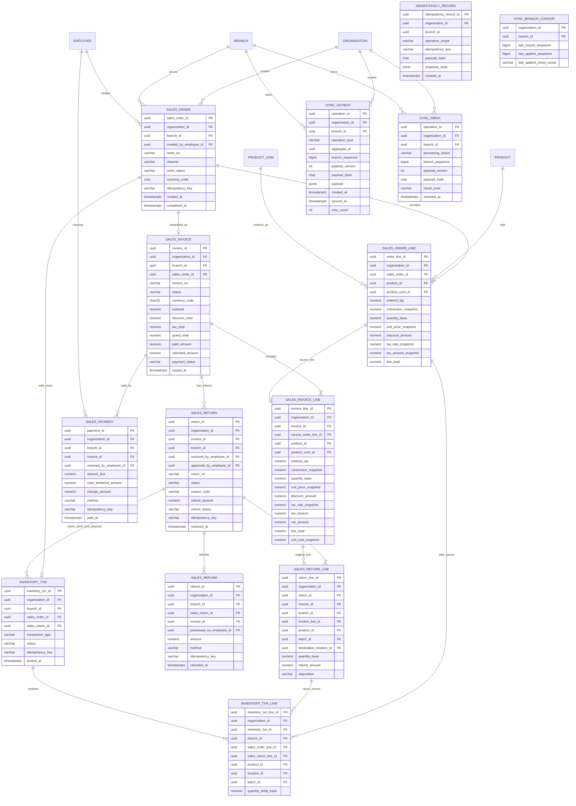

# Pharmacy ERP Backend-Only MVP Specification

**Purpose:** Standalone backend requirements baseline for technical review.

**Source basis and verification limit:** This controlled update uses the supplied integrated Blueprint (`ERP-Brain-Integrated-General-Team-Blueprint-Backend-Updated.md`), backend extraction (`ERP-Backend-Specification.md`), and current decision/audit records present in the workspace. It is an internal consistency pass over those supplied files, not a claim of completeness against any unavailable earlier master Blueprint. No PostgreSQL DDL, migrations, EF Core model, complete trigger-definition inventory, OpenAPI artifact, or running API was supplied; physical enforcement and runtime behavior remain unverified.

---

## Table of Contents

- [1. Document Overview & Architectural Baseline](#1-document-overview-architectural-baseline)
  - [1.1 Note on Scope and Hierarchy of Authority](#11-note-on-scope-and-hierarchy-of-authority)
  - [1.2 Integrated MVP Contract](#12-integrated-mvp-contract)
  - [1.3 Architectural Principles](#13-architectural-principles)
  - [1.4 Fixed Technology Stack](#14-fixed-technology-stack)
  - [1.5 Backend MVP Scope](#15-backend-mvp-scope)
- [2. System & Component Architecture](#2-system-component-architecture)
  - [2.1 Distributed System Architecture (Cloud & Branch-Local POS)](#21-distributed-system-architecture-cloud-branch-local-pos)
  - [2.2 ERP Backend Modular Monolith Structure](#22-erp-backend-modular-monolith-structure)
  - [2.3 N-Tier Solution Layout & Layer Responsibilities](#23-n-tier-solution-layout-layer-responsibilities)
  - [2.4 Integration Architecture & The Canonical Model](#24-integration-architecture-the-canonical-model)
  - [2.5 Canonical Adapter Capabilities and Controls](#25-canonical-adapter-capabilities-and-controls)
  - [2.6 Canonical Reads and Incremental Change Feeds](#26-canonical-reads-and-incremental-change-feeds)
  - [2.7 Approved Canonical Write Boundary](#27-approved-canonical-write-boundary)
- [3. Data Architecture & Persistence Model](#3-data-architecture-persistence-model)
  - [3.1 Core Data Architecture & Storage Boundaries](#31-core-data-architecture-storage-boundaries)
  - [3.2 Database Deployment Topology: Cloud erp_db vs. Branch-Local Databases](#32-database-deployment-topology-cloud-erp_db-vs-branch-local-databases)
  - [3.3 Shared Database Conventions, Identifiers & Data Types](#33-shared-database-conventions-identifiers-data-types)
  - [3.4 Address Value Object Specification](#34-address-value-object-specification)
  - [3.5 Single DbContext, EF Core Rules & Repositories](#35-single-dbcontext-ef-core-rules-repositories)
  - [3.6 Conceptual ERP Domain Model & ERD Overview](#36-conceptual-erp-domain-model-erd-overview)
- [4. Branch Offline Operation & Data Synchronization](#4-branch-offline-operation-data-synchronization)
  - [4.1 Offline POS Architecture & Execution Model](#41-offline-pos-architecture-execution-model)
  - [4.2 Durable Operation Queues: SYNC_OUTBOX and SYNC_INBOX](#42-durable-operation-queues-sync_outbox-and-sync_inbox)
    - [4.2.1 Conditional Serialized-Text Payload Protocol](#421-conditional-serialized-text-payload-protocol)
  - [4.3 Synchronization Flow, Delta Feeds & Conflict Policy](#43-synchronization-flow-delta-feeds-conflict-policy)
  - [4.4 Synchronization Endpoints & Data Contracts](#44-synchronization-endpoints-data-contracts)
- [5. Stage 1 Specification — Organization, Identity, Catalog & Inventory Ledger](#5-stage-1-specification-organization-identity-catalog-inventory-ledger)
  - [5.1 Stage Purpose & Tenant Root](#51-stage-purpose-tenant-root)
  - [5.2 Database Schema & ERD](#52-database-schema-erd)
  - [5.3 Exact Fields, Constraints, Indexes & Navigation Properties](#53-exact-fields-constraints-indexes-navigation-properties)
  - [5.4 Product Reorder Rule Specification](#54-product-reorder-rule-specification)
  - [5.5 Stage 1 Business Rules & Invariants](#55-stage-1-business-rules-invariants)
  - [5.6 Stage 1 API Request/Response DTO Contracts](#56-stage-1-api-requestresponse-dto-contracts)
  - [5.7 Stage 1 Canonical Integration Contract](#57-stage-1-canonical-integration-contract)
  - [5.8 Stage 1 API Endpoints](#58-stage-1-api-endpoints)
  - [5.9 Stage 1 Domain Functional Breakdown](#59-stage-1-domain-functional-breakdown)
- [6. Stage 2 Specification — Cashier POS Sales, Invoicing, Payments & Returns](#6-stage-2-specification-cashier-pos-sales-invoicing-payments-returns)
  - [6.1 Stage Purpose & Cashier-Only Scope](#61-stage-purpose-cashier-only-scope)
  - [6.2 Database Schema & ERD](#62-database-schema-erd)
  - [6.3 Persisted Fields, Constraints & Navigation Properties](#63-persisted-fields-constraints-navigation-properties)
  - [6.4 Sale, Stock, Cash Payment, and Return Business Rules](#64-sale-stock-cash-payment-and-return-business-rules)
  - [6.5 Stage 2 API Request/Response DTO Contracts](#65-stage-2-api-requestresponse-dto-contracts)
  - [6.6 Stage 2 Canonical Integration Contract](#66-stage-2-canonical-integration-contract)
  - [6.7 Stage 2 API Endpoints & Controller Conventions](#67-stage-2-api-endpoints-controller-conventions)
  - [6.8 Stage 2 Domain Functional Breakdown](#68-stage-2-domain-functional-breakdown)
- [7. Stage 3 Specification — Purchasing Cycle, One-Step PO Receiving & Supplier Payments](#7-stage-3-specification-purchasing-cycle-one-step-po-receiving-supplier-payments)
  - [7.1 Stage Purpose & Purchasing Scope](#71-stage-purpose-purchasing-scope)
  - [7.2 Database Schema & ERD](#72-database-schema-erd)
  - [7.3 Exact Fields, Constraints & Navigation Properties](#73-exact-fields-constraints-navigation-properties)
  - [7.4 Purchase Value Rules & Landed Cost Allocation](#74-purchase-value-rules-landed-cost-allocation)
  - [7.5 N-Tier Implementation Guide (Domain, Infrastructure, Application, API)](#75-n-tier-implementation-guide-domain-infrastructure-application-api)
  - [7.6 Business Logic & Edge Cases](#76-business-logic-edge-cases)
  - [7.7 Stage 3 API Request/Response DTO Contracts](#77-stage-3-api-requestresponse-dto-contracts)
  - [7.8 Stage 3 Canonical Purchase Order Contract](#78-stage-3-canonical-purchase-order-contract)
  - [7.9 Stage 3 API Endpoints Contract](#79-stage-3-api-endpoints-contract)
  - [7.10 Stage 3 Domain Functional Breakdown](#710-stage-3-domain-functional-breakdown)
- [8. Cross-Cutting Backend Contracts & Interfaces](#8-cross-cutting-backend-contracts-interfaces)
  - [8.1 ERP Internal Application Query/Command Interfaces](#81-erp-internal-application-querycommand-interfaces)
  - [8.2 Canonical HTTP API Specifications & Staged Endpoints](#82-canonical-http-api-specifications-staged-endpoints)
  - [8.3 Canonical Draft Purchase Order Command](#83-canonical-draft-purchase-order-command)
  - [8.4 ERP Eventing & Transactional Outbox Contract](#84-erp-eventing-transactional-outbox-contract)
  - [8.5 Authentication & JWT Token Claims Contract](#85-authentication-jwt-token-claims-contract)
  - [8.6 Standard API Error Contract & Validation Envelopes](#86-standard-api-error-contract-validation-envelopes)
  - [8.7 Observability, Distributed Tracing & W3C Traceparent](#87-observability-distributed-tracing-w3c-traceparent)
  - [8.8 ERP API Consumer Contract](#88-erp-api-consumer-contract)
  - [8.9 Consolidated Cross-Stage Rules](#89-consolidated-cross-stage-rules)
- [9. Security, Governance & Audit Architecture](#9-security-governance-audit-architecture)
  - [9.1 Security Architecture & Controls](#91-security-architecture-controls)
  - [9.2 AI Write Restrictions & Policy Engine Boundary](#92-ai-write-restrictions-policy-engine-boundary)
  - [9.3 System of Record Audit Logging (integration.AUDIT_LOG)](#93-system-of-record-audit-logging-integrationaudit_log)
- [10. Testing, Quality Verification & Release Gates](#10-testing-quality-verification-release-gates)
  - [10.1 Backend Testing Strategy](#101-backend-testing-strategy)
  - [10.2 Development Phases & Cumulative ERD Dependency Rules](#102-development-phases-cumulative-erd-dependency-rules)
  - [10.3 Backend Critical Path Analysis](#103-backend-critical-path-analysis)
  - [10.4 Cross-Stage Release Checklist & Verification Gates](#104-cross-stage-release-checklist-verification-gates)
  - [10.5 Application Service Design Rule](#105-application-service-design-rule)
- [11. Deployment, Infrastructure & Operational Baseline](#11-deployment-infrastructure-operational-baseline)
  - [11.1 Container & Service Deployment Architecture](#111-container-service-deployment-architecture)
  - [11.2 Cloud and Branch-Local Delivery Baseline](#112-cloud-and-branch-local-delivery-baseline)
  - [11.3 Backend Repository Structure & Artifact Layout](#113-backend-repository-structure-artifact-layout)
- [12. Risks and Open Architectural Decisions](#12-risks-and-open-architectural-decisions)
  - [12.1 Technical Risks and Mitigations](#121-technical-risks-and-mitigations)
  - [12.2 Open Architectural Decisions](#122-open-architectural-decisions)
- [13. Scope Review / Deferred Material](#13-scope-review-deferred-material)
  - [13.1 Pending Product or Architecture Decisions](#131-pending-product-or-architecture-decisions)
---

<a id="1-document-overview-architectural-baseline"></a>
## 1. Document Overview & Architectural Baseline

<a id="11-note-on-scope-and-hierarchy-of-authority"></a>
### 1.1 Note on Scope and Hierarchy of Authority

This document defines the backend requirements present in the supplied specification for the Pharmacy ERP System of Record and its integration boundaries. It has not been independently verified against unavailable source material.

Within the prior extraction, the Integrated MVP Contract and three cumulative stage specifications were designated as authoritative over older illustrative examples. This audit separately identifies conflicts between that extraction and the supplied integrated Blueprint; those cross-source conflicts are not resolved by this statement.

The backend ERD and API are released as three cumulative stages:
- **Stage 1:** Organization, Identity, Catalog, and Inventory Ledger
- **Stage 2:** Cashier POS Sales, Invoices, Cash Payments, Returns, and Offline Sync
- **Stage 3:** Purchasing Cycle (Suppliers, One-Step PO Receiving, Supplier Payments, and Vendor Returns)

The canonical contract exposed to the external Brain/AI service is versioned and stable, ensuring the ERP System of Record enforces all business invariants, database constraints, financial snapshots, and tenant isolation.

<a id="12-integrated-mvp-contract"></a>
### 1.2 Integrated MVP Contract

| Area | Backend requirement |
| --- | --- |
| Delivery model | Three cumulative backend ERD/API stages. |
| .NET backend | One modular-monolith codebase and `PharmacyDbContext`, deployed as cloud ERP API and branch-local runtime. |
| Database | Shared cloud PostgreSQL `erp_db` stores multiple organizations. Branch-local database uses the same logical ERP schema and migrations. Schemas: `identity`, `catalog`, `inventory`, `sales`, `purchasing`, `integration`. |
| Organization scope | Each pharmacy owner is an Organization/tenant. Every tenant-owned row carries `organization_id`; branch operations are scoped by `branch_id`. Tenant context comes from authenticated identity, never an untrusted request field. |
| POS scope | Cashier-only sales. `SALES_ORDER` is cashier cart/order; completion creates one invoice, payment record, and stock issue transaction atomically. No customer, e-commerce, delivery, reservation, or POS-terminal entity is in the MVP schema. |
| Offline operation | Branch-local API writes sales/returns offline. Durable `SYNC_OUTBOX` retries to cloud; cloud `SYNC_INBOX` deduplicates by `operation_id`. Cloud-to-branch bootstrap/delta reads refresh catalog/reference data. |
| Inventory source of truth | Append-only `INVENTORY_TXN`/`INVENTORY_TXN_LINE` are authoritative; `STOCK_BALANCE` is a concurrency-safe projection. Draft orders do not reserve/decrement stock; posted sale/return operations do. |
| Canonical boundary | Cloud .NET Canonical HTTP API is the external ERP boundary. It exposes staged reads and only backend-supported approved configuration/draft-purchase commands. It does not accept AI-created cashier sales orders. |
| Historical snapshots | Posted invoices, returns, and supplier documents retain quantities, UOM conversions, prices, costs, taxes, totals, and refund facts applied at posting. |

<a id="13-architectural-principles"></a>
### 1.3 Architectural Principles

| # | Principle | Backend application |
|---|---|---|
|1|ERP is the system of record|.NET owns identity, inventory, orders, invoices, supplier documents, payments, totals, and state transitions.|
|2|Canonical contracts separate ERP data from external consumers|Consumers use versioned DTOs, never pharmacy table names or SQL.|
|3|Stock is ledger-backed|Every posted stock change has an immutable inventory transaction line; balances are concurrency-safe projections.|
|4|Documents keep historical snapshots|Posted invoice and purchase lines retain UOM, conversion, price, tax, and cost snapshots.|
|5|Restricted writes require approval|Allowed external writes require explicit approval of the exact proposal before the Canonical API command.|
|6|Organization and branch scope are explicit|Every tenant-owned row carries `organization_id`; branch access is checked on every use case.|
|7|Use a modular monolith|One API and transaction boundary keep sales, stock, and purchasing consistent.|
|8|Freeze contracts before parallel implementation|OpenAPI, JSON Schemas and fixtures are reviewed by producers and consumers.|
|9|Minimize sensitive data|Canonical responses contain only fields needed by the approved operation; omit credentials and unnecessary personal data.|
|10|Keep persistence ownership separate|`erp_db` is the sole ERP system of record; external integration has no direct path into ERP tables. |

<a id="14-fixed-technology-stack"></a>
### 1.4 Fixed Technology Stack

| Area | Technology | Backend role |
| --- | --- | --- |
| ERP backend | .NET / ASP.NET Core, folder-based N-Tier modular monolith | System of Record, workflows, API and canonical adapter |
| ERP data | PostgreSQL cloud `erp_db` and branch-local ERP database per branch; Redis for backend-owned plumbing | Consolidated cloud operation and offline branch POS |
| Persistence | EF Core, one `PharmacyDbContext`, one ordered cumulative migration chain | Shared cloud and branch-local ERP schema |
| Delivery | Docker Compose and GitHub Actions | Build, contract checks, container delivery and migration rollout |

Nginx is the reverse proxy. The backend uses simple Application service interfaces; MediatR and additional broker platforms are not required by the documented MVP.

<a id="15-backend-mvp-scope"></a>
### 1.5 Backend MVP Scope

The backend ERD and API are delivered in three cumulative stages:

1. Organization-scoped identity, catalog, and inventory ledger.
2. POS-only cashier orders, invoices, cash payments, returns/refunds, and local/cloud synchronization.
3. Suppliers, purchase orders, one-step partial receiving, supplier payments, and vendor returns.

The cloud uses shared PostgreSQL `erp_db` for multiple Organizations. Each branch has one local ERP database using the same logical schema and migrations. `organization_id` is the tenant boundary on every tenant-owned row; `branch_id` scopes branch operations. Future and explicitly excluded capabilities are recorded in §13.

<a id="2-system-component-architecture"></a>
## 2. System & Component Architecture

<a id="21-distributed-system-architecture-cloud-branch-local-pos"></a>
### 2.1 Distributed System Architecture (Cloud & Branch-Local POS)

~~~mermaid
flowchart TB
 subgraph Branch["Each pharmacy branch — one POS device"]
 POS["Branch POS client"]
 LOCALAPI["Branch-local .NET API"]
 LOCALDB[("Branch-local ERP database")]
 SYNCOUT["SYNC_OUTBOX"]
 POS --> LOCALAPI
 LOCALAPI --> LOCALDB
 LOCALAPI --> SYNCOUT
 end
 subgraph Cloud["Cloud ERP — shared across Organizations"]
 CLOUDAPI[".NET ERP API"]
 CLOUDDB[("PostgreSQL erp_db<br/>organization-scoped rows")]
 SYNCIN["SYNC_INBOX"]
 CANON["Canonical HTTP API<br/>/api/v1/canonical/*"]
 CLOUDAPI --> CLOUDDB
 CANON --> CLOUDAPI
 end
 SYNCOUT -->|"retryable operations"| CLOUDAPI
 CLOUDAPI -->|"bootstrap and change feed"| LOCALAPI
~~~

The same .NET N-Tier codebase, organized with feature folders inside shared layers, runs in the cloud and as a branch-local service:
- The branch POS client talks to its local API/database so a lost Internet connection does not stop cashier work.
- The local database holds durable branch operations; the cloud stores consolidated organization data.
- SYNC_OUTBOX and SYNC_INBOX support retry and deduplication.
- The cloud Canonical API is the external integration boundary. External consumers receive no local database credentials or direct sync-table access.
- Sale completion, return posting, purchase receiving, and inventory adjustment remain .NET Application operations using database transactions.
- The branch-local runtime is the sole stock command writer for its branch. Cloud exposes no direct stock mutation endpoint; branch stock changes are posted locally and synchronized as facts. The cloud branch projection changes only after those facts are applied; conflict behavior is defined in §4.3.

<a id="22-erp-backend-modular-monolith-structure"></a>
### 2.2 ERP Backend Modular Monolith Structure

~~~text
PharmacyERP.sln
/src
 /PharmacyERP.Api Controllers, middleware, auth, versioning
 /PharmacyERP.Application Use cases, DTOs, interfaces, validation, mapping
 /PharmacyERP.Domain Entities, value objects, enums, invariants, exceptions
 /PharmacyERP.Infrastructure PharmacyDbContext, EF configs, repositories, migrations
 /Persistence/Configurations One IEntityTypeConfiguration per entity
 /Persistence/Repositories Generic CRUD plus workflow-specific repositories
 /BackgroundServices Local/cloud sync worker and outbox publisher
 /ObjectStorage Optional S3-compatible image storage
 /Features
 /Identity / Catalog / Inventory / Sales / Purchasing / Integration
/tests
/contracts OpenAPI, JSON Schema, fixtures
~~~

This is one .NET solution, one API host, one PostgreSQL connection, and one `PharmacyDbContext`. Each feature owns its entity/configuration/service files; the shared context applies those configurations and the single migration chain.
- **Domain** owns business invariants;
- **Application** orchestrates use cases and transactions;
- **Infrastructure** implements EF Core and external adapters;
- **Api** exposes HTTP contracts.

Use simple interfaces and service classes; a message bus or separate context per feature is not needed for this MVP. Generic repositories fit straightforward master-data CRUD. Inventory locking/FEFO, sales posting, receiving, payments, and returns use explicit custom methods and transactions.

<a id="23-n-tier-solution-layout-layer-responsibilities"></a>
### 2.3 N-Tier Solution Layout & Layer Responsibilities

~~~text
/apps/erp-backend
 /PharmacyERP.Api
 /Controllers (Thin controllers per business aggregate)
 /Middleware (Exception envelope, auth, W3C traceparent)
 /PharmacyERP.Application
 /Features (Use cases, DTOs, validators, query services)
 /Common (PagedResult, Result<T>, interfaces)
 /PharmacyERP.Domain
 /Entities / ValueObjects (Invariants, factory methods, state machine)
 /Enums / Exceptions (Typed business exceptions)
 /PharmacyERP.Infrastructure
 /Persistence/Configurations (IEntityTypeConfiguration per entity)
 /Persistence/Repositories (Explicit transactional repositories)
 /Persistence/Migrations (Single cumulative migration chain)
 /Authentication (ASP.NET Core Identity & JWT issuance)
 /BackgroundServices (Local/cloud sync worker, outbox publisher)
 /ObjectStorage (Optional S3/MinIO driver)
~~~

Layer boundaries:
- **Domain:** entities, value objects, invariant methods, enums, and domain exceptions. No EF, HTTP, or LLM dependency.
- **Application:** use cases, interfaces, DTOs, authorization and validation, transaction orchestration, mapping, and error/result decisions.
- **Infrastructure:** the one PharmacyDbContext, EF configurations and migrations, repositories, password hashing/JWT integration, outbox/background services, and optional S3-compatible image storage.
- **API:** controllers, authentication/authorization middleware, request validation, versioning, and exception-to-error-envelope mapping.
- **External integration boundary:** versioned Canonical HTTP API only. No direct ERP `DbContext`, database connection, or Redis access.

<a id="24-integration-architecture-the-canonical-model"></a>
### 2.4 Integration Architecture & The Canonical Model

The Canonical API gives external consumers a stable, ERP-agnostic contract. Physical pharmacy entities and workflow stages remain owned by the .NET backend. The canonical payloads are exposed through versioned contracts:

| Canonical entity | Core meaning | Maps from the staged pharmacy model |
| --- | --- | --- |
| Product | SKU, display name, category, active state, base UOM and supported conversions | catalog.PRODUCT, PRODUCT_CATEGORY, PRODUCT_UOM |
| InventoryItem | Product/organization/branch/location/batch, on-hand and available quantity, average cost, quality, expiry and update time | inventory.STOCK_BALANCE, INVENTORY_LOCATION, INVENTORY_BATCH; available quantity is derived from eligible on-hand stock because the MVP has no reservations |
| Sale / SaleLine | Posted cashier sale facts with quantity, price/tax/discount snapshots and timestamp | Posted sales.SALES_INVOICE and SALES_INVOICE_LINE, linked to the completed SALES_ORDER |
| SalesOrder | Non-PII cashier order lifecycle, read-only to external consumers | sales.SALES_ORDER and SALES_ORDER_LINE; channel is POS only |
| SaleReturn / SaleReturnLine | Posted returned quantities, disposition, and refund facts needed for analytics | sales.SALES_RETURN, SALES_RETURN_LINE, and SALES_REFUND |
| PurchaseOrder / PurchaseOrderLine | Supplier, branch, lifecycle, ordered/received/remaining quantities and cost snapshots | purchasing.PURCHASE_ORDER and PURCHASE_ORDER_LINE |
| Supplier | Stable supplier identifier, legal name, lead time, and active state only when needed | purchasing.SUPPLIER; omit tax, address, and contact details the model does not need |

The Canonical API validates and returns versioned JSON. Additive fields are backward-compatible; breaking changes require a new version and contract fixtures. The stage DTOs and routes take precedence over generalized examples.

<a id="25-canonical-adapter-capabilities-and-controls"></a>
### 2.5 Canonical Adapter Capabilities and Controls

The .NET Integration module exposes the versioned `/api/v1/canonical/*` boundary and invokes ordinary Application use cases. It returns stable canonical DTOs; staged ERP entities and persistence remain backend-owned.

| Capability | Direction | Backend contract |
| --- | --- | --- |
| Products, inventory, sales, orders, returns, suppliers, purchase orders | Read | Paginated, organization/branch-authorized; use stage-defined `updated_since`/cursor where available. |
| Product/UOM/reorder configuration and draft purchase order | Restricted write | Only stage-supported commands; require approved exact proposal, current authorization, validation, idempotency and audit. |
| `capabilities` | Discovery | Report only operations available in the deployed stage. |

.NET is authoritative for identity, organization/branch authorization, business validation, state, totals, idempotency and audit. Scheduled reads use the documented read-only service identity; user-driven requests carry the authenticated actor. Reads may use bounded retries; writes retry only with the same idempotency key and unchanged typed payload. Breaking contract changes require a new version and reviewed fixtures. Do not expose cashier order creation/completion, stock mutation, invoice/payment/return posting, physical receipt, or supplier transmission as canonical writes.

<a id="26-canonical-reads-and-incremental-change-feeds"></a>
### 2.6 Canonical Reads and Incremental Change Feeds

The Canonical API is the ERP integration boundary. It serves authorized, branch-scoped cloud projections using stage-defined `updated_since` and/or cursor parameters. Cursor-mode replication uses the durable, commit-ordered `OUTBOX_EVENT.event_sequence` described in §4.2; `updated_since` is a convenience filter only and is not a no-loss replication cursor. List responses return a continuation cursor; consumers must use stable canonical identifiers and idempotent upserts. On-demand reads requiring current workflow or inventory state use the current Canonical API response.

The ERP transaction commits business state and its internal outbox event atomically. Every change-feed-visible mutation emits a durable outbox event in that same transaction, including deactivation/tombstone facts and branch-scoped identity or reference-data changes. The ERP outbox is backend-owned plumbing, not an external consumer API or business store. Canonical collection synchronization is independent of user-facing sale completion; a sale never waits for an external consumer or computation. Retries replay from the durable cursor and consumers upsert by stable IDs; no arbitrary time-overlap window is treated as a delivery guarantee.

<a id="27-approved-canonical-write-boundary"></a>
### 2.7 Approved Canonical Write Boundary

The Canonical API exposes only reads and explicitly supported restricted writes. Any AI-assisted write presented to the backend must arrive as the existing typed stage command after explicit approval of the exact proposal. The ERP validates the authenticated actor, current organization and branch access, target state, business rules, and idempotency independently; approval is not a substitute for ERP authorization.

| Contract area | Backend requirement |
| --- | --- |
| Supported reads | Products, branch inventory, posted sales, non-PII POS order state, returns, suppliers and purchase orders, subject to deployed-stage capability. |
| Allowed writes | Stage 1 product/UOM/reorder configuration; Stage 3 draft purchase order, only where the endpoint exists. |
| Forbidden writes | No raw SQL; stock-balance mutation; inventory transaction posting; invoice, payment/refund, return, or receipt posting; arbitrary status patch; or supplier transmission. |
| Approval binding | Only the exact typed payload approved by the authenticated user may be executed. The approval boundary verifies proposal ownership against authenticated user/session, pending state, expiry, unchanged payload hash, and currently allow-listed command. .NET independently checks current organization/branch access and business state. A changed branch, supplier, quantity, or line set requires a new proposal and approval. |
| Idempotency/recovery | Retries reuse the same idempotency key and deterministic canonical representation of the same typed payload. A timeout is reconciled by retrying with that key; the backend returns the original result or a typed mismatch/conflict. No silent payload mutation or second proposal. At most one state-changing execution may succeed for an approved proposal. |
| Audit | ERP writes the authenticated actor and accepted business mutation to `integration.AUDIT_LOG`; approval-system lifecycle remains outside ERP persistence except for defined correlation fields. The integration caller records the approval decision and returned `CanonicalWriteResult` in its own system. |
| State/failure | Rejected or expired proposals cannot execute. The integration contract reports typed `pending`, `rejected`, `expired`, `succeeded`, or `failed` outcomes; failures are visible and auditable, not retried with changed arguments. Drafts use normal ERP edit/cancel endpoints; posted financial or ledger facts are reversed only through a new authorized ERP transaction. |

Backend consumers cannot use untrusted free text to change actor, tenant, branch, approval state, or typed command arguments. The ERP remains authoritative for state transitions.

<a id="3-data-architecture-persistence-model"></a>
## 3. Data Architecture & Persistence Model

<a id="31-core-data-architecture-storage-boundaries"></a>
### 3.1 Core Data Architecture & Storage Boundaries

| Store / boundary | MVP implementation | Owner | Backend rule |
| --- | --- | --- | --- |
| ERP system of record | Shared cloud PostgreSQL `erp_db` plus one branch-local ERP database per branch; same logical schemas and migrations, one `PharmacyDbContext` codebase | .NET / EF Core | Cloud consolidates organization data; branch local supports offline POS. |
| ERP integration boundary | Versioned Canonical HTTP API; no external direct database, Redis, or sync-table access | .NET Integration | All external reads/writes pass ERP authorization and validation. |
| ERP cache/event plumbing | Backend-owned Redis; append-only `integration.OUTBOX_EVENT` and `integration.AUDIT_LOG` in ERP database | .NET | Not a business source of truth or external database interface. |
| Logs and backups | Structured JSON to stdout; back up `erp_db` to off-host storage and rehearse restore | Operations | Restore ERP state independently. |

The detailed PostgreSQL ERP schema and each stage's entity fields are defined in §§5–7. External canonical identifiers are references only; the ERP remains the source of truth for identity, stock, money and workflow status.

<a id="32-database-deployment-topology-cloud-erp_db-vs-branch-local-databases"></a>
### 3.2 Database Deployment Topology: Cloud erp_db vs. Branch-Local Databases

Use shared cloud PostgreSQL erp_db and one branch-local PostgreSQL database per branch. Both use the same logical schemas and ordered EF migration chain through the same PharmacyDbContext codebase:

| PostgreSQL schema | Main tables |
|---|---|
| identity | ORGANIZATION, BRANCH, EMPLOYEE, USER_ACCOUNT, USER_BRANCH_ACCESS, USER_REFRESH_TOKEN, BRANCH_ENROLLMENT |
| catalog | PRODUCT_CATEGORY, PRODUCT, PRODUCT_UOM, PRODUCT_REORDER_RULE |
| inventory | INVENTORY_LOCATION, INVENTORY_BATCH, STOCK_BALANCE, INVENTORY_TXN, INVENTORY_TXN_LINE |
| sales | SALES_ORDER, SALES_ORDER_LINE, SALES_INVOICE, SALES_INVOICE_LINE, SALES_PAYMENT, SALES_RETURN, SALES_RETURN_LINE, SALES_REFUND |
| purchasing | SUPPLIER, PURCHASE_ORDER, PURCHASE_ORDER_LINE, SUPPLIER_PAYMENT, VENDOR_RETURN, VENDOR_RETURN_LINE |
| integration | OUTBOX_EVENT_CURSOR (cloud), OUTBOX_EVENT, AUDIT_LOG, IDEMPOTENCY_RECORD, SYNC_OUTBOX (branch-local), SYNC_INBOX (cloud), SYNC_BRANCH_CURSOR (both) |

Relationships between logical schemas use normal PostgreSQL FK constraints and EF Core navigation properties. Use restrictive/no-action delete behavior (`DeleteBehavior.Restrict`). Avoid polymorphic source IDs wherever a typed FK can be added.

<a id="33-shared-database-conventions-identifiers-data-types"></a>
### 3.3 Shared Database Conventions, Identifiers & Data Types

- **Primary and Foreign Keys:** UUID PK/FK. Every tenant-owned table has non-null `organization_id` and a unique alternate key `(organization_id, primary_id)` for organization-aware composite FKs; Organization itself is keyed by `organization_id`.
- **Business Identifiers:** Business codes such as SKU, barcode, branch code, supplier code, invoice number, and PO number are `varchar` with organization/branch-scoped uniqueness as applicable.
- **Data Types & Precisions:**
 - Quantities, conversion factors, and unit costs: `numeric(18,4)` or `numeric(18,6)`.
 - Money amounts: `numeric(18,2)`.
 - Currency: `char(3)`, seeded to `EGP`.
 - Timestamps: `timestamptz` UTC.
 - Expiration and manufacturing dates: `date`.
- **Audit Columns:** Core mutable rows use `created_at` and `updated_at`. Transactions also store their actor and timestamp.
- **Soft Deactivation:** Identity, catalog, and supplier master rows use `is_active` for soft deactivation. Never hard-delete referenced records. Transaction records are retained and status-transitioned; posted stock lines are append-only.
- **Tenant Scoping & Composite FKs:** Composite foreign keys include `organization_id` so a valid UUID from another tenant cannot satisfy a cross-tenant relationship. A foreign key prevents deletion of a referenced row. Soft deactivation changes `is_active`; it does not erase history or cascade to invoices/movements.
- **Idempotency:** Every retriable write accepts `Idempotency-Key`, persisted and scoped to operation. Same key/same payload returns the original result; same key/different payload is rejected.
- **Server Authority:** The server owns prices, product-level tax rate, totals/change, inventory availability, and status transitions. Client-supplied totals are informational only.
- **Pagination & Standards:** All lists are paginated. API and Canonical DTOs use stable IDs, explicit states, UTC dates, and currency where relevant. OpenAPI/JSON Schema in `/contracts` is the source of truth.

<a id="34-address-value-object-specification"></a>
### 3.4 Address Value Object Specification

Address is an EF Core Owned type (`OwnsOne`) stored as prefixed columns on its owner, not an independent table in this MVP:

~~~text
line1 varchar(200), line2 varchar(200) nullable,
city varchar(100), region varchar(100) nullable,
postal_code varchar(20) nullable, country_code char(2)
~~~

Use it on `Organization`, `Branch`, `Employee`, and `Supplier`. Sales orders and returns do not store customer identity or delivery address.

<a id="35-single-dbcontext-ef-core-rules-repositories"></a>
### 3.5 Single DbContext, EF Core Rules & Repositories

PharmacyDbContext has all stage DbSets and all module configurations. Each module owns its entity and `IEntityTypeConfiguration` files:
- Configure Address with `OwnsOne` and prefixed columns.
- Configure decimal precision, composite keys, indexes, unique and check constraints explicitly.
- Configure `DeleteBehavior.Restrict` for all business FKs.
- Configure a global EF Core query filter for `organization_id`; apply `is_active` to ordinary master-data list queries, not globally, so historical document navigations can load deactivated records. Authorization is separately enforced in Application, including branch access. PostgreSQL Row-Level Security is enabled and forced on every tenant-owned table as defense in depth, including raw SQL. Every database unit of work begins an explicit transaction before its first tenant query or mutation, then runs parameterized `SELECT set_config('app.organization_id', @organization_id, true)` from the authenticated/provisioned context; every policy uses matching `USING` and `WITH CHECK` predicates equivalent to `organization_id = NULLIF(current_setting('app.organization_id', true), '')::uuid`. The third `set_config` argument is transaction-local. No session-scoped `SET` is permitted. Commit/rollback clears the value automatically before the connection returns to the pool; the EF connection/transaction interceptor rejects tenant SQL without an active transaction and bound organization. The application DB role is neither table owner nor `BYPASSRLS`; FORCE ROW LEVEL SECURITY is enabled. Missing/empty context matches no tenant rows. Credential verification and PlatformProvisioner remain narrowly scoped exceptions and cannot access ordinary tenant data without setting the tenant context. A cross-tenant request test reuses a pooled connection for Organization A then B and verifies that neither stale context nor raw SQL crosses tenants; reset/rollback paths are also tested.
- Configure navigation properties at both ends of each relationship; repositories load only the aggregates/collections the use case needs.

Generic repositories are acceptable for simple category/employee/supplier list CRUD. Use custom repository methods for inventory locking/FEFO, atomic sale completion, purchase receiving/payment, return/refund posting, and local/cloud synchronization. Those workflows need business queries and transactions a generic CRUD wrapper cannot express cleanly.

<a id="36-conceptual-erp-domain-model-erd-overview"></a>
### 3.6 Conceptual ERP Domain Model & ERD Overview

~~~mermaid
erDiagram
 ORGANIZATION ||--o{ BRANCH : owns
 ORGANIZATION ||--o{ PRODUCT : scopes
 ORGANIZATION ||--o{ INVENTORY_TXN : scopes
 ORGANIZATION ||--o{ SALES_ORDER : scopes
 ORGANIZATION ||--o{ SUPPLIER : scopes
 BRANCH ||--o{ EMPLOYEE : employs
 EMPLOYEE ||--o| USER_ACCOUNT : login
 USER_ACCOUNT ||--o{ USER_BRANCH_ACCESS : branch_scope
 ORGANIZATION ||--o{ BRANCH_ENROLLMENT : enrolls
 BRANCH ||--o{ BRANCH_ENROLLMENT : enrolls
 ORGANIZATION ||--|| OUTBOX_EVENT_CURSOR : sequences
 OUTBOX_EVENT_CURSOR ||--o{ OUTBOX_EVENT : allocates
 ORGANIZATION ||--o{ OUTBOX_EVENT : owns
 USER_ACCOUNT ||--o{ USER_REFRESH_TOKEN : refreshes
 PRODUCT ||--|{ PRODUCT_UOM : units
 PRODUCT ||--o{ INVENTORY_BATCH : lots
 BRANCH ||--o{ INVENTORY_LOCATION : has
 PRODUCT ||--o{ PRODUCT_REORDER_RULE : threshold
 BRANCH ||--o{ PRODUCT_REORDER_RULE : branch_threshold
 INVENTORY_LOCATION ||--o{ STOCK_BALANCE : holds
 INVENTORY_BATCH ||--o{ STOCK_BALANCE : balance
 INVENTORY_TXN ||--|{ INVENTORY_TXN_LINE : contains
 SALES_ORDER ||--|{ SALES_ORDER_LINE : contains
 SALES_ORDER ||--o| SALES_INVOICE : completes_as
 SALES_INVOICE ||--|{ SALES_INVOICE_LINE : contains
 SALES_INVOICE ||--o{ SALES_PAYMENT : paid_by
 SALES_INVOICE ||--o{ SALES_RETURN : returned_against
 SALES_RETURN ||--|{ SALES_RETURN_LINE : contains
 SALES_RETURN ||--o{ SALES_REFUND : may_refund
 SALES_ORDER ||--o| INVENTORY_TXN : sale_issue
 SALES_RETURN ||--o{ INVENTORY_TXN : return_stock_and_disposal
 SUPPLIER ||--o{ PURCHASE_ORDER : supplies
 PURCHASE_ORDER ||--|{ PURCHASE_ORDER_LINE : contains
 SUPPLIER ||--o{ SUPPLIER_PAYMENT : payee
 EMPLOYEE ||--o{ SUPPLIER_PAYMENT : recorded_by
 PURCHASE_ORDER ||--o{ SUPPLIER_PAYMENT : paid_by
 PURCHASE_ORDER ||--o{ INVENTORY_TXN : receipt
 SUPPLIER ||--o{ VENDOR_RETURN : supplier
 PRODUCT ||--o{ VENDOR_RETURN_LINE : product
 INVENTORY_LOCATION ||--o{ VENDOR_RETURN_LINE : location
 VENDOR_RETURN ||--o{ INVENTORY_TXN : return_to_supplier
 INVENTORY_TXN ||--o| INVENTORY_TXN : reverses
~~~

This is an orientation view; the chapters below define physical fields and composite organization-aware foreign keys. Every tenant-owned row includes `organization_id`. A branch-scoped row also carries `branch_id` where needed. Tenant scope comes from authenticated Organization context; sync messages carry scope metadata for validation but cannot select another tenant. The per-branch sync credential is configuration for the local runtime, not a POS-terminal business table.

| Table / canonical concept | Stage-model mapping | Notes |
| --- | --- | --- |
| Product | catalog.PRODUCT, PRODUCT_CATEGORY, PRODUCT_UOM | UOM conversions and base-unit quantity are explicit. |
| InventoryItem | inventory.STOCK_BALANCE joined with INVENTORY_LOCATION and INVENTORY_BATCH | API projection; availability is derived from eligible on-hand stock because the MVP has no reservations. |
| StockMovement | inventory.INVENTORY_TXN / INVENTORY_TXN_LINE | Append-only ledger; balance is updated in the same transaction and can be reconciled. |
| Sale / SaleLine | sales.SALES_ORDER, SALES_INVOICE, and their lines | Cashier order is the cart; completion creates the immutable invoice/sale fact and stock issue. |
| SaleReturn / SaleReturnLine / Refund | sales.SALES_RETURN, SALES_RETURN_LINE, SALES_REFUND | A return references the original invoice and produces its own stock/refund records; the invoice is not replaced. |
| Supplier | purchasing.SUPPLIER | Legal/tax/contact fields and an owned Address value; row carries organization_id. |
| PurchaseOrder / lines | purchasing.PURCHASE_ORDER / PURCHASE_ORDER_LINE | Stage 3 owns partial receipt quantities, totals, payments, and typed inventory links. |
| Employee / UserAccount | identity.EMPLOYEE / USER_ACCOUNT | Employee identity is separate from login credentials; history retains employee FKs. |
| SyncOperation | integration.SYNC_OUTBOX / SYNC_INBOX | Durable local-to-cloud operation delivery and cloud duplicate detection; not exposed to external consumers. |
| OutboxEvent / AuditLog | integration.OUTBOX_EVENT / AUDIT_LOG | ERP-owned integration and audit records. |
| OutboxEventCursor | integration.OUTBOX_EVENT_CURSOR | Organization change-sequence allocator in the cloud database; separate from the branch synchronization cursor. |

<a id="4-branch-offline-operation-data-synchronization"></a>
## 4. Branch Offline Operation & Data Synchronization

<a id="41-offline-pos-architecture-execution-model"></a>
### 4.1 Offline POS Architecture & Execution Model

Each pharmacy branch operates one POS device equipped with a branch-local PostgreSQL ERP database and branch-local .NET API runtime:
- **Cashier Continuity:** If Internet connectivity is lost, cashiers continue scanning products, calculating totals, creating sales orders, taking cash payments, issuing receipts, and accepting returns against local stock.
- **Local Transaction Atomicity:** Each posted local operation (sales order completion, cash payment, stock issue) and its corresponding `SYNC_OUTBOX` entry commit together in the local database transaction.
- **No Direct Cloud Dependency:** Offline sales do not perform synchronous calls to the cloud ERP. The local database maintains the branch's authoritative stock projection while disconnected.
- **Brain Isolation:** External consumers never connect to branch-local databases or sync tables; authorized consolidated reads use the Canonical API.

<a id="42-durable-operation-queues-sync_outbox-and-sync_inbox"></a>
### 4.2 Durable Operation Queues: SYNC_OUTBOX and SYNC_INBOX

Branch offline synchronization uses an asynchronous, durable outbox/inbox pattern:

```text
Branch POS Action -> Local ERP Transaction -> Write Business Rows + SYNC_OUTBOX -> Commit
 |
 (Background Sync Worker)
 |
 POST /api/v1/sync/operations
 |
 v
Cloud ERP API -> Check SYNC_INBOX (Deduplication) -> Apply to erp_db -> Acknowledge -> Mark Synced
```

#### Schema Definitions:

##### integration.SYNC_OUTBOX (Branch-Local Database)
- `operation_id`: UUID PK (stable identifier generated at operation time)
- `organization_id`: UUID FK
- `branch_id`: UUID FK
- `operation_type`: varchar(50) (e.g., `COMPLETE_SALES_ORDER`, `POST_SALES_RETURN`)
- `aggregate_id`: UUID (e.g., `sales_order_id`, `return_id`)
- `branch_sequence`: bigint (strictly increasing per branch; assigned in the posting transaction)
- `payload_version`: int (version of the immutable operation payload contract)
- `payload_hash`: char(64) (SHA-256 hex digest of deterministic UTF-8 canonical JSON for the versioned typed payload)
- `payload`: jsonb (versioned typed operation DTO; sender/receiver hash the typed payload after applying the same pinned canonical JSON serializer, never PostgreSQL JSONB bytes)
- `created_at`: timestamptz (time operation occurred locally)
- `synced_at`: timestamptz nullable (timestamp cloud acknowledged receipt)
- `retry_count`: int (count of sync delivery attempts)
- `last_error`: varchar(500) nullable

##### integration.SYNC_INBOX (Cloud Database)
- `operation_id`: UUID PK (matches branch `operation_id`)
- `organization_id`: UUID FK
- `branch_id`: UUID FK
- `processing_status`: varchar(30) (`RECEIVED`, `APPLIED`, `CONFLICT`, `FAILED`)
- `received_at`: timestamptz
- `branch_sequence`: bigint
- `payload_version`: int
- `payload_hash`: char(64)
- `payload`: jsonb NOT NULL (exact versioned operation payload retained for conflict retry and audit)
- `result_code`: nullable `varchar(30)` while `processing_status = RECEIVED`; it is set to `APPLIED`, `CONFLICT`, or `FAILED` after the first attempt reaches a terminal outcome and then remains immutable. Duplicate responses may return `ALREADY_APPLIED` while preserving the original result.
- Unique `(organization_id, branch_id, branch_sequence)`; operation ID is the idempotent primary key.

##### integration.IDEMPOTENCY_RECORD (Cloud and Branch-Local Database)
- `idempotency_record_id`: UUID PK
- `organization_id`: UUID NOT NULL
- `branch_id`: UUID nullable for organization-wide commands
- `operation_scope`: varchar(100) NOT NULL (stable command name and resource scope)
- `idempotency_key`: varchar(100) NOT NULL
- `payload_hash`: char(64) NOT NULL (SHA-256 of deterministic UTF-8 canonical JSON for the versioned typed request)
- `response_body`: jsonb NOT NULL (original typed response)
- `created_at`: timestamptz NOT NULL
- Unique `(organization_id, branch_id, operation_scope, idempotency_key)` for non-null branch IDs; a separate unique index `(organization_id, operation_scope, idempotency_key)` applies where branch_id IS NULL. Same key/hash returns stored response, different hash is rejected. The Application command service claims/checks the idempotency key before executing business mutations and writes the persistent result and business rows in one database transaction; it is not a post-action middleware/filter. A failed transaction leaves neither business changes nor a success idempotency result. Same-key retries cannot execute a committed operation twice. This table is for mutating business commands, not login or token refresh.

##### integration.SYNC_BRANCH_CURSOR (Cloud and Branch-Local Database)
- `(organization_id, branch_id)`: composite PK
- `last_issued_sequence`: bigint NOT NULL DEFAULT 0
- `last_applied_sequence`: bigint NOT NULL DEFAULT 0
- `last_applied_cloud_cursor`: varchar(500) NOT NULL DEFAULT '' (opaque cloud-to-branch cursor containing the last scanned committed cloud event sequence)
- `SYNC_BRANCH_CURSOR` remains an independent entity with different ownership semantics: the branch owns `last_issued_sequence` and `last_applied_cloud_cursor`; cloud owns `last_applied_sequence`. It is not merged into `BRANCH`.
- Branch posting increments `last_issued_sequence` by row-locked update in the same transaction as the business write and branch `SYNC_OUTBOX` insert; rollback therefore does not leave a sequence gap. Cloud advances `last_applied_sequence` with the inbox/business transaction only after the next contiguous branch operation is applied.
- Cloud-to-branch changes use the separate organization-scoped `OUTBOX_EVENT_CURSOR`/`OUTBOX_EVENT.event_sequence`; this is not the branch operation sequence and is not stored in `BRANCH`. The branch persists `last_applied_cloud_cursor` in the same local transaction that applies the entire returned change page. Replaying a page from the prior cursor is idempotent. If the cloud cannot serve an expired cursor, it returns `SYNC_CURSOR_EXPIRED`; the branch performs a controlled reference/PO resnapshot while retaining local business history and pending outbox operations.

<a id="421-conditional-serialized-text-payload-protocol"></a>
### 4.2.1 Conditional Serialized-Text Payload Protocol

The current synchronization contract remains `payload jsonb` plus a SHA-256 hash of the versioned typed payload serialized by the pinned canonical JSON algorithm (§4.2, §8.9.2). The following envelope is a preferred conditional protocol design only; it does not replace the current DTO, `payload`, or hash contract and is not finalized until protocol compatibility review and tests pass:

- The sender serializes the versioned payload exactly once to UTF-8 text, stores that exact `payload_text` with the queued operation, and transmits the same bytes on every retry. SHA-256 is computed over those exact UTF-8 bytes. Retries do not deserialize/re-serialize or otherwise regenerate payload text or hash.
- The receiver validates the declared encoding, protocol/envelope version, payload version, byte length/transport completeness, and hash before deserializing. It rejects a hash mismatch without applying business rows or advancing the branch cursor; the raw text/hash remain available for audited recovery.
- Encoding is UTF-8 without BOM. The envelope defines the operation ID, organization/branch, branch sequence, operation type, payload version, encoding, payload text and SHA-256 hex digest; field names, canonical envelope serialization, maximum size and malformed/truncated-body behavior require protocol review before adoption.
- Required contract tests cover Arabic text, non-ASCII Unicode and emoji, decimal representations/precision, JSON escaping, byte-for-byte retries, interrupted transfers, duplicate delivery, process restart and backup restore. Hash verification precedes payload parsing in all applicable cases.
- Existing clients that send JSONB/canonical typed payload remain supported under their existing payload version. A new protocol version must be introduced; migration requires a compatibility window with version-aware readers, unchanged v1 behavior, client capability/rollout inventory, rollback path and demonstrated mixed-version interoperability. No client upgrade or storage migration is implied until the review is approved.

<a id="43-synchronization-flow-delta-feeds-conflict-policy"></a>
### 4.3 Synchronization Flow, Delta Feeds & Conflict Policy

1. **Local Commit & Queueing:** Each posted local operation and its `SYNC_OUTBOX` entry commit together. If Internet is unavailable, the POS continues operating against its local stock projection.
2. **Push Synchronization (Branch -> Cloud):** A background sync worker sends pending operations in strict `branch_sequence` order using stable operation IDs and retries with bounded exponential backoff.
3. **Cloud Deduplication & Application:** The cloud verifies payload version/hash, enforces the next contiguous sequence for that branch, and stores exact posted ledger facts. It never reruns FEFO or recalculates a locally completed sale. Repeated operation IDs never create duplicate business rows. A normal duplicate delivery returns the current inbox outcome (`CONFLICT` while blocked, or `ALREADY_APPLIED` after successful application); an authorized retry of the same immutable payload may reprocess a recoverable conflict.
4. **Pull Synchronization (Cloud -> Branch):** `GET /api/v1/sync/bootstrap` and `GET /api/v1/sync/changes` return organization- and branch-scoped identity/security provisioning data through the protected enrollment channel, product/UOM/price/tax/reference data, and approved/orderable purchase-order snapshots/deltas. They never return an opening-balance fact or stock snapshot to be applied as branch stock. The branch records its actual opening count and cost as locally authorized `OPENING_BALANCE` ledger transactions; the branch remains unavailable for sales until enrollment, required reference data, and local opening-balance setup are committed. A zero-opening-stock branch may be enabled with zero stock. Local opening facts synchronize to cloud through the normal ordered outbox. Any cloud stock projection is a cloud-side read model and is never applied by the branch. Branch changes are applied idempotently against the saved feed cursor.
5. **Acknowledgment:** The branch marks an operation synchronized in `SYNC_OUTBOX` (`synced_at = now`) only after receiving explicit cloud acknowledgment.
6. **Conflict Policy:**
 - The cloud does not accept branch stock mutations. An adjustment, receipt, sale, return, or vendor return must be executed by the owning branch-local runtime; cloud routes return a runtime-unavailable response rather than mutate the projection.
 - A deterministic conflict is persisted and audited at the current sequence. It does not consume or advance `last_applied_sequence`; the conflicting operation remains at the branch queue head and later operations stay blocked, because skipping it would make the cloud ledger incomplete. Transient transport/server failures use bounded exponential backoff; deterministic conflicts do not loop automatically.
 - `POST /api/v1/sync/operations/{operationId}/retry` is available to an authorized cloud synchronization administrator after the underlying compatibility/reference-data issue is corrected. It reprocesses the exact typed payload retained in SYNC_INBOX for the immutable operation ID, sequence, payload version, and payload hash; it cannot edit or skip the operation. Success advances the cursor and unblocks later operations. For irreparable or tampered payloads, operator recovery means restoring the exact immutable outbox row (operation ID, sequence, payload version, canonical payload, and hash) from a verified branch backup, then retrying it. If no exact copy exists, the sequence remains blocked indefinitely; the MVP defines no edit, skip, or consume-as-rejected path.
 - A catalog change that conflicts with a locally posted document, or an inconsistent synchronized transaction fact, becomes an explicit review state. The sync worker must not silently edit posted local documents. The source operation, conflict reason, retry/recovery action, and outcome are audited.

<a id="44-synchronization-endpoints-data-contracts"></a>
### 4.4 Synchronization Endpoints & Data Contracts

| Method and route | Direction | Purpose | Request Body / Parameters | Response |
|---|---|---|---|---|
| `POST /api/v1/sync/operations/{operationId}/retry` | Admin -> Cloud | Retry exact immutable conflicting head operation after recovery; requires sync-admin scope and reason; cannot alter/skip operation | Operation ID and audited reason | Current per-operation result; success advances cursor only after exact payload applies |
| `POST /api/v1/sync/operations` | Branch -> Cloud | Ordered batch delivery of pending branch operations; requires enrolled branch credentials | `SyncOperationBatchRequest` (`organization_id`, `branch_id`, list of `operation_id`, `branch_sequence`, `operation_type`, `payload_version`, `payload_hash`, `payload`, `created_at`); body scope must match enrollment | Per-operation `SyncOperationResultDto` (`operation_id`, `branch_sequence`, status: `APPLIED` / `ALREADY_APPLIED` / `CONFLICT` / `FAILED`, `expected_next_sequence` when a gap exists, typed details); batch acknowledgment includes highest contiguous applied cursor |
| `GET /api/v1/sync/bootstrap` | Branch calls Cloud; response Cloud -> Branch | Initial full branch snapshot on enrollment; requires enrolled branch credentials | Query: `branchId`; organization is derived from enrollment, not a trusted client parameter | Catalog, UOM sale price/product tax rate, reference data, applicable PO snapshots, identity/security data through the protected enrollment channel, and initial sync cursors; no stock projection or opening-balance facts. Branch-local opening balance must be posted from an authorized local stock count before sales are enabled |
| `GET /api/v1/sync/changes` | Branch calls Cloud; response Cloud -> Branch | Cursor-based delta feed for the enrolled branch | Query: `branchId`, opaque `sinceCursor`; organization is derived from enrollment | Changed reference/catalog records, authorized identity/security changes, approved/orderable PO snapshots, and deactivations, plus opaque `nextCursor` bound to the last scanned committed organization `event_sequence`; branch applies each page atomically and idempotently. The server captures a committed high-water sequence, pages events in sequence order, advances `nextCursor` over scanned entries even when branch filtering yields no body item, and replays a request from the prior cursor deterministically. The serialized allocator prevents a later commit from appearing behind an already-issued cursor. Expired cursors return `SYNC_CURSOR_EXPIRED` and require controlled resnapshot. |

---
<a id="5-stage-1-specification-organization-identity-catalog-inventory-ledger"></a>
## 5. Stage 1 Specification — Organization, Identity, Catalog & Inventory Ledger

<a id="51-stage-purpose-tenant-root"></a>
### 5.1 Stage Purpose & Tenant Root

Create the tenant root, initial branch, users, catalog, stock locations/lots, append-only inventory ledger, and current balance projection. Each pharmacy is an Organization and a tenant in the shared cloud database. Every tenant-owned row carries organization_id; branch operations also carry branch_id. The database and Application layer both enforce tenant scope.

<a id="52-database-schema-erd"></a>
### 5.2 Database Schema & ERD

~~~mermaid
erDiagram
 ORGANIZATION ||--o{ BRANCH : owns
 BRANCH ||--o{ EMPLOYEE : employs
 EMPLOYEE ||--o| USER_ACCOUNT : login
 USER_ACCOUNT ||--o{ USER_BRANCH_ACCESS : branch_scope
 ORGANIZATION ||--o{ BRANCH_ENROLLMENT : enrolls
 BRANCH ||--o{ BRANCH_ENROLLMENT : enrolls
 ORGANIZATION ||--|| OUTBOX_EVENT_CURSOR : sequences
 OUTBOX_EVENT_CURSOR ||--o{ OUTBOX_EVENT : allocates
 ORGANIZATION ||--o{ OUTBOX_EVENT : owns

 PRODUCT_CATEGORY o|--o{ PRODUCT_CATEGORY : parent
 PRODUCT_CATEGORY ||--o{ PRODUCT : groups
 PRODUCT ||--|{ PRODUCT_UOM : units
 PRODUCT ||--o{ PRODUCT_REORDER_RULE : reorder_policy
 BRANCH ||--o{ PRODUCT_REORDER_RULE : branch_policy

 BRANCH ||--o{ INVENTORY_LOCATION : has
 PRODUCT ||--o{ INVENTORY_BATCH : batches
 BRANCH ||--o{ INVENTORY_LOCATION : has
 PRODUCT ||--o{ PRODUCT_REORDER_RULE : threshold
 BRANCH ||--o{ PRODUCT_REORDER_RULE : branch_threshold
 INVENTORY_LOCATION ||--o{ STOCK_BALANCE : holds
 INVENTORY_BATCH ||--o{ STOCK_BALANCE : counted_in

 BRANCH ||--o{ INVENTORY_TXN : records
 EMPLOYEE ||--o{ INVENTORY_TXN : creates
 INVENTORY_TXN ||--|{ INVENTORY_TXN_LINE : contains
 PRODUCT ||--o{ INVENTORY_TXN_LINE : moves
 PRODUCT_UOM ||--o{ INVENTORY_TXN_LINE : entered_as
 INVENTORY_LOCATION ||--o{ INVENTORY_TXN_LINE : at_location
 INVENTORY_BATCH ||--o{ INVENTORY_TXN_LINE : batch

 ORGANIZATION {
 uuid organization_id PK
 varchar organization_code
 varchar name
 char base_currency
 varchar(64) time_zone_id
 boolean is_active
 timestamptz created_at
 timestamptz updated_at
 }
 BRANCH {
 uuid branch_id PK
 uuid organization_id FK
 varchar branch_code
 varchar name
 boolean is_active
 }
 EMPLOYEE {
 uuid employee_id PK
 uuid organization_id FK
 uuid branch_id FK
 varchar employee_no
 varchar full_name
 boolean is_active
 }
 USER_ACCOUNT {
 uuid user_id PK
 uuid organization_id FK
 uuid employee_id FK
 varchar normalized_username
 varchar password_hash
 varchar role
 varchar branch_scope
 boolean is_active
 }
 USER_BRANCH_ACCESS {
 uuid organization_id PK
 uuid user_id PK
 uuid branch_id PK
 }
 BRANCH_ENROLLMENT {
 uuid enrollment_id PK
 uuid organization_id FK
 uuid branch_id FK
 bytea token_hash UK
 timestamptz expires_at
 timestamptz used_at
 }
 USER_REFRESH_TOKEN {
 uuid refresh_token_id PK
 uuid organization_id FK
 uuid user_id FK
 bytea token_hash UK
 uuid token_family_id
 timestamptz issued_at
 timestamptz expires_at
 timestamptz consumed_at
 timestamptz revoked_at
 timestamptz created_at
 }
 PRODUCT_CATEGORY {
 uuid category_id PK
 uuid organization_id FK
 uuid parent_category_id FK
 varchar code
 varchar name
 boolean is_active
 }
 PRODUCT {
 uuid product_id PK
 uuid organization_id FK
 uuid category_id FK
 varchar sku
 varchar barcode
 varchar name
 varchar base_uom_code
 numeric_9_4 tax_rate
 boolean lot_tracking_required
 int expiry_alert_days
 boolean is_active
 }
 PRODUCT_UOM {
 uuid product_uom_id PK
 uuid organization_id FK
 uuid product_id FK
 varchar uom_code
 varchar display_name
 numeric_18_6 conversion_to_base
 numeric_18_4 sale_unit_price
 boolean is_base
 boolean is_sellable
 boolean is_purchasable
 }
 PRODUCT_REORDER_RULE {
 uuid reorder_rule_id PK
 uuid organization_id FK
 uuid product_id FK
 uuid branch_id FK
 numeric reorder_point_base
 numeric reorder_quantity_base
 numeric max_quantity_base
 boolean is_active
 }
 INVENTORY_LOCATION {
 uuid location_id PK
 uuid organization_id FK
 uuid branch_id FK
 varchar location_code
 varchar name
 varchar location_type
 boolean is_sellable
 boolean is_active
 }
 INVENTORY_BATCH {
 uuid batch_id PK
 uuid organization_id FK
 uuid product_id FK
 varchar batch_number
 date expires_on
 date manufactured_on
 varchar quality_status
 }
 STOCK_BALANCE {
 uuid organization_id PK
 uuid location_id PK
 uuid batch_id PK
 numeric on_hand_qty_base
 numeric average_unit_cost
 bigint row_version
 timestamptz updated_at
 }
 INVENTORY_TXN {
 uuid inventory_txn_id PK
 uuid organization_id FK
 uuid branch_id FK
 uuid created_by_employee_id FK
 varchar transaction_no
 varchar transaction_type
 varchar status
 varchar idempotency_key
 uuid reverses_inventory_txn_id FK
 timestamptz posted_at
 }
 INVENTORY_TXN_LINE {
 uuid inventory_txn_line_id PK
 uuid organization_id FK
 uuid inventory_txn_id FK
 uuid branch_id FK
 uuid product_id FK
 uuid location_id FK
 uuid batch_id FK
 uuid product_uom_id FK
 numeric entered_qty
 numeric conversion_snapshot
 numeric quantity_delta_base
 numeric unit_cost_base
 }
 OUTBOX_EVENT_CURSOR {
 uuid organization_id PK, FK
 bigint last_event_sequence
 timestamptz updated_at
 }
 OUTBOX_EVENT {
 uuid event_id PK
 uuid organization_id FK
 uuid branch_id FK (NULL for org-wide)
 bigint event_sequence
 varchar event_type
 varchar schema_version
 jsonb payload
 timestamptz occurred_at
 timestamptz published_at
 }
 AUDIT_LOG {
 uuid audit_log_id PK
 uuid organization_id FK
 uuid actor_user_id FK
 uuid actor_employee_id FK
 uuid branch_id FK
 varchar action
 varchar entity_name
 uuid entity_id
 jsonb before_data
 jsonb after_data
 timestamptz created_at
 }
~~~

<a id="53-exact-fields-constraints-indexes-navigation-properties"></a>
### 5.3 Exact Fields, Constraints, Indexes & Navigation Properties

The following are logical schema requirements. Their physical database and EF Core enforcement remains a later implementation verification.

| Table | Persisted fields and data types | Keys, unique/check constraints, precision | Navigation properties |
|---|---|---|---|
| identity.ORGANIZATION | organization_id uuid, organization_code varchar(30), name varchar(150), base_currency char(3), time_zone_id varchar(64) NOT NULL, Address line1/line2/city/region/postal/country, is_active bool, created_at/updated_at timestamptz | PK organization_id; unique organization_code; valid IANA time zone | Branches |
| identity.BRANCH | organization_id uuid, branch_id uuid, branch_code varchar(30), name varchar(150), Address, is_active bool, timestamps | PK branch_id; unique organization_id+branch_code; unique organization_id+branch_id for scoped FKs; Organization FK | Organization, Employees, Locations, ReorderRules |
| identity.EMPLOYEE | organization_id uuid, employee_id uuid, branch_id uuid, employee_no varchar(30), full_name varchar(150), email varchar(254) nullable, phone varchar(30) nullable, job_title varchar(80), Address, hired_on date, is_active bool, timestamps | PK employee_id; unique organization_id+branch_id+employee_no; unique organization_id+branch_id+employee_id for home-branch references; unique organization_id+employee_id for actor/creator references; composite FK organization_id+branch_id | Branch, UserAccount, authored transactions |
| identity.USER_ACCOUNT | organization_id uuid, user_id uuid, employee_id uuid, username varchar(80), normalized_username varchar(80), password_hash varchar(500), role varchar(30), branch_scope varchar(10), is_active bool, access_failed_count int, lockout_end timestamptz nullable, last_login_at nullable, timestamps | PK user_id; unique organization_id+user_id; unique organization_id+normalized_username; unique organization_id+employee_id; composite FK organization_id+employee_id; role CHECK in Admin/Pharmacist/Cashier; branch_scope CHECK in ALL/ASSIGNED; CHECK (branch_scope <> 'ALL' OR role = 'Admin') | Employee, BranchAccess, RefreshTokens |
| identity.USER_BRANCH_ACCESS | organization_id uuid, user_id uuid, branch_id uuid | PK organization_id+user_id+branch_id; FKs to UserAccount and Branch; assigned scope only | UserAccount, Branch |
| identity.BRANCH_ENROLLMENT | enrollment_id uuid, organization_id uuid, branch_id uuid, token_hash bytea, expires_at timestamptz, used_at timestamptz nullable, created_at timestamptz | PK; organization-aware Branch FK; unique token_hash; single-use short-lived enrollment credential | Branch |
| identity.USER_REFRESH_TOKEN | refresh_token_id uuid, organization_id uuid, user_id uuid, token_hash bytea, token_family_id uuid, issued_at/expires_at timestamptz, consumed_at/revoked_at timestamptz nullable, created_at timestamptz | PK refresh_token_id; composite UserAccount FK; unique token_hash; expires_at > issued_at; reuse revokes family | UserAccount |
| catalog.PRODUCT_CATEGORY | organization_id uuid, category_id uuid, parent_category_id uuid nullable, code varchar(30), name varchar(100), description varchar(250) nullable, is_active bool, timestamps | PK category_id; unique organization_id+code; composite self-FK organization_id+parent_category_id; no self-parent CHECK (parent_category_id <> category_id) | Parent, Children, Products |
| catalog.PRODUCT | organization_id uuid, product_id uuid, category_id uuid, sku varchar(40), barcode varchar(80) nullable, name varchar(180), generic_name varchar(180) nullable, brand_name varchar(180) nullable, base_uom_code varchar(20), tax_rate numeric(9,4) NOT NULL DEFAULT 0, image_url varchar(300) nullable, lot_tracking_required bool, expiry_alert_days int, is_active bool, timestamps | PK product_id; unique organization_id+sku; unique organization_id+barcode (NULLs ignored); composite Category FK organization_id+category_id; tax_rate CHECK 0 <= tax_rate <= 1; alert days >= 0 | Category, UOMs, batches, stock and transaction lines |
| catalog.PRODUCT_UOM | organization_id uuid, product_uom_id uuid, product_id uuid, uom_code varchar(20), display_name varchar(50), conversion_to_base numeric(18,6), sale_unit_price numeric(18,4) nullable, is_base bool, is_sellable bool, is_purchasable bool, is_active bool, timestamps | PK product_uom_id; unique organization_id+product_id+uom_code; alternate key organization_id+product_id+product_uom_id; conversion>0; sellable requires nonnegative price; one active base UOM per product with conversion_to_base = 1 | Product, inventory and document lines |
| catalog.PRODUCT_REORDER_RULE | organization_id uuid, reorder_rule_id uuid, product_id uuid, branch_id uuid, reorder_point_base numeric(18,4), reorder_quantity_base numeric(18,4), max_quantity_base numeric(18,4) nullable, is_active bool, timestamps | PK reorder_rule_id; composite Product and Branch FKs; unique organization_id+product_id+branch_id; quantities nonnegative; max_quantity_base IS NULL OR max_quantity_base >= reorder_point_base | Product, Branch |
| inventory.INVENTORY_LOCATION | organization_id uuid, location_id uuid, branch_id uuid, location_code varchar(30), name varchar(100), location_type varchar(25), is_sellable bool, is_active bool, timestamps | PK location_id; alternate key organization_id+branch_id+location_id; composite Branch FK organization_id+branch_id; unique organization_id+branch_id+location_code | Branch, StockBalances, TxnLines |
| inventory.INVENTORY_BATCH | organization_id uuid, batch_id uuid, product_id uuid, batch_number varchar(80), manufactured_on date nullable, expires_on date nullable, quality_status varchar(25), timestamps | PK batch_id; alternate key organization_id+product_id+batch_id; composite Product FK organization_id+product_id; unique organization_id+product_id+batch_number+expires_on, with NULL expiry treated as not distinct; manufactured<=expires; status in AVAILABLE/QUARANTINED/EXPIRED/RECALLED | Product, StockBalances, TxnLines |
| inventory.STOCK_BALANCE | organization_id uuid, location_id uuid, batch_id uuid, on_hand_qty_base/average_unit_cost numeric(18,4), row_version bigint, updated_at | Composite PK organization_id+location_id+batch_id; scoped Location/Batch FKs; on_hand>=0; cost>=0 | Location, Batch |
| inventory.INVENTORY_TXN | organization_id uuid, inventory_txn_id uuid, branch_id uuid, transaction_no varchar(40), transaction_type varchar(30), status varchar(20), reason_code varchar(40) nullable, note varchar(500) nullable, idempotency_key varchar(100), created_by_employee_id uuid, reverses_inventory_txn_id uuid nullable, posted_at nullable | PK; unique organization_id+inventory_txn_id+branch_id, organization_id+branch_id+transaction_no, and organization_id+branch_id+transaction_type+idempotency_key; creator FK is organization+employee; target branch authorization is checked in Application; DRAFT/POSTED/CANCELLED; posted rows immutable | Branch, Employee, Lines; Stage 2/3 source links |
| inventory.INVENTORY_TXN_LINE | organization_id uuid, inventory_txn_line_id uuid, inventory_txn_id uuid, branch_id uuid, product_id uuid, location_id uuid, batch_id NOT NULL (NON-LOT sentinel where applicable), product_uom_id uuid, entered_qty numeric(18,4), conversion_snapshot numeric(18,6), quantity_delta_base numeric(18,4), unit_cost_base numeric(18,4) | PK; FK `(organization_id,inventory_txn_id,branch_id)` to transaction; same-product UOM/batch and same-branch location composite FKs; entered qty/factor >0; delta !=0; CHECK (abs(quantity_delta_base) = round(entered_qty * conversion_snapshot, 4)); lot-tracked product requires batch | Txn, Product, Location, Batch, UOM |
| integration.OUTBOX_EVENT_CURSOR | organization_id uuid PK/FK, last_event_sequence bigint NOT NULL DEFAULT 0, updated_at timestamptz | One cloud allocator row per Organization; nonnegative sequence | Allocates durable cloud change-feed positions |
| integration.OUTBOX_EVENT | event_id uuid, organization_id uuid, branch_id uuid nullable (NULL means organization-wide), event_sequence bigint NOT NULL, event_type varchar(80), schema_version varchar(20), payload jsonb, occurred_at timestamptz, published_at timestamptz nullable, attempt_count int, last_error varchar(500) nullable, trace_id varchar(100) | PK; unique organization_id+event_sequence; attempt_count >= 0; publisher/feed index | ERP-internal event record and feed source; never directly exposed |
| integration.IDEMPOTENCY_RECORD | idempotency_record_id uuid, organization_id uuid, branch_id nullable, operation_scope varchar(100), idempotency_key varchar(100), payload_hash char(64), response_body jsonb, created_at timestamptz | PK; unique organization/branch/operation/key, with separate partial unique index for NULL branch | None |
| integration.AUDIT_LOG | audit_log_id uuid, organization_id uuid, branch_id uuid nullable, actor_user_id uuid nullable, actor_employee_id uuid nullable, actor_type varchar(20), action varchar(80), entity_schema varchar(63), entity_name varchar(100), entity_id uuid, source_prompt_id varchar(100) nullable, before_data/after_data jsonb nullable, trace_id varchar(100), created_at timestamptz | PK; composite actor FKs; append-only; organization/branch/entity/actor/date indexes | Organization, UserAccount, Employee where present |

**Durable change-feed sequencing:** For each Organization, the cloud command transaction locks its `OUTBOX_EVENT_CURSOR` row, increments `last_event_sequence`, and inserts every resulting `OUTBOX_EVENT` with the assigned, strictly increasing `event_sequence` before committing the business mutation. The row lock is held until commit/rollback, so a later sequence cannot commit before an earlier one; a rollback also rolls back the counter update. Multiple events in one transaction receive consecutive sequence values. Every feed-visible mutation writes an event atomically, including deactivation/tombstone and identity/access changes; `branch_id` routes branch-scoped changes, and organization-wide changes are fanned out to each affected branch or explicitly included for all branch cursors. Events remain available at least until all applicable branch cursors have passed them; current retention rule keeps them with linked business history.

**Required FEFO indexes:** `INVENTORY_LOCATION(organization_id,branch_id,is_sellable,location_id)`, `INVENTORY_BATCH(organization_id,product_id,quality_status,expires_on,batch_id)`, and `STOCK_BALANCE(organization_id,location_id,batch_id)` (the existing PK). Add `STOCK_BALANCE(organization_id,batch_id,location_id)` for batch reconciliation. Exact target tuples for composite FKs must have matching primary/unique constraints; DDL/EF implementation remains to be verified.

<a id="54-product-reorder-rule-specification"></a>
### 5.4 Product Reorder Rule Specification

PRODUCT_REORDER_RULE is an optional threshold and suggested replenishment quantity for a product at a branch. For example, if the reorder point is 10 and sellable stock reaches 8, an authorized consumer may recommend ordering the configured quantity. It does not change stock or create a purchase order. Its configuration and read contract are included in Stage 1; automatic purchase-order creation is not.

<a id="55-stage-1-business-rules-invariants"></a>
### 5.5 Stage 1 Business Rules & Invariants

- Stock is stored in the product base UOM. Document lines preserve entered UOM and conversion snapshot.
- Inventory ledger lines are append-only; STOCK_BALANCE is updated in the same transaction and can be reconciled from the ledger.
- There is no reserved quantity in the MVP. Availability is the sum of eligible stock in sellable locations and acceptable batches.
- Lot-tracked products require a batch. Expired, recalled, quarantined, and non-sellable stock cannot be sold.
- Use row locks or optimistic row_version checks. Concurrent changes to the same balance cannot make stock negative.
- All tenant queries derive organization_id from authenticated context. Branch access is checked separately; client-supplied organization_id is not trusted.
- Product, branch, category, location, batch, and UOM foreign keys are organization-aware.
- Users never edit STOCK_BALANCE directly. Initial stock and corrections are posted as inventory transactions with a reason and idempotency key. The opening-balance command is branch-local and requires the counted quantity, NON-LOT or real batch, location, and authorized unit-cost snapshot; Cloud never sends opening balances or stock snapshots to initialize a branch.

<a id="56-stage-1-api-requestresponse-dto-contracts"></a>
### 5.6 Stage 1 API Request/Response DTO Contracts

| DTO | Direction | Main fields |
|---|---|---|
| LoginRequest/Response | FE↔API | organization_code, username, password → access/refresh token, expiry, user, organization_id, branch_scope, authorized branch_ids, issuer, audience and key ID |
| OrganizationDto / CreateOrganizationRequest | PlatformProvisioner→API | organization code/name, base currency, IANA time_zone_id, address; initial branch code/name/address; first Admin employee number/name, username, password; response returns organization, branch, user IDs and enrollment setup state |
| BranchDto / BranchRequest | FE↔API | code, name, address; organization comes from authenticated scope |
| EmployeeDto / EmployeeRequest | FE↔API | branch, employee number, name, contact, title, hired date, active |
| ProductCategoryDto / Request | FE↔API | optional parent, code, name, description, active |
| ProductDto / CreateProductRequest | FE↔API | category, SKU/barcode, name, base UOM, UOMs, image reference, lot/expiry settings |
| ProductUomDto | API→FE | code, display name, factor, sale_unit_price, base/sellable/purchasable/active |
| ReorderRuleDto / Request | FE↔API | product, branch, reorder point/quantity/max in base units |
| InventorySummaryDto | API→FE | product/branch, on-hand/available, weighted cost, locations and lots |
| InventoryTxnRequest/Dto | FE↔API | type, branch, reason, idempotency key, lines; response includes number, actor, time and posted lines |
| PagedResult<T>/ApiErrorDto | API→FE | cursor/page and typed error envelope |

<a id="57-stage-1-canonical-integration-contract"></a>
### 5.7 Stage 1 Canonical Integration Contract

These requirements define only the .NET Canonical API contract; external consumer internals are outside this backend specification.

- **CanonicalProduct:** organization_id, id, SKU/barcode, name/category, base UOM, supported conversions, active state, updated_at.
- **CanonicalInventoryItem:** organization_id, branch_id, product_id, location_id, batch details, quantity_on_hand_base, quantity_available_base, average_unit_cost_base, reorder_point_base when configured, updated_at. There is no reserved_quantity field.
- Canonical reads are paginated and support updated_since/cursor; the Brain never queries erp_db or branch-local databases.

<a id="58-stage-1-api-endpoints"></a>
### 5.8 Stage 1 API Endpoints

`POST /api/v1/organizations` requires a deployment-only PlatformProvisioner credential and atomically creates Organization, initial Branch, home-branch Employee, and first Admin; the credential cannot read tenant business data. Creation seeds one `SELLABLE`, one `QUARANTINE`, and one `SCRAP` location for the branch. Admin-only user endpoints provide `GET/POST /api/v1/users`, `GET/PATCH /api/v1/users/{userId}`, `POST /api/v1/users/{userId}/password-reset`, and `POST /api/v1/users/{userId}/revoke-sessions`. Admin issues a single-use short-lived branch token at `POST /api/v1/branches/{branchId}/enrollment-tokens` (organization is derived from the authenticated Admin context and the branch is authorized within it); branch runtime redeems it at `POST /api/v1/branch-enrollment` (redeem request token; returns organization_id, branch_id, runtime credential, initial sync cursor and credential expiry). Tokens are stored hashed in `identity.BRANCH_ENROLLMENT`; user credentials/role changes are sent only over the authenticated encrypted enrollment channel. `POST /api/v1/auth/logout` revokes the current refresh-token family. Locations support GET/POST/PATCH under `/api/v1/inventory/locations`; batches are read-only resources created by receipt/opening-balance ledger workflows, not arbitrary CRUD.

| Method and route | Purpose |
|---|---|
| POST /api/v1/auth/login (organization_code, username, password); POST /api/v1/auth/refresh; POST /api/v1/auth/logout; GET /api/v1/auth/me | Authentication, token rotation/revocation, and current trusted scope |
| POST /api/v1/organizations | PlatformProvisioner-only; atomically create Organization + first Branch + Employee + Admin |
| GET/POST /api/v1/branches; GET/PATCH /api/v1/branches/{id}; POST /api/v1/branches/{branchId}/enrollment-tokens; POST /api/v1/branch-enrollment | Branch management and secure branch runtime enrollment |
| GET/POST /api/v1/users; GET/PATCH /api/v1/users/{id}; POST /api/v1/users/{id}/password-reset; POST /api/v1/users/{id}/revoke-sessions | Admin-only account, role/access, password and session management |
| GET/POST /api/v1/employees; GET/PATCH /api/v1/employees/{id} | Employee management |
| GET/POST /api/v1/product-categories; GET/PATCH /api/v1/product-categories/{id} | Category management |
| GET/POST /api/v1/products; GET/PATCH /api/v1/products/{id} | Product management |
| GET /api/v1/products/{id}/uoms; POST /api/v1/products/{id}/uoms; PATCH /api/v1/products/{id}/uoms/{uomId} | Read, create, update permitted nonhistorical attributes, or deactivate using is_active=false; no full replacement or hard delete |
| GET/PUT /api/v1/branches/{branchId}/products/{productId}/reorder-rule | Optional branch replenishment threshold |
| GET /api/v1/inventory/locations; POST /api/v1/inventory/locations; PATCH /api/v1/inventory/locations/{id} | Branch-scoped location management; default SELLABLE/QUARANTINE/SCRAP rows are created with each branch |
| GET /api/v1/inventory/batches | Read batches; batch rows are created only by opening-balance/receipt ledger workflows |
| GET /api/v1/inventory/balances | Branch/product/location/lot-filtered balance |
| GET /api/v1/inventory/transactions | Paginated ledger history |
| POST /api/v1/inventory/adjustments | Opening balance or authorized stock correction |
| GET /api/v1/canonical/products; GET /api/v1/canonical/inventory | Canonical read collections |
| POST /api/v1/canonical/configuration/products; PUT /api/v1/canonical/configuration/reorder-rules | Approved, allow-listed Brain configuration commands |

<a id="59-stage-1-domain-functional-breakdown"></a>
### 5.9 Stage 1 Domain Functional Breakdown

| Functional Area | Backend Responsibility | Acceptance Criteria |
|---|---|---|
| Organization, Branch & Identity Foundation | Organization, branch, employee, account, tenant scoping | All reads/writes use authenticated organization context |
| Product Catalog & Unit Conversion | Product, category, UOM and optional reorder rule | Organization-scoped uniqueness and conversion rules |
| Inventory Ledger & Stock Balances | Location, batch, balance, inventory ledger and costing | Atomic/idempotent movements; no negative sellable balance |
| Security, Database Integration & Outbox | Auth/RBAC, shared DbContext/migration, audit/outbox, Canonical adapter | One migration chain; scoped FKs and backend contract fixtures |

---
<a id="6-stage-2-specification-cashier-pos-sales-invoicing-payments-returns"></a>
## 6. Stage 2 Specification — Cashier POS Sales, Invoicing, Payments & Returns

<a id="61-stage-purpose-cashier-only-scope"></a>
### 6.1 Stage Purpose & Cashier-Only Scope

Add cashier-only orders, invoices, cash payments, returns/refunds, and branch-local/cloud synchronization. Each branch has one POS device with a local ERP database and local API. The MVP has no CUSTOMER, e-commerce, delivery, reservation, or POS_TERMINAL table. A cashier draft order does not reserve stock.

<a id="62-database-schema-erd"></a>
### 6.2 Database Schema & ERD



<a id="63-persisted-fields-constraints-navigation-properties"></a>
### 6.3 Persisted Fields, Constraints & Navigation Properties

The following are logical schema requirements; physical enforcement is validated against migrations and EF Core configuration during implementation.

All rows contain organization_id. Each FK is organization-aware; branch-scoped records also include branch_id. Currency-denominated line/header totals use numeric(18,2), entered unit prices and unit costs use numeric(18,4), tax rates use numeric(9,4), quantities use numeric(18,4), conversion snapshots use numeric(18,6), and timestamps are UTC timestamptz.

| Table | Main fields and rules |
|---|---|
| sales.SALES_ORDER | organization_id, sales_order_id, branch_id, created_by_employee_id, order_no, channel=POS, order_status=DRAFT/COMPLETED/CANCELLED, currency_code, idempotency_key, created_at/completed_at. Unique organization_id+branch_id+order_no and organization_id+branch_id+idempotency_key. |
| sales.SALES_ORDER_LINE | organization_id, order_line_id, sales_order_id, product_id, product_uom_id, entered_qty numeric(18,4), conversion_snapshot numeric(18,6), quantity_base numeric(18,4), unit_price_snapshot numeric(18,4), discount_amount numeric(18,2), tax_rate_snapshot numeric(9,4), tax_amount_snapshot numeric(18,2), line_total numeric(18,2), timestamps. Server copies current PRODUCT_UOM price and PRODUCT tax; tax_rate_snapshot is a fractional rate. Unique `(organization_id,order_line_id,product_id)` supports the inventory ledger source-line FK; its product UOM is independently validated against PRODUCT_UOM. Edits allowed only while the order is DRAFT. |
| sales.SALES_INVOICE | organization_id, invoice_id, branch_id, sales_order_id, invoice_no, status, currency_code, subtotal, discount_total, tax_total, grand_total, paid_amount, refunded_amount, payment_status, issued_at, timestamps. One invoice per completed order; unique organization_id+branch_id+invoice_no, organization_id+sales_order_id, and organization_id+branch_id+invoice_id. No delivery amounts. |
| sales.SALES_INVOICE_LINE | organization_id, invoice_line_id, invoice_id, source_order_line_id, product_id, product_uom_id, entered_qty numeric(18,4), conversion_snapshot numeric(18,6), quantity_base numeric(18,4), unit_price_snapshot numeric(18,4), discount_amount numeric(18,2), tax_rate_snapshot numeric(9,4) (snapshot of PRODUCT.tax_rate), tax_amount numeric(18,2), net_amount numeric(18,2), line_total numeric(18,2) = net_amount + tax_amount, unit_cost_snapshot numeric(18,4). Posted snapshots are immutable; unique `(organization_id,invoice_id,invoice_line_id,product_id)` supports matching return-line FKs. |
| sales.SALES_PAYMENT | organization_id, payment_id, branch_id, invoice_id, received_by_employee_id, amount_due numeric(18,2), cash_tendered_amount numeric(18,2), change_amount numeric(18,2), method=CASH for MVP, idempotency_key, paid_at, note nullable. branch_id is copied from the invoice by the server; the employee FK is organization-scoped, and Application authorization verifies that the actor may work at the invoice branch. `amount_due > 0`; unique organization_id+branch_id+idempotency_key. |
| sales.SALES_RETURN | organization_id, return_id, invoice_id, branch_id, received_by_employee_id, approved_by_employee_id nullable, return_no, status, reason_code, refund_amount, refund_status, idempotency_key, received_at. Unique organization_id+branch_id+return_no and organization_id+branch_id+idempotency_key; unique `(organization_id,return_id,branch_id,invoice_id)`; branch_id equals invoice branch. Employee FKs are organization-scoped; Application authorization checks access to the invoice branch, including the distinct approver policy. |
| sales.SALES_RETURN_LINE | organization_id, return_line_id, return_id, invoice_id, branch_id, invoice_line_id, product_id, batch_id uuid NOT NULL (NON-LOT sentinel where applicable), destination_location_id, quantity_base, refund_amount, disposition. Parent invoice/branch/product are copied by the server; composite FKs prevent cross-invoice, cross-product, cross-branch, batch, and location mismatches. Unique `(organization_id,return_line_id,branch_id,product_id,batch_id,destination_location_id)` supports an exact ledger-line FK. Cumulative returned quantity cannot exceed sold allocation. |
| sales.SALES_REFUND | organization_id, refund_id, branch_id, sales_return_id, invoice_id, processed_by_employee_id, amount, method=CASH for MVP, idempotency_key, refunded_at. Branch and invoice are copied from the return by the server; composite FKs align refund, return, invoice, and branch. The employee FK is organization-scoped; Application authorization verifies the actor may process the refund at that branch. Refund amount cannot exceed the amount paid less prior refunds. |
| inventory.INVENTORY_TXN | Existing Stage 1 fields plus nullable sales_order_id and sales_return_id. A SALE_ISSUE links to one completed order; a SALES_RETURN_IN links to one posted return; a SCRAP_OUT links to its posted return. Unique organization_id+inventory_txn_id+branch_id supports the child branch FK; partial unique organization_id+sales_order_id for SALE_ISSUE and organization_id+sales_return_id separately for SALES_RETURN_IN and SCRAP_OUT. |
| inventory.INVENTORY_TXN_LINE | Existing Stage 1 fields plus branch_id and nullable sales_order_line_id and sales_return_line_id; Stage 3 adds nullable purchase_order_line_id and vendor_return_line_id. Composite FK to transaction header proves branch identity; same-branch location FK applies. Source-line composite FKs match the source line identifier and product; a separate composite FK proves the ledger line’s own `product_uom_id` belongs to that product and is its base UOM. Sale lines have negative quantity_delta_base; returned stock has positive quantity_delta_base. Batch/location allocation is represented by one or more ledger lines. |
| integration.SYNC_OUTBOX | Branch-local durable operation queue: operation_id UUID PK, organization_id, branch_id, operation_type, aggregate_id, branch_sequence, payload_version, payload_hash, payload, created_at, synced_at, retry_count, last_error. Written in the same local transaction as the business operation. |
| integration.SYNC_INBOX | Cloud deduplication record: operation_id UUID PK, organization_id, branch_id, branch_sequence, payload_version, payload_hash, payload jsonb NOT NULL, received_at, processing_status, result_code (NULL only while RECEIVED; immutable terminal first result). The cloud stores the operation_id, outcome, and applied business rows in one transaction. |
| integration.SYNC_BRANCH_CURSOR | Organization/branch synchronization state: composite PK (organization_id, branch_id), last_issued_sequence, last_applied_sequence, last_applied_cloud_cursor varchar(500). Updated transactionally with local outbox writes, cloud inbox application, and branch change-page application. |

<a id="64-sale-stock-cash-payment-and-return-business-rules"></a>
### 6.4 Sale, Stock, Cash Payment, and Return Business Rules

- Cashier order is the draft/cart. Creating a sales order or modifying lines does not reserve or decrement stock.
- Completing a sales order creates one invoice, one cash payment, one SALE_ISSUE inventory transaction, and negative ledger lines in one database transaction.
- Complete requires full cash payment in MVP; partial payments and unpaid credit sales are rejected. The request records cash tendered and the receipt records change due; the payment amount remains the exact invoice amount.
- Complete allocates eligible sellable stock using FEFO (earliest expiry first); if sellable stock is insufficient, the operation is rejected.
- Completing a completed/cancelled order or an order with changed lines returns an error. The same idempotency key returns the original result.
- Once issued, an invoice's identity, branch, source order, currency, issue time, totals, and all invoice-line quantity/UOM/price/discount/tax/cost snapshots are immutable. `paid_amount`, `refunded_amount`, and `payment_status` are the explicitly mutable settlement projection updated atomically from payment/refund facts; they are not corrections to the issued invoice or its lines. Invoice-line `unit_cost_snapshot` is a weighted summary of actual batch/location allocations; inventory ledger line costs remain authoritative for returns and reversals.
- A sales return references the original invoice and invoice lines and must be processed at the invoice’s branch. It is allowed only within 14 days of invoice issue, measured using the Organization’s configured business timezone; record `received_at`.
- A return request specifies the invoice line and quantity, not a client-selected batch/location. The backend derives the original SALE_ISSUE batch/location allocation; quantity cannot exceed the remaining sold quantity for that allocation.
- Returned goods require a disposition (RESTOCK, QUARANTINE, SCRAP). RESTOCK writes positive ledger lines to an eligible sellable location. QUARANTINE writes positive ledger lines to a non-sellable quarantine location. SCRAP records a positive receipt into the non-sellable SCRAP location and an equal linked scrap issue atomically; ending on-hand quantity is zero. All dispositions retain the posted return and ledger history and do not make quarantined or scrapped units sellable.
- Cash refund is recorded atomically with return posting. Cumulative refunded amount cannot exceed the invoice paid amount or the refundable value of the returned invoice lines. Partial refund rounding follows §8.9.12.
- Reversing an invoice by deleting it is forbidden. Every correction is a separate return, stock-in, and refund.
- Cancel a draft order directly; a cancelled draft produces no invoice, payment, or stock movement.

<a id="65-stage-2-api-requestresponse-dto-contracts"></a>
### 6.5 Stage 2 API Request/Response DTO Contracts

| DTO | Direction | Main fields |
|---|---|---|
| CreateSalesOrderRequest | POS→branch-local API | branch, idempotency key, cashier lines with product/UOM/entered quantity; no client-authoritative price, discount, tax, or total; tenant scope comes from authenticated Organization context |
| SalesOrderLineRequest | FE→local API | product, product UOM, entered quantity |
| SalesOrderDto | API→FE | order id/number/status, branch, cashier, lines, server-calculated estimates and time |
| CompleteSalesOrderRequest | POS→branch-local API | idempotency key and cash payment amount/method; server recomputes totals from order snapshots |
| CompleteSalesOrderResultDto | API→FE | completed order, invoice, payment and inventory transaction references |
| SalesInvoiceDto | API→FE | invoice lines and price/tax/cost snapshots, subtotal/discount/tax/grand total, paid/refunded amounts and payment status |
| SalesReturnRequest | POS→branch-local API | original invoice, reason, invoice-line IDs, quantities, disposition and refund request, idempotency key; batch/location are derived from original posted sale allocation, not client-selected |
| SalesReturnDto | API→FE | return lines, receiver, stock transaction, refund state and timestamp |
| SyncOperationRequest/Result | Local API↔Cloud API | operation_id and organization/branch metadata validated against enrolled branch credentials, typed operation payload → accepted/already-applied/conflict result |
| InventorySummaryDto | API→FE | on-hand and available quantities; no reserved quantity |
| PagedResult<T>/ApiErrorDto | API→FE | paginated results and typed error envelope |

<a id="66-stage-2-canonical-integration-contract"></a>
### 6.6 Stage 2 Canonical Integration Contract

- **CanonicalSale:** posted cashier-sale history: organization_id, invoice_id, order_id, branch_id, issued_at, currency, persisted totals, and base-UOM lines with price/discount/tax snapshots.
- **CanonicalSalesOrder:** non-PII, read-only lifecycle data for POS orders when needed; every object carries organization_id and branch-scoped objects carry branch_id. It has no customer, delivery, reservation, or terminal fields.
- **CanonicalSaleReturn:** organization_id, branch_id, original invoice/sale-line references, returned quantities, disposition, refund amount/status, and update time.
- Canonical reads use cloud collection endpoints and updated_since/cursor. External consumers do not connect to branch databases or sync tables.
- **No Stage 2 Canonical write command creates a cashier order.** AI may read sales and returns; POS orders require an authenticated cashier.

<a id="67-stage-2-api-endpoints-controller-conventions"></a>
### 6.7 Stage 2 API Endpoints & Controller Conventions

| Method and route | Purpose |
|---|---|
| POST /api/v1/sales-orders | Create cashier DRAFT with lines |
| GET /api/v1/sales-orders | List by branch, status and date |
| GET /api/v1/sales-orders/{id} | Order and line details |
| PUT /api/v1/sales-orders/{id}/lines | Replace draft line set; draft only |
| POST /api/v1/sales-orders/{id}/complete | Atomic invoice + cash payment + stock issue + outbox |
| POST /api/v1/sales-orders/{id}/cancel | Cancel a draft; no stock reversal needed |
| GET /api/v1/sales-invoices | Search invoices by branch/date/number |
| GET /api/v1/sales-invoices/{id} | Invoice details and payment/refund summary |
| POST /api/v1/sales-returns | Validate and post return, stock receipt, and any cash refund |
| GET /api/v1/sales-returns | Search returns by branch/date/invoice |
| GET /api/v1/sales-returns/{id} | Return lines, stock movement and refund details |
| POST /api/v1/sync/operations | Internal local-to-cloud operation batch; idempotent per operation_id |
| GET /api/v1/sync/bootstrap | Initial branch data snapshot and cursor |
| GET /api/v1/sync/changes | Organization/branch-scoped changes after cursor |
| GET /api/v1/canonical/sales | Canonical read: posted sales by range/branch/cursor |
| GET /api/v1/canonical/orders | Canonical read: non-PII POS order state if needed |
| GET /api/v1/canonical/returns | Canonical read: posted sales returns/refunds |

Use business-operation endpoints, not a controller for every database table. Suggested controllers:
- `SalesOrdersController`
- `SalesInvoicesController`
- `SalesReturnsController`
- `SyncController` (internal service route)

Payment creation during normal POS checkout is part of `complete`; a separate payment endpoint is out of MVP unless later-payment workflows are approved. Canonical endpoints are a separate integration surface.

Every mutating request uses an idempotency key. Invalid order transitions return 409; insufficient stock returns a typed 409 with affected lines; a return outside 14 days or exceeding the remaining returnable quantity returns a typed policy error. All reads/writes are organization- and branch-scoped.

<a id="68-stage-2-domain-functional-breakdown"></a>
### 6.8 Stage 2 Domain Functional Breakdown

| Functional Area | Backend Responsibility | Acceptance Criteria |
|---|---|---|
| Sales Order & Invoice Lifecycle | SalesOrder/Line, invoice/line, totals, cashier lifecycle | Draft is non-posting; complete creates one invoice and stable snapshots |
| FEFO Allocation & Sync Worker | Inventory locking/FEFO, sale issue, return stock-in, local/cloud sync worker | No oversell; retry-safe sync; ledger and balance update atomically |
| Returns, Refunds & Canonical Mapping | SalesReturn/Line, SalesRefund, 14-day policy and canonical read mapping | Partial returns stay within original quantities/amounts; full history retained |
| Cash Payment, Auth & DbContext Integration | Payment records, organization/branch authorization, shared DbContext/migration, audit and API integration | One context; scoped FKs; complete/return idempotency; contract fixtures pass |

---
<a id="7-stage-3-specification-purchasing-cycle-one-step-po-receiving-supplier-payments"></a>
## 7. Stage 3 Specification — Purchasing Cycle, One-Step PO Receiving & Supplier Payments

<a id="71-stage-purpose-purchasing-scope"></a>
### 7.1 Stage Purpose & Purchasing Scope

Add supplier records, purchase order and lines, one-step receiving that directly posts accepted units to the existing inventory ledger, supplier payments, and vendor returns. No separate Goods Receipt module is needed. Repeated partial receipt commands are supported while an order remains open.

<a id="72-database-schema-erd"></a>
### 7.2 Database Schema & ERD

~~~mermaid
erDiagram
 ORGANIZATION ||--o{ SUPPLIER : scopes
 ORGANIZATION ||--o{ PURCHASE_ORDER : scopes
 ORGANIZATION ||--o{ PURCHASE_ORDER_LINE : scopes
 ORGANIZATION ||--o{ SUPPLIER_PAYMENT : scopes
 ORGANIZATION ||--o{ VENDOR_RETURN : scopes
 ORGANIZATION ||--o{ VENDOR_RETURN_LINE : scopes
 SUPPLIER ||--o{ PURCHASE_ORDER : receives
 BRANCH ||--o{ PURCHASE_ORDER : destination
 EMPLOYEE ||--o{ PURCHASE_ORDER : creates
 PURCHASE_ORDER ||--|{ PURCHASE_ORDER_LINE : contains
 PRODUCT ||--o{ PURCHASE_ORDER_LINE : product
 PRODUCT_UOM ||--o{ PURCHASE_ORDER_LINE : unit
 PURCHASE_ORDER ||--o{ SUPPLIER_PAYMENT : payments
 SUPPLIER ||--o{ SUPPLIER_PAYMENT : payee
 EMPLOYEE ||--o{ SUPPLIER_PAYMENT : recorded_by
 SUPPLIER ||--o{ VENDOR_RETURN : receives
 BRANCH ||--o{ VENDOR_RETURN : sends
 EMPLOYEE ||--o{ VENDOR_RETURN : processes
 VENDOR_RETURN ||--|{ VENDOR_RETURN_LINE : contains
 PURCHASE_ORDER_LINE ||--o{ VENDOR_RETURN_LINE : source
 PRODUCT ||--o{ VENDOR_RETURN_LINE : product
 INVENTORY_BATCH ||--o{ VENDOR_RETURN_LINE : returned_lot
 INVENTORY_LOCATION ||--o{ VENDOR_RETURN_LINE : from_location
 PURCHASE_ORDER ||--o{ INVENTORY_TXN : receipt_source
 VENDOR_RETURN ||--o{ INVENTORY_TXN : return_source
 INVENTORY_TXN ||--|{ INVENTORY_TXN_LINE : lines
 PURCHASE_ORDER_LINE ||--o{ INVENTORY_TXN_LINE : received_line
 %% Address columns are flattened EF Core Owned properties with address_ prefixes, not an Address entity/table.
 SUPPLIER {
 uuid organization_id FK
 uuid supplier_id PK
 varchar supplier_code UK
 varchar legal_name
 varchar tax_registration_number
 varchar contact_email
 varchar address_line1
 varchar address_city
 boolean is_active
 }
 PURCHASE_ORDER {
 uuid organization_id FK
 uuid purchase_order_id PK
 uuid supplier_id FK
 uuid branch_id FK
 varchar po_no UK
 varchar status
 char currency_code
 numeric subtotal
 numeric tax_total
 numeric additional_costs
 numeric total_amount
 numeric paid_amount
 varchar payment_status
 varchar idempotency_key UK
 }
 PURCHASE_ORDER_LINE {
 uuid organization_id FK
 uuid po_line_id PK
 uuid purchase_order_id FK
 uuid product_id FK
 uuid product_uom_id FK
 numeric entered_ordered_qty
 numeric conversion_snapshot
 numeric ordered_qty_base
 numeric received_qty_base
 numeric rejected_qty_base
 numeric cancelled_qty_base
 numeric unit_cost_entered
 numeric unit_cost_base
 numeric discount_amount
 numeric tax_amount
 numeric tax_rate_snapshot
 numeric line_total
 numeric allocated_additional_cost
 int min_remaining_shelf_days
 }
 SUPPLIER_PAYMENT {
 uuid organization_id FK
 uuid supplier_payment_id PK
 uuid supplier_id FK
 uuid purchase_order_id FK
 uuid recorded_by_employee_id FK
 numeric amount
 char(3) currency_code
 varchar method
 varchar idempotency_key UK
 timestamptz paid_at
 }
 VENDOR_RETURN {
 uuid organization_id FK
 uuid vendor_return_id PK
 uuid supplier_id FK
 uuid branch_id FK
 varchar return_no UK
 varchar status
 varchar reason_code
 timestamptz created_at
 }
 VENDOR_RETURN_LINE {
 uuid organization_id FK
 uuid vendor_return_line_id PK
 uuid vendor_return_id FK
 uuid branch_id FK
 uuid purchase_order_line_id FK
 uuid product_id FK
 uuid batch_id FK
 uuid location_id FK
 numeric quantity_base
 numeric unit_cost_snapshot
 }
~~~

<a id="73-exact-fields-constraints-navigation-properties"></a>
### 7.3 Exact Fields, Constraints & Navigation Properties

The following are logical schema requirements; physical enforcement is validated against migrations and EF Core configuration during implementation.

| Table | Fields and types | Keys/constraints | EF navigation properties |
|---|---|---|---|
| purchasing.SUPPLIER | organization_id uuid; supplier_id uuid; supplier_code varchar(30); legal_name varchar(180); tax_registration_number varchar(60) nullable; contact_email varchar(254) nullable; phone varchar(30) nullable; Address fields; default_lead_time_days int; is_active bool; timestamps | PK; unique organization_id+supplier_code; optional unique organization_id+tax number; lead time>=0 | PurchaseOrders, Payments, VendorReturns; Address owned |
| purchasing.PURCHASE_ORDER | organization_id uuid; purchase_order_id uuid; supplier_id uuid; branch_id uuid; created_by_employee_id uuid; po_no varchar(40); status varchar(25); expected_on date nullable; currency_code char(3); subtotal/tax_total/additional_costs/total_amount/paid_amount numeric(18,2); payment_status varchar(25); created_by_type varchar(20); idempotency_key varchar(100); ordered_at timestamptz nullable; timestamps | PK; FKs Supplier/Branch and organization-scoped Employee; Application authorization verifies the actor may create or act on a PO for its branch; unique organization_id+PO number and organization_id+idempotency key; alternate key `(organization_id,purchase_order_id,supplier_id)`; paid between zero and due | Supplier, Branch, CreatedBy, Lines, Payments, ReceiptTxns |
| purchasing.PURCHASE_ORDER_LINE | organization_id uuid; po_line_id uuid; purchase_order_id uuid; product_id uuid; product_uom_id uuid; entered_ordered_qty numeric(18,4); conversion_snapshot numeric(18,6); ordered_qty_base/received_qty_base/rejected_qty_base/cancelled_qty_base numeric(18,4); unit_cost_entered/unit_cost_base numeric(18,4); discount_amount/tax_amount/line_total/allocated_additional_cost numeric(18,2); tax_rate_snapshot numeric(9,4) (snapshot of PRODUCT.tax_rate); min_remaining_shelf_days int | PK; alternate key `(organization_id,po_line_id,product_id)`; FKs PO/Product/UOM; nonnegative counts and costs; received+cancelled<=ordered; conversion snapshot >0 | PO, Product, ProductUom, InventoryTxnLines, VendorReturnLines |
| purchasing.SUPPLIER_PAYMENT | organization_id uuid; supplier_payment_id uuid; supplier_id uuid; purchase_order_id uuid; recorded_by_employee_id uuid; amount numeric(18,2); currency_code char(3); method varchar(20); payment_reference varchar(100) nullable; idempotency_key varchar(100); paid_at timestamptz; note varchar(250) nullable | PK; FKs Supplier/PO and organization-scoped Employee; composite FK `(organization_id,purchase_order_id,supplier_id)` to PO alternate key; unique organization_id+idempotency key; amount>0 | Supplier, PO, RecordedBy |
| purchasing.VENDOR_RETURN | organization_id uuid; vendor_return_id uuid; supplier_id uuid; branch_id uuid; created_by_employee_id uuid; return_no varchar(40); status varchar(20); reason_code varchar(40); note varchar(500) nullable; idempotency_key varchar(100); created_at/posted_at timestamptz | PK; unique organization_id+vendor_return_id+branch_id, organization_id+branch_id+return_no, and organization_id+branch_id+idempotency_key; FKs Supplier/Branch and organization-scoped Employee; Application authorization verifies the actor may act for its branch; DRAFT/POSTED/CANCELLED | Supplier, Branch, CreatedBy, Lines, InventoryTxn |
| purchasing.VENDOR_RETURN_LINE | organization_id uuid; vendor_return_line_id uuid; vendor_return_id uuid; branch_id uuid; purchase_order_line_id uuid; product_id uuid; batch_id uuid; location_id uuid; quantity_base numeric(18,4); unit_cost_snapshot numeric(18,4); reason_code varchar(40) | PK; alternate keys `(organization_id,vendor_return_line_id,product_id)` and `(organization_id,vendor_return_line_id,branch_id,product_id,batch_id,location_id)`; composite FK to Return header and same-branch Location; FKs PO line/Product/Batch; quantity>0 and within eligible received stock | Return, PO line, Product, Batch, Location, InventoryTxnLine |

Stage 3 adds organization-aware typed FKs on purchasing and existing ledger tables. InventoryTxn branch and source references use exact composite tuples, so a branch transaction cannot refer to a document from another branch:
- `InventoryTxn.purchase_order_id` and `vendor_return_id`;
- `InventoryTxnLine.purchase_order_line_id` and `vendor_return_line_id`.
Stage 2 sales links remain. Every purchasing row carries organization_id, and composite FKs prevent supplier, branch, employee, product, PO, batch, or ledger references from crossing organizations.

<a id="74-purchase-value-rules-landed-cost-allocation"></a>
### 7.4 Purchase Value Rules & Landed Cost Allocation

PO total is calculated by the server from line snapshots and persisted in the header for stable list reads. `line_total` is net of line discount and excludes tax; header `subtotal` sums those line values, `tax_total` sums line tax snapshots, and `total_amount = subtotal + tax_total + additional_costs`. Additional costs are not taxed separately in this MVP. Lines remain the audit detail. At PO creation, allocate `additional_costs` once to lines in proportion to ordered line net value and snapshot the allocations. Round allocations to currency cents; assign any residual cent to the final line in ascending `po_line_id` order so allocated amounts sum exactly to the header. Release each line allocation to accepted units pro rata as partial receipts post; rejected or cancelled units receive none. Include released allocation in incoming unit cost before updating the location-and-batch weighted-average cost at the `(organization_id, location_id, batch_id)` stock-balance level. If a line is finally cancelled/rejected, any unreleased allocated cost remains on the PO as a non-inventory purchase cost and does not enter stock valuation. For each line, release currency cents pro rata, assigning the residual to its final accepted receipt. A header cost without line allocation cannot produce reliable product average cost.

<a id="75-n-tier-implementation-guide-domain-infrastructure-application-api"></a>
### 7.5 N-Tier Implementation Guide (Domain, Infrastructure, Application, API)

#### Domain Layer
- **Entities:** Supplier, PurchaseOrder, PurchaseOrderLine, SupplierPayment, VendorReturn, VendorReturnLine.
- **Methods:**
 - `PO.CreateDraft`, `PO.Approve`, `PO.MarkOrdered`, `PO.Receive`, `PO.CancelRemaining`
 - `PO.RecordPayment`, `PO.RecalculatePaymentStatus`
 - `VendorReturn.ValidateEligibleQty`, `VendorReturn.Post`
- **Domain Exceptions:**
 - `SupplierInactiveException`, `DuplicateSupplierCodeException`, `InvalidPoTransitionException`
 - `OverReceiptException`, `ExpiredGoodsException`, `InsufficientRemainingShelfLifeException`
 - `BatchProductMismatchException`, `PaymentExceedsOutstandingException`, `SupplierMismatchException`
 - `VendorReturnExceedsReceivedQuantityException`, `PurchaseOrderClosedException`

#### Infrastructure Layer
- Map purchasing schema and supplier Address Owned type.
- Configure FKs to Product, ProductUom, Branch, Employee, InventoryBatch, InventoryLocation and ledger tables with `DeleteBehavior.Restrict`.
- Index supplier/status/date, PO lines, payment time, return branch/time.
- Custom `PurchaseOrderRepository` and `InventoryRepository` own receiving and locked balance operations; simple supplier list may use generic repository.
- The shared ordered EF migration chain adds purchasing tables and organization-aware typed ledger FKs; apply it independently to cloud and branch-local databases after all configurations are integrated.
- One-step receive is a single Application command; no separate GoodsReceipt header/table. Each partial receive command produces its own InventoryTxn linked to the same PO/lines.

#### Application Layer
- **Interfaces:** `ISupplierService`, `IPurchaseOrderService`, `IPurchaseReceivingService`, `ISupplierPaymentService`, `IVendorReturnService`, `IPurchaseOrderRepository`, `ISupplierRepository`.
- **Receiving Service:** validates lots and all lines, posts ledger/balance/cost, updates PO, audit/outbox in one database transaction.

#### API Layer
- **Controllers:** `SuppliersController`, `PurchaseOrdersController`, `SupplierPaymentsController`, `VendorReturnsController`.
- Receive and post-return are explicit commands, not arbitrary status PATCH. Known policy failures return typed errors, never raw exceptions.

<a id="76-business-logic-edge-cases"></a>
### 7.6 Business Logic & Edge Cases

#### Supplier, PO, and One-Step Receiving
1. Supplier has legal name, code, tax registration number, contact email, phone, Address and lead time. Tax ID/contact email can be nullable where business rules allow. Supplier deactivation preserves historical POs.
2. Create DRAFT PO with product, UOM, quantity, expected date, line price/tax and additional costs. Server normalizes to base UOM and stores price/conversion snapshots.
3. State machine: `DRAFT → APPROVED → ORDERED → PARTIALLY_RECEIVED → RECEIVED/CLOSED`. DRAFT or APPROVED, not-yet-ordered POs may be cancelled with a reason only when no supplier payment has been posted. Once ordered, cancellation applies only to the remaining quantity and requires a reason. Ordered documents are not silently rewritten; use an amendment/cancel-replace workflow.
4. Receive endpoint takes PO line quantities and actual batch/manufacture/expiry. Validate the entire request before writes.
5. For each accepted lot, create/find InventoryBatch and create InventoryTxn+line. Rejected units do not enter sellable stock.
6. Update received/rejected cumulative fields and stock cost/balance atomically. If units remain, keep PARTIALLY_RECEIVED and allow a later receive command, even if the later delivery uses another batch. Close only when received or remainder explicitly cancelled.
7. Receipt source links are real FKs to PO/line and ledger. Same idempotency key cannot post twice.

#### Expiry and Costing
- Always reject expired lots for sellable receipt.
- For lot-tracked products, minimum remaining shelf life is captured on the PO line with `min_remaining_shelf_days` defaulting to 90 days. The PO line may specify a different value for that order; no product/supplier policy field is assumed. Require `expires_on >= received_on + configured days`. For products with `lot_tracking_required=false`, the effective minimum is 0 and the NON-LOT sentinel may have NULL `expires_on`; expiry comparison does not apply.
- A shelf-life violation returns `EXPIRY_POLICY_VIOLATION`. A permitted exception requires role and reason; it is never an unhandled exception.
- `manufactured_on` is optional unless product policy requires it; if present it cannot exceed expiry.
- Accepted quantity $q$ at incoming cost $c$ updates the location-and-batch weighted-average cost at the specific organization/location/batch tuple:
 $$\text{New Cost} = \frac{(\text{Current On-Hand Qty}_{org,location,batch} \times \text{Current Avg Cost}_{org,location,batch}) + (q \times c)}{\text{Current On-Hand Qty}_{org,location,batch} + q}$$
- Incoming cost $c$ includes the PO-line share of additional costs released pro rata for the accepted quantity. The PO ordered-line-net allocation and partial-receipt release rule in §7.4 apply; prior receipt snapshots are immutable.
- On partial/rejected shipment, remaining obligation equals `ordered - accepted - cancelled`. Rejected quantity stays visible and can be replaced or cancelled.

#### Supplier Payments and Returns
- Each cash payment inserts SupplierPayment and updates `PO.paid_amount`/`payment_status` in the same transaction. Partial payments are supported only for APPROVED, ORDERED, PARTIALLY_RECEIVED, RECEIVED, or CLOSED POs with a positive outstanding amount. Amount cannot exceed outstanding; DRAFT/CANCELLED POs reject payment.
- Payment does not mark goods received. Receipt does not mark PO paid. Currency must match the PO.
- Vendor return line refers to PO line, batch and location; quantity cannot exceed accepted received stock still available. Post produces a negative InventoryTxn and updates balance/cost; it never deletes original receipt.
- Supplier credit/cash reimbursement is not inferred from the physical return. Record only actual cash facts supplied by the user workflow.

<a id="77-stage-3-api-requestresponse-dto-contracts"></a>
### 7.7 Stage 3 API Request/Response DTO Contracts

| DTO | Direction | Fields |
|---|---|---|
| CreateSupplierRequest/SupplierDto | Both | code, legal name, tax ID?, email?, phone?, address, lead time, active |
| CreatePurchaseOrderRequest | FE→API | supplier, branch, currency, expected date?, lines[{product,UOM,entered qty,unit cost,discount,tax}], additional costs?, idempotency |
| PurchaseOrderLineDto | API→FE | entered qty/UOM, normalized base qty, received/rejected/cancelled/remaining base qty, price/tax/line total |
| PurchaseOrderDto | API→FE | number/status/supplier/branch/date/currency/subtotal/tax/freight/total/paid/outstanding/payment status/lines |
| ApprovePurchaseOrderRequest | FE→API | idempotency key |
| ReceivePurchaseOrderRequest | FE→API | key, location, received date, lines[{PO line, received/accepted/rejected quantity, UOM; for each receipt line, `received_qty_base = accepted_qty_base + rejected_qty_base`; the PO `received_qty_base` accumulator counts accepted quantity only, batch number, manufacture?, expiry?, override reason?}] |
| PurchaseReceiptResultDto | API→FE | inventory txn ID, PO status, accepted/rejected/remaining quantities, batches, trace |
| RecordSupplierPaymentRequest | FE→API | supplier, PO, amount, currency, CASH, reference?, key |
| SupplierPaymentDto | API→FE | id, amount, time, actor, PO paid/outstanding/payment status |
| CreateVendorReturnRequest | FE→API | supplier, branch, reason, lines[{PO line,batch,location,qty,reason}], key |
| VendorReturnDto | API→FE | number/status/supplier/lines/actor/inventory txn/time |
| PagedResult<T>/ApiErrorDto | API→FE | Shared envelope |

The request accepts entered UOM; the response returns entered and normalized values. Server totals and statuses are authoritative.

<a id="78-stage-3-canonical-purchase-order-contract"></a>
### 7.8 Stage 3 Canonical Purchase Order Contract

The backend exposes supplier, inventory, sale, and purchase-order facts through the versioned Canonical contract. The following example is the documented canonical purchase-order response:

~~~json
{
 "schema": "canonical.PurchaseOrder",
 "version": "1.0",
 "organization_id": "org-01",
 "id": "po-501",
 "supplier_id": "supplier-08",
 "branch_id": "branch-01",
 "status": "PARTIALLY_RECEIVED",
 "currency": "EGP",
 "total_amount": 5475.00,
 "paid_amount": 2000.00,
 "payment_status": "PARTIALLY_PAID",
 "lines": [
 {
 "product_id": "product-01",
 "ordered_quantity_base": 300,
 "received_quantity_base": 120,
 "remaining_quantity_base": 180,
 "unit_cost_base": 18.25
 }
 ],
 "updated_at": "2026-10-07T16:00:00Z"
}
~~~

A supported Stage 3 canonical write is limited to creating a draft purchase order. The request uses the existing Stage 3 command fields and normal ERP validation; .NET derives the actor from the JWT, checks current organization/branch scope, computes authoritative totals, persists DRAFT, and writes audit. Ordering/sending, receiving, supplier payment, and vendor-return posting remain normal ERP operations and are not exposed as canonical write commands.

<a id="79-stage-3-api-endpoints-contract"></a>
### 7.9 Stage 3 API Endpoints Contract

| Method and route | Request → response |
|---|---|
| GET/POST /api/v1/suppliers | page / CreateSupplierRequest → SupplierDto |
| GET/PATCH /api/v1/suppliers/{id} | supplier DTO / allowed patch |
| PATCH /api/v1/suppliers/{id}/status | is_active → supplier DTO |
| POST /api/v1/purchase-orders | CreatePurchaseOrderRequest → PurchaseOrderDto |
| PATCH /api/v1/purchase-orders/{id}; POST /api/v1/purchase-orders/{id}/cancel | DRAFT-only edit; DRAFT or APPROVED-before-ORDERED cancellation only when paid_amount=0 and with a reason → PurchaseOrderDto |
| GET /api/v1/purchase-orders | supplier/branch/status/date/cursor → page |
| GET /api/v1/purchase-orders/{id} | details and totals |
| POST /api/v1/purchase-orders/{id}/approve | idempotency → PO |
| POST /api/v1/purchase-orders/{id}/order | mark ordered/sent → PO |
| POST /api/v1/purchase-orders/{id}/receive | ReceivePurchaseOrderRequest → PurchaseReceiptResultDto |
| POST /api/v1/purchase-orders/{id}/cancel-remaining | BranchLocal only; reason/key → PO CLOSED when no remaining obligation; emits CANCEL_REMAINING_PURCHASE_ORDER |
| POST /api/v1/supplier-payments | RecordSupplierPaymentRequest → SupplierPaymentDto |
| GET /api/v1/supplier-payments/{id} | payment detail |
| GET /api/v1/vendor-returns; GET /api/v1/vendor-returns/{id} | List/detail → VendorReturnDto |
| POST /api/v1/vendor-returns | CreateVendorReturnRequest → draft return |
| POST /api/v1/vendor-returns/{id}/cancel | DRAFT-only cancel → VendorReturnDto |
| POST /api/v1/vendor-returns/{id}/post | idempotency → posted return |
| GET /api/v1/canonical/suppliers | updated_since/cursor → CanonicalSupplier[] |
| GET /api/v1/canonical/purchase-orders | branch/status/updated_since/cursor → CanonicalPurchaseOrder[] |
| GET /api/v1/canonical/inventory | branch/product/cursor → CanonicalInventoryItem[] |
| POST /api/v1/canonical/purchase-orders/drafts | AI draft command → CanonicalWriteResult |

Receiving, payments and returns require idempotency. Return 409 for invalid transitions, 422 for expiry/quantity policy, 403 for forbidden branch/supplier.

<a id="710-stage-3-domain-functional-breakdown"></a>
### 7.10 Stage 3 Domain Functional Breakdown

| Functional Area | Backend Responsibility | Acceptance Criteria |
|---|---|---|
| Supplier & Purchase Order Aggregate | Supplier and PO aggregate, line snapshots, header totals and lifecycle | Draft/approval/order state works; totals server-owned and persisted |
| One-Step Receiving & Costing | One-step receipt, lot/shelf-life validation, ledger linking and moving average | Full/partial receive atomic; rejected stock not sellable; retry safe |
| Supplier Payments & Vendor Returns | SupplierPayment/aggregate and VendorReturn workflows; canonical purchase fixtures | Partial pay reconciles; return cannot exceed accepted on-hand quantity |
| DbContext Integration, Audit & AI Adapter | Auth/branch policy, shared DbContext/migration, API contract, audit/outbox, AI draft PO adapter | One context and physical FKs compile; AI writes draft only with actor/prompt audit |

---
<a id="8-cross-cutting-backend-contracts-interfaces"></a>
## 8. Cross-Cutting Backend Contracts & Interfaces

<a id="81-erp-internal-application-querycommand-interfaces"></a>
### 8.1 ERP Internal Application Query/Command Interfaces

Not HTTP. The .NET Application layer exposes typed query and command services, such as `IInventoryQueries.GetItemAsync(productId, branchId)` and `IPurchaseOrderService.ReceiveAsync(...)`. The Integration module maps their results to canonical shapes. This is an internal .NET contract, not a separate external path.

<a id="82-canonical-http-api-specifications-staged-endpoints"></a>
### 8.2 Canonical HTTP API Specifications & Staged Endpoints

All external endpoints are versioned under `/api/v1/`. The `/contracts` directory is the shared source of truth (OpenAPI + JSON Schema).

Canonical reads use stage-supported collection endpoints:
- `GET /api/v1/canonical/products`
- `GET /api/v1/canonical/inventory`
- `GET /api/v1/canonical/sales`
- `GET /api/v1/canonical/orders`
- `GET /api/v1/canonical/returns`
- `GET /api/v1/canonical/suppliers`
- `GET /api/v1/canonical/purchase-orders`

Filter parameters include branch, time range, `updated_since`, and cursor pagination. Cursor-based replication is backed by `OUTBOX_EVENT.event_sequence`; `updated_since` is not a no-loss cursor and must not be used as the sole checkpoint for synchronization.

#### Example: CanonicalInventoryItem JSON Response

~~~json
{
 "schema": "canonical.InventoryItem",
 "version": "1.0",
 "branch_id": "branch-01",
 "product_id": "product-01",
 "location_id": "location-01",
 "base_uom_code": "tablet",
 "quantity_on_hand_base": 240,
 "available_quantity_base": 240,
 "average_unit_cost_base": 1.25,
 "reorder_point_base": 60,
 "lots": [
 {
 "batch_id": "batch-01",
 "available_quantity_base": 120,
 "manufactured_on": "2026-01-01",
 "expires_on": "2027-08-31",
 "quality_status": "AVAILABLE"
 }
 ],
 "updated_at": "2026-10-07T12:00:00Z"
}
~~~

#### Staged Write Commands:

| Stage | Canonical command | Result |
| --- | --- | --- |
| 1 | POST /api/v1/canonical/configuration/products or PUT /api/v1/canonical/configuration/reorder-rules | CanonicalWriteResult for the approved product/UOM/reorder configuration |
| 2 | No Stage 2 Canonical write command | Canonical API exposes posted cashier sales and returns read-only; it cannot create or complete a cashier order |
| 3 | POST /api/v1/canonical/purchase-orders/drafts | CanonicalWriteResult plus normal PurchaseOrderDto for a draft PO |

For supported writes, the request body is the existing Stage DTO: `request_id`, `source_prompt_id`, `idempotency_key`, `branch_id`, and typed product/UOM or purchase-order draft lines.
- Stage 1 configuration retains its action and target-ID fields.
- Stage 3 retains `created_by_type=AI_ASSISTED` where defined by the command contract.
- The user/actor is derived from the JWT; the integration caller cannot supply an arbitrary actor or approval field that the backend contract does not define.
- Approval metadata remains in the external approval system; it is not an ERP-owned schema.
- .NET revalidates organization and branch access, target state, business rules, totals, and idempotency before persisting.

<a id="83-canonical-draft-purchase-order-command"></a>
### 8.3 Canonical Draft Purchase Order Command

The canonical draft PO endpoint maps only typed Stage 3 command fields: `request_id`, `source_prompt_id` where defined, `idempotency_key`, `supplier_id`, `branch_id`, `expected_on`, and supported product/UOM/quantity/cost lines. .NET validates the payload, authorizes the authenticated actor and branch, computes authoritative totals, and returns the normal purchase-order resource. Approval metadata is not an ERP business field unless the stage DTO explicitly defines it.

<a id="84-erp-eventing-transactional-outbox-contract"></a>
### 8.4 ERP Eventing & Transactional Outbox Contract

The ERP backend writes versioned `OUTBOX_EVENT` records in its `integration` schema and publishes them to backend-owned infrastructure (Redis/workers). That contract is for ERP-side transactional delivery and audit:
- External consumers do not consume the ERP stream or outbox directly; supported incremental reads use Canonical API collection endpoints with stage-defined `updated_since`/`cursor` filters.
- Any future event acceleration must be exposed as a Canonical API capability before external consumers can use it.

<a id="85-authentication-jwt-token-claims-contract"></a>
### 8.5 Authentication & JWT Token Claims Contract

Example identifiers below are UUID-shaped illustrative values; production tokens contain actual issued identifiers. The role/scope example is a Pharmacist and therefore excludes `user:admin`.

User JWTs are issued by .NET Identity using asymmetric RS256 signing keys identified by a distinct, never-reused `kid` for every key; consumers validate through `GET /.well-known/jwks.json`. JWTs include `iss`, `aud`, and `kid`; external services validate through the published JWKS endpoint. Private keys remain in protected cloud/branch key stores, are never shared as a common secret. For routine rotation, publish and distribute the new public key/JWKS entry before issuing any token with the new private key; begin signing with the new key only after validators can resolve its `kid`. Retain the old public key while any token signed by it can still be valid, then remove it only after the maximum applicable token lifetime plus configured clock-skew/cache allowance. A `kid` is never reused for different key material. For suspected compromise, stop signing with that key immediately, mark its `kid` revoked in validators and JWKS distribution, reject tokens bearing it (including otherwise unexpired tokens), issue replacement key material with a fresh `kid`, force affected sessions to reauthenticate, audit incident actions, and notify/reprovision branch runtimes through the authenticated recovery channel; branch-local offline tokens remain constrained by their 24-hour maximum validity and branch-local trust boundary. Key compromise response and branch recovery must be rehearsed before production. External services validate signature, issuer, audience, expiry, subject, role, organization, branch scope, and authorized branch IDs. Scopes are an authorization vocabulary, not self-granted privileges; the API checks role, tenant, branch, runtime and resource state on every call. Role permissions: Admin manages branches/users/master data and organization-wide reads; Pharmacist manages catalog and branch inventory/purchasing/returns but not user administration; Cashier creates/completes POS sales and eligible sales returns only. `USER_BRANCH_ACCESS` governs ASSIGNED users; an Admin with `branch_scope=ALL` may operate across organization branches. Branch-local runtime additionally restricts every token to its enrolled branch. Tenant users have a home branch through Employee and explicit access through `identity.USER_BRANCH_ACCESS`; `branch_scope=ALL` is permitted only for an authorized organization Admin. Branch-local tokens are always constrained to the enrolled branch.

~~~json
{
 "sub": "550e8400-e29b-41d4-a716-446655440000",
 "roles": ["Pharmacist"],
 "organization_id": "550e8400-e29b-41d4-a716-446655440001",
 "branch_scope": "ASSIGNED",
 "branch_ids": ["550e8400-e29b-41d4-a716-446655440002"],
 "scopes": ["inventory:read", "inventory:write", "purchase-order:read", "purchase-order:draft", "purchase-order:approve", "purchase-order:receive", "supplier-payment:write", "return:write"],
 "iat": 1758700000,
 "exp": 1758703600
}
~~~

Scheduled ingestion uses a separate short-lived .NET-issued service token limited to read-only canonical collection endpoints and the configured organization/branches. It cannot invoke write commands. The exact JWT issuer and claims remain owned by the .NET Identity contract. Scope values are defined here: `inventory:read/write`, `sales:read/write`, `purchase-order:read/draft/approve/receive`, `supplier-payment:write`, `return:read/write`, `sync:retry`, and `user:admin`. `sync:retry` is valid only for an authorized cloud synchronization administrator and still requires resource-level authorization plus an audit reason. These are requested capabilities only; endpoint policy and resource state remain authoritative.

<a id="86-standard-api-error-contract-validation-envelopes"></a>
### 8.6 Standard API Error Contract & Validation Envelopes

All APIs use `/api/v1/`. A validation or business rule failure returns the standard error envelope. Malformed syntax/protocol is 400; well-formed field/domain validation is 422; state, sequence, stock, and idempotency conflicts are 409. Each error code maps to exactly one status:

~~~json
{
 "error": {
 "code": "OUT_OF_STOCK",
 "message": "The requested quantity is not currently available.",
 "details": [{ "field": "lines[0].quantity", "issue": "available quantity is 3" }],
 "trace_id": "00-4bf92f3577b34da6a3ce929d0e0e4736-00f067aa0ba902b7-01"
 }
}
~~~

Common Error Codes:
- `MALFORMED_REQUEST` (HTTP 400; malformed JSON, invalid syntax, or missing required protocol header)
- `VALIDATION_ERROR` (HTTP 422; syntactically valid request with field, type, range, or domain validation failure)
- `UNAUTHORIZED` (HTTP 401)
- `FORBIDDEN` / `FORBIDDEN_BRANCH` (HTTP 403)
- `NOT_FOUND` (HTTP 404)
- `CONFLICT` / `INVALID_STATE_TRANSITION` (HTTP 409)
- `OUT_OF_STOCK` (HTTP 409)
- `EXPIRY_POLICY_VIOLATION` (HTTP 422)
- `IDEMPOTENCY_MISMATCH` (HTTP 409)

ERP validation and forbidden-branch errors are passed through with their proper HTTP status codes.

<a id="87-observability-distributed-tracing-w3c-traceparent"></a>
### 8.7 Observability, Distributed Tracing & W3C Traceparent

Propagate `traceparent` (W3C standard) on every HTTP call across ERP APIs and external consumers where supported. A structured log line uses `{ts, level, service, trace_id, message, ...extra}`. Never log access tokens, passwords, or unnecessary prompt text.

<a id="88-erp-api-consumer-contract"></a>
### 8.8 ERP API Consumer Contract

- Authoritative totals, tax calculations, discounts, and inventory availability are server-calculated; client-side values are purely informational.
- POS cashier operations are submitted to the branch-local API runtime.
- Cashier orders can only be created and completed through the POS workflow.
- No frontend writes canonical data directly or treats an external AI recommendation as a completed transaction.

---
<a id="89-consolidated-cross-stage-rules"></a>
### 8.9 Consolidated Cross-Stage Rules

The following rules apply across stages and supplement the stage-specific schemas and workflows.

#### 8.9.1 Organization-aware keys and actor references
- Actor/creator employee references use `(organization_id, employee_id)` and do not require the employee home branch to equal the business document branch. Application authorization checks whether the authenticated user may act at that target branch using `USER_BRANCH_ACCESS` or Admin `branch_scope=ALL`. Same-branch FKs remain required for branch-owned locations, batches, source documents, and child lines.
- Every tenant-owned table with a single-column primary key has a unique alternate key `(organization_id, primary_id)`. Organization itself is keyed by `organization_id`; `inventory.STOCK_BALANCE` keeps its composite primary key. Every tenant-owned FK uses `organization_id` in the referencing and referenced tuples. This is already mandated by the shared Blueprint convention.
- Resolve `identity.USER_ACCOUNT` employee uniqueness as `UNIQUE (organization_id, employee_id)`, consistent with the tenant-aware key convention. Keep the composite employee FK `(organization_id, employee_id)`.
- `integration.AUDIT_LOG.branch_id` is nullable for organization-level/system provisioning actions and otherwise references `(organization_id,branch_id)`; branch-local rows carry the branch. `integration.AUDIT_LOG.actor_user_id` references `identity.USER_ACCOUNT(user_id)` through `(organization_id, actor_user_id) → (organization_id, user_id)` when present. `actor_employee_id` independently references `identity.EMPLOYEE(employee_id)` through `(organization_id, actor_employee_id) → (organization_id, employee_id)` when present. Both are nullable to support service/system events and historical records with no actor row. When both are populated they must belong to the same organization. Do not infer a user/employee relationship beyond the existing employee FK on USER_ACCOUNT.
- Resolve Stage 3 names from the Blueprint ERD/entity keys: INVENTORY_TXN.purchase_order_id → PURCHASE_ORDER.purchase_order_id; INVENTORY_TXN.vendor_return_id → VENDOR_RETURN.vendor_return_id; INVENTORY_TXN_LINE.purchase_order_line_id → PURCHASE_ORDER_LINE.po_line_id; INVENTORY_TXN_LINE.vendor_return_line_id → VENDOR_RETURN_LINE.vendor_return_line_id. Apply organization_id to each composite FK. Use `sales.SALES_RETURN_LINE.return_line_id` as the line primary key.
- The exact organization-aware unique keys and FK constraints above are logical requirements. Their physical presence must be checked against DDL or EF Core configuration during implementation validation.

#### 8.9.2 Synchronization recovery and idempotency
- Preserve atomicity: local business writes and SYNC_OUTBOX insert commit together; cloud business application and SYNC_INBOX result commit together. An `operation_id` is applied at most once. Duplicate delivery returns the current persisted inbox outcome; after an authorized retry successfully applies a previously conflicted operation, subsequent deliveries return `ALREADY_APPLIED`.
- Retry transient transport and server failures using the already documented bounded exponential backoff. Do not discard an operation after a retry count. A deterministic business conflict stops automatic retry, remains visible as a review state, and is not resolved by editing a posted document. The branch retains the operation until an explicit cloud acknowledgment; a conflict acknowledgment is recorded as a conflict outcome, not as successful application.
- Retain cloud SYNC_INBOX deduplication records for the lifetime of the ERP business records; do not purge operation IDs in the MVP. Retain branch SYNC_OUTBOX rows until acknowledged and retain their acknowledged rows with the associated local business history. Retain IDEMPOTENCY_RECORD and OUTBOX_EVENT for the lifetime of their linked business/audit records; no purge or archive job is enabled in the MVP. Backups must include these records so restore cannot cause duplicate application.
- Idempotency keys are scoped by organization, optional branch, and specific command/resource. Reuse of the same key with the same deterministic canonical JSON representation of the typed request replays the original outcome; reuse with a different payload hash is rejected. Persist the key, payload hash, and original response in `integration.IDEMPOTENCY_RECORD` in the same transaction as the command. Business rows may retain their documented idempotency key and unique constraint as an additional safeguard.
- Set `integration.SYNC_INBOX.result_code` to nullable `varchar(30)` while `processing_status = RECEIVED`; set it to `APPLIED`, `CONFLICT`, or `FAILED` at the first terminal outcome and keep it immutable. `processing_status` remains the processing lifecycle (`RECEIVED`, `APPLIED`, `CONFLICT`, `FAILED`). A replay response reports the current processing outcome (`ALREADY_APPLIED` after successful application) while preserving the immutable first terminal `result_code` for audit. Consumers use `processing_status` and the response status for current outcome; `result_code` records the first terminal outcome only. Response details are stable typed result details. On explicit retry, processing_status may transition CONFLICT → RECEIVED → APPLIED; result_code preserves the first outcome and retry attempts are audited. The cloud inbox result and business writes are one transaction.
- A deterministic conflict does not consume or advance the sequence. The exact operation remains at the branch queue head; all later operations remain blocked because skipping it would make the cloud ledger incomplete. The branch-local ERP continues to accept locally valid offline business operations and append them to its durable outbox; they are not visible in cloud projections or consumers until the blocked sequence is resolved. An authorized Cloud synchronization administrator may call `POST /api/v1/sync/operations/{operationId}/retry` after correcting a recoverable reference/version issue. Retry processes the same immutable operation ID, sequence, payload version, and hash; it cannot edit or skip it. For irreparable or tampered payloads, operator recovery means restoring the exact immutable outbox row (operation ID, sequence, payload version, canonical payload, and hash) from a verified branch backup, then retrying it. If no exact copy exists, the sequence remains blocked indefinitely; the MVP defines no edit, skip, or consume-as-rejected path. Resolve conflicts through normal authorized ERP commands when such a command is already supported; no new remote mutation capability is introduced here.

#### 8.9.3 Inventory eligibility, returns, costing, and precision
- FEFO orders eligible dated batches by `expires_on` ascending; equal expiry dates break ties by `batch_id` ascending for deterministic allocation. A NULL expiry means no known expiry and sorts after dated stock. Expiry comparisons use the Organization’s configured business date. Expired-by-date, RECALLED, QUARANTINED, and non-sellable stock is never available for sale.
- Preserve `inventory.INVENTORY_BATCH.expires_on` as nullable. A NULL-expiry batch is permitted only for the system NON-LOT batch of a product with lot_tracking_required=false. A lot-tracked receipt requires batch_number and expires_on. manufactured_on is optional; when present it cannot exceed expires_on. No product/supplier-specific shelf-life policy is modeled in this MVP.
- `inventory.INVENTORY_BATCH.batch_id` must be identical for the same organization, product, exact `batch_number`, and `expires_on` tuple on every branch. Generate it in each runtime as UUIDv5 using the RFC 4122 DNS namespace UUID 6ba7b810-9dad-11d1-80b4-00c04fd430c8 and the canonical UTF-8 JSON object {organization_id, product_id, batch_number, expires_on}; encode NULL expiry as JSON null, use canonical property ordering and invariant formatting, and do not case-fold or trim `batch_number`. This makes the existing unique natural key converge across branches without remapping ledger references. If the same identity arrives with conflicting non-identity attributes, the cloud records a conflict for review and does not silently overwrite them. For the documented batch-keyed STOCK_BALANCE primary key, create one system batch row per non-lot-tracked product using reserved batch number `NON-LOT` and NULL dates with the same deterministic rule. This row cannot be used by a lot-tracked product. Lot-tracking configuration cannot change while stock or posted ledger history exists for the product.
- Enforce batch uniqueness for NULL expiry as well as dated batches: one unique constraint/index on `(organization_id, product_id, batch_number, expires_on)` where expiry is present, plus one on `(organization_id, product_id, batch_number)` where expiry is NULL. This avoids PostgreSQL’s ordinary NULL-distinct unique behavior admitting duplicate NULL-expiry identities.
- Adopt quality values `AVAILABLE`, `QUARANTINED`, `EXPIRED`, and `RECALLED`. Expiry by date is independently ineligible even if the stored quality value has not been refreshed. Adopt location types `SELLABLE`, `QUARANTINE`, `DAMAGED`, and `SCRAP`; `is_sellable` must be false for the last three and may be true only for `SELLABLE`. Keep `is_sellable` as the authoritative sale-eligibility flag in combination with batch quality/expiry.
- Map return disposition as follows: RESTOCK adds accepted quantity to an eligible sellable location; QUARANTINE adds accepted quantity to a non-sellable quarantine location; SCRAP is recorded as a positive return receipt into a non-sellable SCRAP location and an equal scrap issue, linked to the return line and committed atomically, so the ledger records the physical return and disposal while the resulting on-hand balance is zero. Refund amount remains governed by the existing payment/refund limits. No stock balance is edited outside a ledger-backed business operation.
- Use the documented location-and-batch weighted-average formula: `new_average_cost = ((current_on_hand_qty × current_average_cost) + (accepted_qty × incoming_unit_cost)) / (current_on_hand_qty + accepted_qty)`. At PO creation, allocate header `additional_costs` across lines in proportion to ordered line net value; on partial receipt, release each line’s allocation pro rata only to accepted units. Include the released allocation in incoming unit cost before updating the balance-level average. This fixes the previously unclear allocation basis; it does not add a new cost module.
- Store quantities and unit costs at the documented `numeric(18,4)` precision and monetary totals at `numeric(18,2)`. Round calculated unit cost to four decimal places and monetary totals to two decimal places at persistence boundaries using PostgreSQL numeric rounding (half away from zero); do not round intermediate allocation inputs earlier than necessary. Keep historical line and cost snapshots immutable after posting.

#### 8.9.4 Purchase-order lifecycle
- Keep the documented states `DRAFT`, `APPROVED`, `ORDERED`, `PARTIALLY_RECEIVED`, `RECEIVED`, `CLOSED`, and `CANCELLED`.
- `RECEIVED` means all ordered quantity has been accepted; where any quantity was rejected, the obligation remains open until replacement accepted or explicitly cancelled. `CLOSED` means the accepted quantity is final and any remaining quantity was explicitly cancelled with a reason. A partially received order may be closed only after that cancellation. `CANCELLED` is allowed while DRAFT or APPROVED and not yet ordered, only when no supplier payment has been posted; after ordering, use the documented remaining-quantity cancellation path and preserve the original ordered record.
- The receiving command validates the full request and updates PO quantities, batch, ledger, balances, costs, audit, and outbox atomically. Invalid state transitions return the documented conflict response.

#### 8.9.5 Role and audit field definitions
- Adopt the existing three-role walkthrough as the MVP role set: `Admin`, `Pharmacist`, `Cashier`; persist in `identity.USER_ACCOUNT.role varchar(30)` and enforce the same closed set with a database CHECK and API authorization. Use these exact case-sensitive values in JWT role claims. `Admin` manages organization/branch and master data; `Pharmacist` handles product/inventory/purchasing workflows; `Cashier` handles sales and eligible sales returns. All roles remain limited by organization and branch scope; no role bypasses tenant isolation.
- Resolve the Stage 1 audit fields without changing the conceptual contract: `actor_user_id uuid NULL`, `actor_employee_id uuid NULL`, `actor_type varchar(20)`, `action varchar(80)`, `entity_schema varchar(63)`, `entity_name varchar(100)`, `entity_id uuid`, nullable before/after JSONB, and the already documented trace/source fields. The slash notation `entity_schema/name/id` is decomposed as schema, entity name, and entity UUID. Keep append-only audit behavior.

#### 8.9.6 field types and dimensions

The following definitions are part of the MVP schema contract; they are engineering choices where the source did not specify a type, and are identified for later physical implementation verification.

| Table.Column | Adopted definition |
|---|---|
| `identity.EMPLOYEE.email` | `varchar(254) NULL` |
| `identity.EMPLOYEE.phone` | `varchar(30) NULL` |
| `catalog.PRODUCT_CATEGORY.description` | `varchar(250) NULL` |
| `catalog.PRODUCT.generic_name` | `varchar(180) NULL` |
| `catalog.PRODUCT.brand_name` | `varchar(180) NULL` |
| `catalog.PRODUCT.image_url` | `varchar(300) NULL` |
| `inventory.INVENTORY_TXN.reason_code` | `varchar(40) NULL` |
| `inventory.INVENTORY_TXN.note` | `varchar(500) NULL` |
| `integration.OUTBOX_EVENT.attempt_count` | `int NOT NULL DEFAULT 0 CHECK (attempt_count >= 0)` |
| `integration.OUTBOX_EVENT.last_error` | `varchar(500) NULL` |
| `integration.AUDIT_LOG.actor_type` | `varchar(20) NOT NULL` |
| `integration.AUDIT_LOG.action` | `varchar(80) NOT NULL` |
| `integration.AUDIT_LOG.entity_schema` | `varchar(63) NOT NULL` |
| `integration.AUDIT_LOG.entity_name` | `varchar(100) NOT NULL` |
| `sales.SALES_PAYMENT.note` | `varchar(500) NULL` |
| `integration.SYNC_OUTBOX.last_error` | `varchar(500) NULL` |
| `integration.SYNC_INBOX.result_code` | `varchar(30) NULL` while `processing_status = RECEIVED`; terminal values in §4.3 |

For other fields, explicit same-entity types and shared precision conventions control. A bare `varchar` or `numeric` remains unspecified where no convention supplies the dimension.

#### 8.9.7 Address mapping and implementation verification
Map Address owned properties to prefixed owner columns: `line1 → address_line1`, `line2 → address_line2`, `city → address_city`, `region → address_region`, `postal_code → address_postal_code`, and `country_code → address_country_code`. The EF Core Owned mapping must implement these names. This logical choice resolves the Blueprint’s prefixed-column convention and Supplier ERD examples; actual column generation is a later migration/EF verification, not a claim of existing implementation.

#### 8.9.8 Decisions versus verification

Logical schema choices in §§3–8 define the requirements; physical implementation verification does not block specification finalization. They do not assert that the physical database or API currently enforces them. Implementation validation must inspect generated DDL/migrations and EF Core configuration for: organization-aware alternate unique keys and composite FKs; batch NULL uniqueness; role and inventory checks; address column names; idempotency uniqueness and atomic outbox/inbox behavior; and the selected field types. No existing DDL, migration, EF model, or executable contract was supplied for that verification.

#### 8.9.9 Core workflow completeness corrections

The following clarifications close execution gaps found during the final architecture review. They complete the already documented login, POS pricing, branch synchronization, inventory, return, and purchasing workflows; they do not add a separate product or integration module.

#### Tenant-aware authentication and branch-local login

- `LoginRequest` contains `organization_code`, `username`, and `password`. Authentication first resolves the active Organization by its unique code, then looks up `USER_ACCOUNT` by `(organization_id, normalized_username)`. Usernames remain unique per Organization; no global username uniqueness is added. Because forced RLS cannot use an unauthenticated JWT claim, authentication uses a narrowly privileged credential-verification role/function: it may resolve an active organization by exact organization code and read only credential and lockout fields for that organization and normalized username; it cannot access tenant business tables or bypass RLS for ordinary commands. Organization provisioning uses the separate deployment-only PlatformProvisioner credential and is not performed through the tenant-user role.
- ASP.NET Core Identity is the authentication framework, while `identity.USER_ACCOUNT` is its only account persistence record through a custom tenant-aware store. Do not create a second default Identity user table or store a second password hash. Password hashing and verification use the configured ASP.NET Identity password hasher.
- A branch-local API authenticates only against its branch-local database and enrolled organization/branch. Initial account provisioning and subsequent credential/role/active-state changes use the authenticated, encrypted branch enrollment/synchronization channel; ordinary catalog bootstrap never contains password hashes. A branch cannot authenticate a user from another Organization.
- Persist refresh-token hashes, not bearer tokens, in `identity.USER_REFRESH_TOKEN` with `refresh_token_id uuid PK`, `organization_id uuid NOT NULL`, `user_id uuid NOT NULL`, `token_hash bytea NOT NULL`, `token_family_id uuid NOT NULL`, `issued_at timestamptz NOT NULL`, `expires_at timestamptz NOT NULL`, `consumed_at timestamptz NULL`, `revoked_at timestamptz NULL`, and `created_at timestamptz NOT NULL`; FK `(organization_id,user_id)` to `USER_ACCOUNT(organization_id,user_id)` and unique `token_hash`. Refresh tokens rotate on use and are revoked on logout/password reset/account deactivation. Cloud and branch-local stores maintain independent tokens. This table makes the existing `/api/v1/auth/refresh` contract implementable.
- Branch-local authentication is available during connectivity loss using the locally provisioned account and signing key. A branch key is unique to that enrolled runtime, protected by the host secret store, and not copied through data bootstrap. Offline-issued tokens are accepted only by that branch runtime and have a maximum validity of 24 hours; revocation/role changes apply locally when received and otherwise at next reconnection.

#### Authoritative POS price and tax source

- Store one current tenant-wide `sale_unit_price numeric(18,4) NULL` on each sellable UOM in `catalog.PRODUCT_UOM`. Store `tax_rate numeric(9,4) NOT NULL DEFAULT 0` on `catalog.PRODUCT` as a fractional rate from 0 through 1 (`0.1400` means 14%). A UOM with `is_sellable=true` must have a non-null, nonnegative sale price; a non-sellable UOM may have NULL sale price. No branch price list, promotions, or effective-dated pricing is part of this MVP.
- `CreateSalesOrderRequest` accepts product ID, product-UOM ID, and entered quantity; it does not accept authoritative unit price, discount, tax rate, or total. The local API loads the last synchronized active UOM sale price and Product tax rate from its branch-local database, converts to base units using the active UOM factor, and snapshots those values on the order line. That local snapshot is authoritative for a sale completed offline; cloud accepts the posted facts without recalculating them. A discount is zero unless an explicitly authorized backend rule supplies it; clients cannot set an arbitrary discount.
- `CompleteSalesOrderRequest` references the order, cash tendered amount, and method. Server computes due/change; stored payment equals due and change equals tendered minus due, which must be nonnegative. The server recomputes totals from stored snapshots, validates payment against the payable amount, and atomically creates invoice, payment, inventory issue, audit and sync operation. Currency is the Organization `base_currency`; Stage 3 PO currency must match it. No foreign-exchange conversion is implied.
- For each line, `net = round(entered_qty × unit_price_snapshot − discount_amount, 2)` and `tax_amount_snapshot = round(net × tax_rate_snapshot, 2)`; `line_total = net + tax_amount_snapshot`. Round tax per invoice line to two decimal places using PostgreSQL numeric rounding (half away from zero); invoice totals are the sum of persisted line snapshots. Persist line_total = net_amount + tax_amount; refund calculations use this tax-inclusive amount. The line-level tax and price snapshots are immutable after posting. The bootstrap/change feed supplies current `PRODUCT_UOM.sale_unit_price` and `PRODUCT.tax_rate`, not an unspecified independent price source.

#### Branch-owned stock ledger and sync facts

- Each branch-local runtime is the sole command writer for that branch’s inventory ledger and stock balances. All stock-changing operations for that branch (sale, sales return, inventory adjustment, PO receipt, vendor return) execute on its local database. The cloud holds a consolidated read projection and accepts branch-posted facts; it never independently reallocates FEFO or posts a second competing stock mutation for that branch. Cloud has no stock-write route in the MVP; a business user must issue a stock-changing command through the owning branch runtime.
- Synchronization sends immutable posted transaction facts, including transaction/line IDs, exact source document IDs, product/UOM, conversion snapshot, batch, location, signed base quantity, unit-cost snapshot, and branch sequence. The same payload includes the operation’s immutable audit facts (audit ID, original actor user/employee, actor type, action, entity identity, trace/source IDs, and event time); the cloud stores them once with inbox/business application. The cloud stores/applies the exact facts idempotently; it does not rerun sale allocation or recalculate the sold batch. Sale completion remains locally validated against local eligible stock.
- Add `branch_sequence bigint NOT NULL` and `payload_version int NOT NULL` to each branch `SYNC_OUTBOX` row. Sequence is monotonically allocated per branch in the same local transaction as the operation. Add `branch_sequence bigint NOT NULL`, `payload_hash char(64) NOT NULL`, and `payload jsonb NOT NULL` to retain the exact operation for retry; `SYNC_INBOX.result_code varchar(30)` is nullable while processing_status is RECEIVED and set to the first terminal outcome; unique `(organization_id,branch_id,branch_sequence)` and PK `operation_id`. Cloud processes each branch’s operations in sequence; a gap is not applied and returns the expected next sequence. Different branches can sync concurrently. Acknowledgments include the highest contiguous applied sequence cursor.
- Payload hashes are SHA-256 over deterministic UTF-8 canonical JSON for the versioned typed payload (stable property ordering, invariant numeric formatting, no insignificant whitespace). JSONB storage is not itself the hash input: sender and receiver reserialize the deserialized typed payload with the same pinned version-specific canonical JSON algorithm before calculating or verifying the hash. The inbox stores the submitted hash. A repeated operation ID or branch sequence with the same hash returns the current persisted outcome; a different hash is rejected as `IDEMPOTENCY_MISMATCH` and audited. Unsupported `payload_version` is rejected without applying business rows and produces an explicit compatibility conflict.
- A branch bootstrap includes reference data, current price/tax data, applicable PO snapshots, and its cursor, but no stock projection or opening-balance facts. It includes the Employee and UserAccount rows for users authorized to act at that branch, together with the applicable `USER_BRANCH_ACCESS` rows, so organization-scoped actor FKs resolve in the branch database; credentials and role/access updates travel only through the protected enrollment channel. BranchLocal records actual opening quantities and authorized costs locally; the cloud has no stock-write route. Thereafter the cloud read projection is updated only from sequenced branch ledger facts. It may be temporarily stale while operations are pending; it must not reject an already locally posted sale solely because the cloud projection is behind. Reconciliation compares the cloud’s last applied branch sequence and balance to the branch snapshot and records an explicit variance for review if they differ.
- The existing SYNC_OUTBOX/SYNC_INBOX tables and POST operation endpoint carry these fields; no generic event broker or direct branch database access is introduced. The request remains ordered per branch, and the result/ack contains operation ID, sequence, status, expected cursor if blocked, and stable error details.

#### Cross-field relational integrity

Organization-aware keys alone do not prove that related fields belong to the same product or branch. Add the following alternate keys and composite FKs to the existing entities:

- `catalog.PRODUCT_UOM`: unique `(organization_id, product_id, product_uom_id)`; each document line’s `(organization_id, product_id, product_uom_id)` references this tuple.
- `inventory.INVENTORY_BATCH`: unique `(organization_id, product_id, batch_id)`; each inventory/return/vendor-return line’s `(organization_id, product_id, batch_id)` references it when batch_id is present.
- `inventory.INVENTORY_LOCATION`: unique `(organization_id, branch_id, location_id)`; branch ledger lines reference `(organization_id, branch_id, location_id)` so a line cannot post to another branch’s location.
- `identity.EMPLOYEE`: unique `(organization_id, branch_id, employee_id)` for home-branch identity and unique `(organization_id, employee_id)` for actor/creator references. Actor/creator FKs use only the organization and employee tuple; they do not impose same-branch membership. The employee row retains its home branch; work at another branch is authorized in Application from the authenticated USER_ACCOUNT and USER_BRANCH_ACCESS (or Admin ALL scope). Business-document branch still scopes location, batch, source-document, and child-line FKs.
- `sales.SALES_INVOICE`: unique `(organization_id, branch_id, invoice_id)`. `sales.SALES_RETURN` exposes unique `(organization_id, return_id, branch_id, invoice_id)` and requires branch_id to equal the invoice branch. Each `SALES_RETURN_LINE` stores server-derived `invoice_id`, `branch_id`, and `product_id`; composite FKs tie it to that return, the matching `(organization_id, invoice_id, invoice_line_id, product_id)` invoice-line tuple, its batch, and its same-branch destination location. `SALES_REFUND` references `(organization_id, sales_return_id, branch_id, invoice_id)` so its invoice and branch match the return.
- `inventory.INVENTORY_TXN` exposes unique `(organization_id, inventory_txn_id, branch_id)` so each `INVENTORY_TXN_LINE` can prove its branch matches the transaction header before referencing a branch-scoped location.
- `purchasing.VENDOR_RETURN` exposes unique `(organization_id, vendor_return_id, branch_id)`; each `VENDOR_RETURN_LINE.branch_id` is copied by the server from its parent and ties the return and location references to that branch. Employee actor references are organization-scoped; Application authorization checks access to the return branch.
- Line alternate keys include the line identifier because multiple lines may legitimately use the same product/UOM: `sales.SALES_ORDER_LINE` exposes `(organization_id, order_line_id, product_id)`; `purchasing.PURCHASE_ORDER_LINE` exposes `(organization_id, po_line_id, product_id)`. `inventory.INVENTORY_TXN_LINE` references those line-and-product tuples for its source sales/purchase line IDs. Its separate `(organization_id, product_id, product_uom_id)` FK targets `catalog.PRODUCT_UOM` and, for ledger rows, the referenced UOM is the product’s base UOM. `sales.SALES_RETURN_LINE` exposes `(organization_id, return_line_id, branch_id, product_id, batch_id, destination_location_id)` and `purchasing.VENDOR_RETURN_LINE` exposes `(organization_id, vendor_return_line_id, branch_id, product_id, batch_id, location_id)` for exact ledger source links. Deferred database constraint triggers additionally verify that each inventory transaction line’s source line belongs to the source document named by its transaction header, and that a vendor-return line’s PO line belongs to the same supplier, organization, and branch as its vendor return. A batch/product mismatch, UOM/product mismatch, source-line/parent mismatch, or location/branch mismatch is rejected by the database.
- For each composite FK target, the exact referenced column tuple must have a matching primary or unique constraint. Add `UNIQUE (organization_id,purchase_order_id,supplier_id)` to PURCHASE_ORDER and FK `(organization_id,purchase_order_id,supplier_id)` from SUPPLIER_PAYMENT so the payee must equal the PO supplier. Add branch-aware unique keys to sales orders, returns, POs and vendor returns, and typed composite source FKs from INVENTORY_TXN `(organization_id,branch_id,source_document_id)` to the corresponding document branch tuple. These are logical requirements; generated DDL/EF constraints must be inspected later. A DB constraint trigger verifies source-line ownership by the transaction header where an ordinary FK cannot express the cross-table parent relationship.

#### Organization timezone and append-only inventory ledger

- Add `identity.ORGANIZATION.time_zone_id varchar(64) NOT NULL` using an IANA time-zone identifier. The configured zone determines business date, 14-day return eligibility, and date-based expiry/shelf-life comparisons. Validate the identifier at organization setup and persist UTC instants in `timestamptz`.
- Inventory transactions are mutable only while DRAFT. A posted transaction and its lines cannot be updated or deleted; corrections use a new posted reversing/adjusting transaction. Replace `REVERSED` as a mutable status with a self-FK `reverses_inventory_txn_id uuid NULL` to the original transaction; the original remains POSTED and immutable. Enforce immutability with a database trigger/constraint that rejects UPDATE or DELETE for POSTED inventory transactions and their lines while allowing DRAFT editing and CANCELLED unposted drafts; do not revoke UPDATE for the whole application role because that would also prevent legitimate DRAFT edits. Add an integration test for permitted DRAFT edits and rejected POSTED UPDATE/DELETE.
- `transaction_type` allowed values for the existing MVP flows are `OPENING_BALANCE`, `ADJUSTMENT_IN`, `ADJUSTMENT_OUT`, `SALE_ISSUE`, `SALES_RETURN_IN`, `PURCHASE_RECEIPT`, `VENDOR_RETURN_OUT`, `SCRAP_OUT`, and `REVERSAL`. Status is `DRAFT`, `POSTED`, or `CANCELLED` (the last is for unposted drafts only). Posted quantity sign is positive for IN/receipt and negative for ISSUE/OUT; reversal lines negate the original posted lines. Each source transaction may have at most one matching source document link; source-link CHECK rules permit only the link corresponding to its type and prohibit incompatible combinations. `SCRAP_OUT` references the source sales return line and is paired atomically with its positive `SALES_RETURN_IN` receipt. Both transaction rows may carry the same parent command idempotency key because their uniqueness includes `transaction_type`; the command-level idempotency record is still written once for the return request.
- Use the term location-and-batch weighted-average cost: it is maintained at the existing `(organization_id, location_id, batch_id)` STOCK_BALANCE granularity, because that is where `average_unit_cost` is stored. This is batch/location costing, not a product-wide moving average. `ADJUSTMENT_IN` and `OPENING_BALANCE` require an authorized per-line unit-cost input; the system does not infer a missing cost. `ADJUSTMENT_OUT` uses current balance cost; reversals and RESTOCK sales returns use the original posted cost snapshot. Sale lines snapshot the cost of the actual allocated stock balance. A RESTOCK return uses the original sale’s `unit_cost_snapshot`, not the current moving average; quarantine stock retains its cost snapshot but remains unavailable for sale. A return referencing multiple sold batches is split into lines matching the original sale allocations.

#### UOM, sales return, and purchasing constraints

- Replace `PUT /api/v1/products/{id}/uoms` full replacement with item-level create/update/deactivate commands; never delete or replace UOM rows referenced by documents. A conversion factor and base-UOM designation become immutable once referenced by a posted document or stock. `PRODUCT.base_uom_code` must identify exactly the active `PRODUCT_UOM` row with `is_base=true`; changes require no stock and no posted-document references.
- Return requests identify the original invoice line and quantity; they do not choose an arbitrary batch/location. The backend derives batch/location allocations from the original posted SALE_ISSUE ledger lines and rejects return quantities exceeding the remaining quantity for that source allocation. For the MVP, a sales return must be processed at the original invoice branch; `branch_id` must equal the invoice branch. The 14-day window uses Organization local business date. `approved_by_employee_id` is nullable; where supplied, the approver must be an active Admin or Pharmacist authorized to act at that branch through `USER_BRANCH_ACCESS` or Admin `branch_scope=ALL`, and must differ from the cashier who received the return; the approver’s home branch need not equal the return branch.
- The server selects each return destination: RESTOCK uses the source sale location when still active and SELLABLE, otherwise the branch default SELLABLE location; QUARANTINE and SCRAP use the branch default location of that type. Callers do not choose a destination. Partial refunds are limited by remaining paid amount. Per-line refund value is proportional to the original persisted invoice-line total (net amount plus tax amount, stored as line_total); round each partial refund to two decimals, and assign any remaining cent fraction on the final returned quantity so cumulative refunds never exceed the original paid amount or the tax-inclusive line_total.
- PO header `subtotal` is the sum of line net values after line discounts; `tax_total` is the sum of line tax snapshots; `total_amount = subtotal + tax_total + additional_costs`. Additional costs are allocated once at PO creation to PO lines in proportion to ordered line net value and snapshotted. Each line’s allocated cost is released to accepted units pro rata as receipts occur; rejected/cancelled units receive no inventory cost allocation. Later partial receipts never rewrite prior cost snapshots. Currency must equal Organization base_currency.
- Supplier payment is an order-level cash settlement against the PO commitment, not an accounts-payable ledger or supplier-invoice match. Its outstanding amount is total_amount minus posted PO payments; receiving rejection/cancellation does not rewrite historical PO totals or infer a credit. Payment is rejected for DRAFT or CANCELLED POs and cannot exceed that current outstanding PO amount. Vendor returns reduce accepted-on-hand quantity and inventory cost but do not create an inferred supplier cash refund or credit; supplier credit accounting is outside this MVP. The return is recorded and linked; financial settlement requires an explicit SupplierPayment/refund fact supported by the current workflow.

#### Runtime endpoint ownership and query filters

- Configure each deployment with `ERP_RUNTIME_MODE=Cloud` or `BranchLocal`. Cloud owns organization/catalog administration, supplier and purchase-order draft/approval/order commands, supplier payments, canonical reads, and sync inbox processing. The canonical draft-PO command is a typed entry point into the same cloud PO service; pre-receipt orderable PO changes are delivered to the owning branch through the cursor-based changes feed. Once a PO is ordered, its ordered quantities and terms are immutable. Cloud-owned PO header, terms, and payment fields and branch-owned receipt, rejection, and cancellation facts are applied as disjoint field sets: a branch feed handler must not replace locally accumulated receipt facts with a cloud snapshot, and Cloud updates its read projection only from sequenced branch receipt/cancellation facts. PURCHASE_ORDER.status is a persisted projection, not independently authored lifecycle state. Cloud alone writes DRAFT, APPROVED, and ORDERED. After ordering, both runtimes derive the projection from ordered, accepted (received_qty_base), and cancelled quantities: CLOSED when accepted plus cancelled equals ordered and a remainder was cancelled; RECEIVED when accepted equals ordered; PARTIALLY_RECEIVED when accepted is positive but accepted plus cancelled is less than ordered; otherwise ORDERED. Rejected quantity remains replaceable and does not reduce the obligation. Cloud updates the projection atomically with sequenced branch facts; BranchLocal uses the same derivation locally. Remaining-quantity cancellation and close are performed by the owning BranchLocal runtime, and resulting receipt/cancellation facts synchronize back to cloud as `CANCEL_REMAINING_PURCHASE_ORDER`; the command records a reason and transitions to CLOSED when no uncancelled quantity remains, so a separate close event is not needed. Cloud DRAFT POs support PATCH and cancel before approval/order. BranchLocal also owns sales order creation/completion, cash payment, sales returns/refunds, inventory adjustments, PO receiving, vendor-return posting, and all branch stock-ledger writes. It receives sync operations only from its local POS and consumes cloud bootstrap/change feeds; the sync worker is branch-local and the operation receiver cloud-only. Cloud never writes a branch stock ledger or balance directly. A route unavailable in a runtime returns 404/405 and is not silently redirected.
- Apply global EF query filters to `organization_id` only. Apply `is_active=true` in ordinary master-data list/query methods; historical documents and their navigations must be able to load inactive products, employees, branches and suppliers. Any administrative include-deactivated query still enforces organization and branch authorization.

#### 8.9.10 Optional hardening not required to complete this MVP

Numeric cursor redesign for every collection, a third-party module-boundary test library, supplier-product contracts, category-cycle prevention beyond the existing no-self-parent check, UUIDv7, and inter-branch stock transfer are not made MVP requirements by this review. PostgreSQL RLS, organization query scoping, indexes, cursor contracts, module interfaces, and branch-local ledger ownership remain required controls. Add these hardening items only through a separately approved scope change.

#### 8.9.11 Closed MVP value sets and checks

- `sales.SALES_ORDER.channel`: `POS`; `order_status`: `DRAFT`, `COMPLETED`, `CANCELLED`.
- `sales.SALES_INVOICE.status`: `ISSUED` (an invoice is created only on completed sale and is immutable); `payment_status`: `PAID`, `PARTIALLY_REFUNDED`, `REFUNDED`.
- `sales.SALES_RETURN.status`: `DRAFT`, `POSTED`, `CANCELLED`; `refund_status`: `NOT_REFUNDED`, `PARTIALLY_REFUNDED`, `REFUNDED`; `disposition`: `RESTOCK`, `QUARANTINE`, `SCRAP`.
- `sales.SALES_PAYMENT.method` and `sales.SALES_REFUND.method`: `CASH` only in this MVP. `purchasing.SUPPLIER_PAYMENT.method`: `CASH` only in this MVP. `purchasing.PURCHASE_ORDER.payment_status`: `UNPAID`, `PARTIALLY_PAID`, `PAID`, derived from `paid_amount` relative to `total_amount` (zero, between zero and total, or equal to total respectively); overpayment is prohibited. The `created_by_type` closed values and `reason_code` sets are not specified by the available source and remain unresolved.
- `integration.SYNC_OUTBOX.operation_type`: `COMPLETE_SALES_ORDER`, `POST_SALES_RETURN`, `POST_INVENTORY_ADJUSTMENT`, `RECEIVE_PURCHASE_ORDER`, `CANCEL_REMAINING_PURCHASE_ORDER`, and `POST_VENDOR_RETURN`. Each has a typed payload version and represents a branch-local operation whose business facts synchronize to cloud. Cloud-owned supplier payments and catalog changes are not branch outbox operations; their state reaches branches through the authenticated cloud change feed. No cloud-only stock mutation is represented as a completed branch operation.
- Apply database CHECK constraints for these closed sets and corresponding API validation. The same exact case-sensitive values are used in DTOs and persisted values. Error envelopes return 422 for invalid values and 409 for invalid state transitions; stock shortage at the branch is 409.
- Inventory transaction checks allow only the source-document FK appropriate to `transaction_type`; an inventory transaction cannot link simultaneously to an order, return, purchase order, and vendor return. `SALE_ISSUE`, `VENDOR_RETURN_OUT`, `SCRAP_OUT`, and `ADJUSTMENT_OUT` have negative lines; `SALES_RETURN_IN`, `PURCHASE_RECEIPT`, `ADJUSTMENT_IN`, and `OPENING_BALANCE` have positive lines. `REVERSAL` exactly negates the original transaction. `SALES_RETURN_IN` and `SCRAP_OUT` each reference the same posted return, with at most one transaction of each type per return; therefore a return may have zero, one, or two inventory transactions depending on disposition; scrap lines identify their source return lines. There is no transfer transaction type in this MVP.
- A PO payment is permitted only for APPROVED, ORDERED, PARTIALLY_RECEIVED, RECEIVED, or CLOSED orders that have an outstanding amount; it is rejected for DRAFT/CANCELLED and cannot exceed the outstanding amount. Purchase-order states are `DRAFT`, `APPROVED`, `ORDERED`, `PARTIALLY_RECEIVED`, `RECEIVED`, `CLOSED`, `CANCELLED`.

#### 8.9.12 Numerical, expiry, and operational rules

- `INVENTORY_TXN_LINE.entered_qty` and `quantity_delta_base` use `numeric(18,4)`; `conversion_snapshot` uses `numeric(18,6)`; `unit_cost_base` uses `numeric(18,4)`. A product/UOM conversion is snapshotted on entered sales and purchase lines. Every inventory ledger line is represented in product base UOM, including FEFO allocation splits, purchase receipts, sales returns, and vendor returns: `product_uom_id` references the product’s base `PRODUCT_UOM`, `entered_qty = abs(quantity_delta_base)`, and `conversion_snapshot = 1`. Source document lines retain their entered-UOM and conversion snapshots. Sales and vendor-return source quantities derive from the original batch/source allocation and do not accept caller-selected UOM conversion. Average cost is calculated at the stock-balance `(organization_id, location_id, batch_id)` level.
- Invoice `unit_price_snapshot` is per entered UOM. Convert to base price using the snapshotted conversion factor for cost/analytics; preserve entered-price snapshots for historical invoice reproduction. Round tax per invoice line to two decimals; invoice tax total is the sum of persisted line taxes. A partial return/refund uses original invoice-line line_total (net plus tax) and original ledger batch allocation; the final partial return receives any remaining cent fraction so cumulative refunds equal but never exceed the refundable original amount.
- For lot-tracked products, the minimum shelf-life default is 90 days and is configurable per PO line. Require `expires_on >= received_on + min_remaining_shelf_days`. For a product with `lot_tracking_required=false`, the effective `min_remaining_shelf_days` is 0 and the NON-LOT sentinel may have NULL `expires_on`; shelf-life comparison does not apply. Lot-tracked batches require `expires_on`. Any exception to a configured lot-tracked shelf-life rule remains limited to an authorized role and reason.
- PO cost allocation denominator is the PO’s ordered line net value captured at PO creation. Allocate the header additional-cost amount to lines once, round to currency cents, and assign any residual cent deterministically to the last line by ascending `po_line_id`. On each receipt release only the line allocation proportional to accepted quantity; round each release to cents and assign the residual on that line’s final accepted receipt. Rejected and finally cancelled quantities receive no inventory cost; any unreleased share remains a non-inventory PO cost. Never change earlier receipt unit-cost snapshots after later partial receipts.
- Branch hosts synchronize system clocks with a trusted time source when connected. Store timestamps in UTC and derive business dates using Organization `time_zone_id`. If local time cannot be trusted and the drift could change a business-date/expiry decision, block date-sensitive posting until corrected or record an authorized, audited override with a reason; never rewrite a posted event timestamp.
- Branch-local backups include the database, pending sync outbox, identity cache, and signing-key recovery material in encrypted protected storage. A branch is not considered safely recoverable until a restore to a replacement host has been rehearsed. Reconnection requires compatible `payload_version`; unknown versions are held and surfaced for upgrade/recovery, never silently discarded.

#### 8.9.13 Schema and API consistency rules

- In all ERDs, `UK` is shorthand for a logical unique key; its scope is the full organization/branch composite documented in the exact-fields constraint table. `UK` must not be interpreted as globally unique unless the constraint table explicitly says so.
- The inventory-location identifier is `location_code` in ERD, persisted schema, DTOs, indexes, and APIs. `code` remains only for `PRODUCT_CATEGORY.code`.
- `purchasing.PURCHASE_ORDER` ERD includes `tax_total`; `PURCHASE_ORDER_LINE` includes `entered_ordered_qty`, `conversion_snapshot`, received/rejected/cancelled quantities, entered/base unit costs, discount/tax snapshots, and minimum remaining shelf days. `PRODUCT_UOM` ERD includes `display_name` and sale price; `PRODUCT` owns tax rate. Stage 3 ERD includes Supplier→SupplierPayment, Employee→SupplierPayment, Product→VendorReturnLine, and InventoryLocation→VendorReturnLine relationships.
- Canonical/OpenAPI contracts are defined in Phase 0 and implemented with the stage that owns the underlying service. Stage 1 release cannot pass without its required canonical configuration command/read contracts; the later consolidation phase is verification, not first implementation.
- Application services return typed `Result<T>` for expected business outcomes; domain exceptions are reserved for violated internal invariants and are translated at the Application boundary. Controllers do not mix arbitrary exception responses with business-result envelopes.
- UOM mutation is additive/item-level only; posted document and inventory snapshots remain immutable. The base-UOM code and `is_base` flag must identify the same one active base UOM.
- Audit log length definitions are uniform everywhere: `actor_type varchar(20)`, `action varchar(80)`, `entity_schema varchar(63)`, `entity_name varchar(100)`.

---
<a id="9-security-governance-audit-architecture"></a>
## 9. Security, Governance & Audit Architecture

<a id="91-security-architecture-controls"></a>
### 9.1 Security Architecture & Controls

| Area | Backend implementation |
| --- | --- |
| Authentication | ASP.NET Core Identity issues user JWTs. External services validate the same signed token and have no separate ERP user store. A separate short-lived service token is read-only and used only for scheduled Canonical API synchronization. |
| Authorization | .NET enforces roles and branch scope on every Canonical API and ERP request. The canonical service remains authoritative. |
| Role permission baseline | Admin: branches/users/catalog, organization-scoped administration and all-branch access when `branch_scope=ALL`; Pharmacist: catalog, inventory adjustments, purchasing, receiving, supplier payments and eligible returns; Cashier: POS order/checkout and eligible sales returns only. Every operation remains tenant-scoped; runtime mode narrows endpoint ownership. |
| Organization scope | Each tenant-owned row carries organization_id; every request validates branch scope. PostgreSQL RLS is enabled and forced; app DB role cannot bypass it, and transactions set organization context locally. |
| API security | HTTPS through Nginx, input validation in .NET, rate limits, versioned endpoints, and idempotency for retriable writes. |
| Secrets | Separate credentials for ERP and external integration. External consumers have no `erp_db` or ERP Redis secret. Use .env/Docker secrets; never commit credentials. Separate RS256 signing keys by runtime, publish JWKS, and rotate keys with overlapping key IDs; never share a symmetric signing secret with consumers. |
| Encryption | TLS in transit, disk encryption at rest, and ASP.NET Identity password hashing. Apply account lockout/rate limiting and refresh-token rotation/reuse detection; a reused consumed token revokes its token family. |
| Data minimization | Do not send employee credentials or unnecessary personal data to external consumers. Aggregate sales and stock for analytics. |
| Audit logs | Successful ERP mutations remain in append-only integration.AUDIT_LOG in erp_db. |
| Agent/tool permissions | All AI writes require an approved ActionProposal. Only configuration and draft commands are exposed; payment, inventory posting, returns, invoice posting, and supplier transmission have no AI tool. |
| Prompt injection | Treat canonical strings and notes as untrusted. Validate typed tool arguments in code; never let free text bypass the allow-list. |
| PII and demo data | Use synthetic or clearly consented data. Redact traces; POS canonical contracts contain no customer or delivery data. |
| Network security | External integration can reach the Canonical API only; it has no route/credentials for `erp_db` or ERP Redis. |

**Role and endpoint-group authorization baseline** (all rows also require tenant and branch scope; runtime ownership further limits routes):

| Endpoint group | Admin | Pharmacist | Cashier |
|---|---|---|---|
| Organization/branch/user administration | Allow within organization; Admin may have `branch_scope=ALL` | Deny | Deny |
| Product/category/UOM/reorder configuration | Allow | Allow | Read only |
| Inventory balances/ledger reads | Allow | Allow | Read eligible stock for POS |
| Inventory adjustment/opening balance | Allow | Allow | Deny |
| POS orders, checkout, invoices/payments | Read/manage as authorized; not cashier execution by default | Read only | Create/complete/cancel own branch drafts |
| Sales return/refund | Allow with approval policy | Allow with approval policy | Receive eligible return; cannot self-approve |
| Supplier/PO, receiving, supplier payment/vendor return | Allow | Allow | Deny |
| Canonical approved configuration/draft-PO writes | Allow only after approval and normal ERP authorization | Allow only after approval and normal ERP authorization | Deny |
| Sync conflict retry | Allow with `sync:retry` scope and audit reason | Deny | Deny |

<a id="92-ai-write-restrictions-policy-engine-boundary"></a>
### 9.2 AI Write Restrictions & Policy Engine Boundary

Every AI-initiated write requires an immutable approved proposal with `request_id`, `source_prompt_id` where defined, `Idempotency-Key`, `trace_id`, exact typed arguments, payload hash, and expiry. Its persistence is external to ERP. The authenticated JWT supplies the actual user and roles; external models cannot choose actor identity from free text.

The authorized integration caller executes only after the same authenticated user explicitly approves the exact proposal through its approved interaction flow. After approval, the command is sent to the existing Canonical API endpoint:
- .NET revalidates scope, branch, target state, and business rules, then writes `AUDIT_LOG` with the actual actor and AI prompt reference.
- No approval-only fields are added to backend DTOs.
- Allowed backend-supported operations: product/UOM/reorder configuration (Stage 1) and draft PO creation (Stage 3).
- Stage 2 cashier sales are initiated only by an authenticated POS cashier.
- **Strictly Disallowed for AI:** raw SQL/schema edits, direct balance writes, posting invoices, receiving shipments, recording payments, posting returns, or transmitting supplier orders.

<a id="93-system-of-record-audit-logging-integrationaudit_log"></a>
### 9.3 System of Record Audit Logging (integration.AUDIT_LOG)

Authoritative business mutations within the ERP are recorded in `integration.AUDIT_LOG`:
- `audit_log_id`: UUID PK
- `organization_id`: UUID FK
- `actor_user_id`: UUID nullable FK
- `actor_employee_id`: UUID nullable FK
- `actor_type`: varchar(20) (`USER`, `SYSTEM`, `AI_ASSISTED`)
- `action`: varchar(80) (e.g., `CREATE`, `COMPLETE`, `POST_RETURN`, `RECEIVE`, `ADJUST_STOCK`)
- `entity_schema`: varchar(63)
- `entity_name`: varchar(100)
- `entity_id`: UUID
- `source_prompt_id`: varchar(100) nullable (links to AI prompt if action was AI-assisted)
- `before_data`: jsonb nullable
- `after_data`: jsonb nullable
- `trace_id`: varchar(100)
- `created_at`: timestamptz

Indexed by organization, entity, actor, and timestamp. Append-only; rows cannot be modified or deleted. The Application role has INSERT/SELECT only for this table; UPDATE/DELETE are denied by database privileges and independently verified in integration tests. Branch-local audit rows are included in the same sequenced sync operation as the business mutation and replicated to cloud; the cloud never invents a branch actor or rewrites the local audit fact.

---
<a id="10-testing-quality-verification-release-gates"></a>
## 10. Testing, Quality Verification & Release Gates

<a id="101-backend-testing-strategy"></a>
### 10.1 Backend Testing Strategy

Required synchronization integration cases include duplicate delivery, reversed arrival order, gap detection, crash after cloud commit before acknowledgment, replay after restore, immutable payload/hash mismatch, and recoverable versus irreparable conflict handling. Feed tests must create delayed/overlapping transactions, prove the commit-ordered sequence cannot skip a late commit, verify page-boundary replay and deactivation/tombstone delivery, and test resnapshot expiry. Tenant isolation tests exercise EF and raw SQL under RLS while reusing pooled connections across organizations, including missing context, rollback, and connection-return paths. Idempotency tests prove atomic rollback and replay. If the conditional `payload_text` protocol is approved, the §4.2.1 encoding/hash/retry/recovery matrix is a release gate; no pass is claimed here.

| Layer | Tool | Scope & Purpose |
| --- | --- | --- |
| Unit — .NET | xUnit | Domain invariants (e.g., sales cannot decrement stock below zero, shelf-life validation, location-and-batch weighted-average cost formulas). |
| Integration — ERP | Testcontainers (.NET) with PostgreSQL erp_db & Redis | Atomic transactions: verify that sale/receipt commits with its ledger, balances, and outbox atomically; verify constraint enforcement. |
| Contract Tests | JSON Schema validation in CI against /contracts/fixtures | Validate .NET DTOs and canonical endpoints against shared schemas; prevent contract drift. |
| Database Migrations | EF Core Migration Verification | Verify that the ordered migration chain applies cleanly from an empty database to cloud erp_db and branch-local databases. |
| Concurrency & Locking | Multi-threaded xUnit tests | Test row locks and row_version checks under concurrent checkouts on the same inventory batch. |

<a id="102-development-phases-cumulative-erd-dependency-rules"></a>
### 10.2 Development Phases & Cumulative ERD Dependency Rules

The backend ERD is delivered in three cumulative stages:
- **Phase 0 — Contracts & Mocks:** OpenAPI and JSON Schemas frozen under `/contracts`; runnable mocks available, including canonical read/approved command contracts required by Stage 1 acceptance.
- **Phase 1 — Foundation:** Repository layout, PostgreSQL `erp_db`, Redis, Identity/auth foundation, and `PharmacyDbContext` skeleton.
- **Phase 2 — ERP Core Stage 1:** Identity, catalog, UOM, locations, batches, inventory ledger, and balances.
- **Phase 3 — ERP Core Stage 2:** Cashier sales orders, invoices, cash payments, sales returns, and branch offline sync.
- **Phase 4 — ERP Core Stage 3:** Suppliers, purchase orders, one-step partial receiving, supplier payments, and vendor returns.
- **Phase 5 — Consolidation:** Verify cloud projections and approved canonical reads/commands against the contracts established in Phase 0; canonical endpoint implementation is delivered with its dependent stage and is not a prerequisite deferred until after all stages.

#### Backend ERD Dependency Rule:

Stage 1 is the only source for shared identity, product, UOM, batch, location, ledger, and balance keys. Stage 2 adds typed sales foreign keys to those entities; Stage 3 adds typed purchasing foreign keys.

Do not implement Stage 2 or Stage 3 entities by inventing parallel product, branch, or stock tables. Run one additive migration per stage after all feature configurations for that stage are merged into the single `PharmacyDbContext`.

<a id="103-backend-critical-path-analysis"></a>
### 10.3 Backend Critical Path Analysis

The backend dependency sequence is Phase 0 contracts → Phase 1 foundation → Stage 1 core and required Stage 1 canonical endpoints → Stage 2 POS/sync → Stage 3 purchasing. Canonical contracts are fixed in Phase 0 and endpoint implementation accompanies the dependent stage; the canonical API is not deferred until after all three stages.

Contract fixtures and validation in CI prevent late integration failures. Future third-party connectors and unstructured-data extensions are deferred (see §13).

<a id="104-cross-stage-release-checklist-verification-gates"></a>
### 10.4 Cross-Stage Release Checklist & Verification Gates

| Gate | Acceptance Criteria |
|---|---|
| Stage 1 | Empty erp_db migration succeeds; UOM and inventory contracts validate; adjustments are ledger-backed and concurrency-safe; AI configuration can execute only after an approved ActionProposal. |
| Stage 2 | Draft orders do not reserve stock; checkout atomically posts invoice/payment/stock/outbox; retries do not duplicate sales; return policy and refund/stock links are traceable; offline outbox sync operates idempotently. |
| Stage 3 | PO totals/payments reconcile; partial receiving creates ledger entries; expired/shelf-life failures are typed; vendor return updates stock; an approved AI draft is visible in the normal PO screen. |
| Final Verification | One .NET solution/PharmacyDbContext codebase, shared cloud erp_db, a branch-local ERP database, ordered backend migrations, fixtures and seed data, full offline-sale-to-reorder walkthrough. |

#### Minimum Verification Checklist:
- **Domain tests:** UOM math, state transitions, totals, over-return/payment, shelf-life policy.
- **Infrastructure integration tests:** ERP FK constraints, Owned Address columns, composite stock key, row locks, atomic ledger+balance, migrations from empty.
- **Contract tests:** OpenAPI/JSON Schema fixtures validate against .NET DTOs.
- **Service integration:** Canonical collection reads serve current consolidated cloud state; canonical writes call normal Application services after proposal approval.
- **End-to-end path:** configure Organization/branch and catalog → opening stock → cashier completes sale and gets invoice/payment/stock issue → disconnect and synchronize the sale later → process an eligible return/refund → read consolidated canonical sales/inventory → receive approved draft PO → one-step receiving updates stock and average cost.

<a id="105-application-service-design-rule"></a>
### 10.5 Application Service Design Rule

One .NET Application service owns each business operation. It checks the actor and state machine, uses the active cloud or branch-local PharmacyDbContext transaction, writes stock/payment/document history plus audit/outbox (and local SYNC_OUTBOX for offline POS operations), and returns a typed DTO. No client or external model changes balances, totals, or relational rows directly.

---
<a id="11-deployment-infrastructure-operational-baseline"></a>
## 11. Deployment, Infrastructure & Operational Baseline

<a id="111-container-service-deployment-architecture"></a>
### 11.1 Container & Service Deployment Architecture

~~~mermaid
flowchart TB
 subgraph Cloud["Cloud ERP"]
 NGINX["Nginx HTTPS reverse proxy"] --> ERPAPI[".NET ERP API"]
 ERPAPI --> ERPDB[("Shared PostgreSQL erp_db")]
 ERPAPI <--> REDIS[("Backend-owned Redis")]
 end
 subgraph Branch["Each branch"]
 POS["POS client"] --> LOCALAPI["Branch-local .NET API"]
 LOCALAPI --> LOCALDB[("Branch-local ERP database")]
 end
 LOCALAPI <-->|"outbox operations / reference change feeds"| ERPAPI
 CI["GitHub Actions"] -.->|"build, contract and migration checks, deploy"| Cloud
~~~

Cloud hosts shared PostgreSQL `erp_db`; each branch has its local ERP database. Cloud and branch ERP deployments share one `PharmacyDbContext` codebase and migration sequence.

<a id="112-cloud-and-branch-local-delivery-baseline"></a>
### 11.2 Cloud and Branch-Local Delivery Baseline

Branch database upgrades are staged and version-gated: a branch may keep its last compatible runtime/schema while offline; migrations must be backward-compatible across the supported payload-version window. The branch must not apply an incompatible schema migration or discard pending outbox rows. Reconnection holds unsupported payload/schema versions for controlled upgrade and replay. A single POS device is a documented recovery risk; encrypted restorable backups remain required, while multi-device HA is deferred.

For local development and demo runtimes, Docker Compose runs PostgreSQL for erp_db alongside the .NET API, ERP Redis, and Nginx. A branch POS runs its branch-local ERP database and API runtime. Production uses the shared multi-tenant cloud erp_db and a separate local database/runtime for each branch. Use separate database users and grants. Apply the same ordered EF migration chain independently to cloud and branch-local ERP databases.

<a id="113-backend-repository-structure-artifact-layout"></a>
### 11.3 Backend Repository Structure & Artifact Layout

The project uses a monorepo structure to ensure that contract changes, backend implementations, and fixtures stay synchronized:

```text
/apps
  /erp-backend        (.NET modular monolith solution — see Section 2.2)
/contracts
  /canonical          (JSON Schema: Product, InventoryItem, SalesOrder, Sale, PurchaseOrder, Supplier)
  /events             (JSON Schema for backend outbox events)
  /fixtures           (Sample JSON payloads for mock servers and contract tests)
  openapi.erp.yaml    (Master OpenAPI specification for ERP API)
/infrastructure
  docker-compose.yml
  docker-compose.prod.yml
  /nginx
  /github-actions     (CI/CD workflows for .NET builds, EF migration validation, contract tests)
/docs
  ERP-Backend-Specification.md   (This specification)
  /adr                           (Architecture Decision Records)
/scripts
  seed-demo-data.*               (Synthetic pharmacy data generator for demo/evaluation)
/tests
  /contract-tests                (Validates .NET API against /contracts schemas)
  /integration-tests             (Testcontainers integration tests for erp_db and Redis)
```


<a id="12-risks-and-open-architectural-decisions"></a>
## 12. Risks and Open Architectural Decisions

<a id="121-technical-risks-and-mitigations"></a>
### 12.1 Technical Risks and Mitigations

| Risk | Likelihood/Impact | Mitigation |
| --- | --- | --- |
| **Contract drift** (changing a canonical field without going through /contracts) | Medium / High | Contract tests in CI fail when backend DTOs disagree with schemas; stage fixtures remain the source of truth. |
| **Scope creep from ambitious specifications** | High if unmanaged | Items explicitly deferred in §13 are not MVP requirements; approved stage contracts and safeguards remain binding. |
| **Branch offline sync edge cases & conflicts** | Medium / High | Strict ordered outbox/inbox with durable deduplication; audit the original actor and operation; preserve pending operations and encrypted backups; reject unsupported payload versions explicitly; surface conflicts without silent document overwrites. |
| **Branch device loss before synchronization** | Medium / High | Encrypted branch-local backup includes pending outbox and identity cache; rehearse restore to replacement hardware before production; never mark unacknowledged operations synced. |
| **Clock drift or incompatible branch payload version** | Medium / High | Use UTC plus organization timezone; block date-sensitive posting if device time could change the business-date decision; version immutable sync payloads and hold unknown versions for recovery. |

<a id="122-open-architectural-decisions"></a>
### 12.2 Open Architectural Decisions

The following non-schema deployment and demonstration choices remain outside the fixed logical schema. Recommendations are not requirements unless adopted elsewhere in this document. Schema and workflow requirements are stated in their relevant sections of this specification.

| Decision | Options | Recommendation | Why | Impact if deferred wrongly |
| --- | --- | --- | --- | --- |
| Hosting/cloud target for deployment | AWS / Azure / GCP / DigitalOcean / single VM | Any single VM / Docker Compose | Architecture is provider-agnostic | Low — changes deploy scripts, not architecture |
| Real vs. synthetic pharmacy data | Anonymized real dataset vs. fully synthetic generator | Synthetic generator with realistic seasonality | Eliminates data privacy and legal hurdles | Medium — affects realism of inventory testing |
| Regulatory/prescription realism | Generic retail-style inventory vs. controlled-substance workflows | Generic retail pharmacy inventory | Proves inventory and ledger invariants without regulatory overhead | Low-Medium |

<a id="13-scope-review-deferred-material"></a>
## 13. Scope Review / Deferred Material

Deferred capabilities: multi-terminal/high-availability POS (the single branch device is a documented single point of failure), cashier shifts and cash-drawer reconciliation, supplier invoice matching, vendor-return supplier credit/accounting, PRODUCT_SUPPLIER sourcing contracts, prescription/controlled-drug classification and related workflows, third-party ERP connector implementations/marketplaces, SaaS billing/subscriptions/tenant administration, and Brain-internal prompts, orchestration, forecasting/model lifecycle and persistence. Current constraints remain: branch-local ledger ownership, tenant/branch authorization, approved canonical write boundary, idempotency, synchronization audit, and source-of-truth rules.

Items below are future or non-MVP statements in the supplied sources, relocated out of the active requirements. “Current constraint” identifies what remains binding for this MVP.

| Original source section | Deferred material | Reason for deferral | Current constraint retained |
|---|---|---|---|
| Supplied source scope/exclusion notes | Tenant billing/subscriptions and per-tenant admin portal | Explicitly future product work | `organization_id` tenant isolation remains mandatory. |
| Supplied future connector examples | Third-party ERP connector implementation and connector marketplace | MVP proves native canonical boundary; no connector implementation is specified as current scope | Canonical API remains the external ERP boundary; consumers receive no database access. |
| Supplied source scope/exclusion notes | Double-entry accounting/general ledger; blind stocktake; complex inter-branch transit | Explicit MVP exclusions | Ledger-backed stock adjustments and branch scoping remain. |
| Supplied source scope/exclusion notes | Separate multi-step goods receipt | Stage 3 specifies one-step receiving; repeated partial receipts remain supported | One-step receipt writes inventory ledger entries atomically. |
| Supplied source scope/exclusion notes | Kafka/RabbitMQ, feature store, vector database | Explicitly not required for MVP | Existing backend-owned Redis/outbox remains; external ERP access stays Canonical API only. |
| Supplied source scope/exclusion notes | Autonomous high-impact AI actions | Explicitly excluded | Current allowed writes require exact approval; no external posting of stock, invoice, payment, return, receipt, or supplier transmission. |
| Supplied source scope/exclusion notes | Controlled-substance/prescription workflows | Explicitly excluded unless regulatory requirements demand them | Generic retail-style inventory is the documented MVP scope; applicability of regulation remains unresolved. |
| Extraction §1.8; Blueprint §§11, 14 | Native mobile, full localization, complex real-time dashboards | Frontend capabilities outside this backend-only MVP | Backend contracts remain versioned and client-independent. |
| Supplied future integration examples | REST/GraphQL/SDK/webhook/database-only connector implementation patterns | Future integration examples, not current ERP backend work | No direct database access; supported integrations use the canonical contract. |
| Supplied SaaS/future architecture discussion | SaaS topology, tenant administration, billing, tenant-specific models, marketplace, multi-vertical expansion | Future architecture, not current MVP deployment | Current organization/branch isolation is required and remains in the main specification. |
| Extraction §3.7; Blueprint §17.2 | Brain-only persistence schemas, feature/model metadata, prompts, and model artifacts | Outside backend ownership | ERP audit and approved Canonical API responsibilities remain specified. |
| Extraction §§1.3–1.5, 2.8; Blueprint §§9–10 | Brain orchestration, prompts, forecasting/model pipelines, internal tool runtime | Internal Brain implementation; only ERP-facing contract is in scope | Approval, actor/branch checks, typed commands, idempotency, and ERP audit remain. |
| Blueprint §16.3 | `/api/v1/brain/insights`, `/api/v1/brain/assistant/chat`, `/api/v1/brain/generations`, and `/api/v1/brain/generations/{requestId}` | Brain-to-frontend service contract, not a Pharmacy ERP backend route | Excluded from this backend API; Canonical ERP API contracts remain in §§5–8. |
| Extraction §11.4; Blueprint §§27, 30 | E-commerce, HR/payroll, inter-branch transfer modules; broker migration; Kubernetes; tracing platform | Future module/infrastructure upgrades | Current modular monolith, PostgreSQL, Redis, Docker Compose, W3C trace propagation, and vertical scaling baseline remain. |
| Blueprint §§18–19, 21 and extraction where present | Individual assignments, team structure, ownership matrices, parallel work plan | Project management/personnel details | Technical layer/module responsibilities are retained. |

<a id="131-pending-product-or-architecture-decisions"></a>
### 13.1 Pending Product or Architecture Decisions

The proposals below are not approved simplifications. Existing entities, fields, constraints, endpoints, transactions, and behavior remain in force until a product/architecture decision is recorded and equivalent integrity/security is demonstrated. No removal or migration is authorized by listing a proposal here.

#### P-01 — Remove OUTBOX_EVENT, Redis, publisher, or event contracts

- **Current behavior:** `integration.OUTBOX_EVENT` is written transactionally; backend workers/Redis publish backend-owned events. Cloud change-feed pagination is additionally backed by the durable event sequence defined in §4.2. External consumers use the Canonical API, not Redis or the ERP outbox.
- **Proposed simplification:** Remove one or more of the outbox entity, Redis, publisher/worker, or event contracts.
- **Affected components:** `integration.OUTBOX_EVENT`, `OUTBOX_EVENT_CURSOR`, Redis deployment, publisher workers, §2.4/§8.4, Canonical change-feed implementation and contracts.
- **Implications:** Removing the durable event source without an equivalent transactional feed would lose change delivery and cursor correctness; removing Redis alone requires a replacement publisher transport, not a new business source of truth.
- **Migration/security:** Retain unacknowledged events and cursor history until the replacement is proven; restrict any replacement transport to backend service identities and preserve tenant/branch filtering. No API or data removal is approved.
- **Decision required:** Which, if any, infrastructure element may be removed, and what tested durable equivalent preserves atomic writes, no-loss change feeds, retention, replay, and access boundaries?

#### P-02 — Replace BRANCH_ENROLLMENT with synchronization-key fields on BRANCH

- **Current behavior:** `identity.BRANCH_ENROLLMENT` stores a hashed, single-use, short-lived enrollment token; an authorized Admin issues it and an enrolled runtime redeems it. Branch credentials are protected separately from ordinary catalog data.
- **Proposed simplification:** Store a shared synchronization key directly on `BRANCH` instead of using the enrollment entity/flow.
- **Affected components:** `BRANCH`, `BRANCH_ENROLLMENT`, enrollment-token and branch-enrollment endpoints, bootstrap/change-feed/push-sync authentication, identity/security synchronization.
- **Implications:** A shared static key could collapse provisioning and routine synchronization authentication, increase blast radius, and complicate multiple devices, rotation, revocation, and audit.
- **Migration/security:** No key is added to `BRANCH` by this proposal. Any replacement must define secure provisioning, one-time/expiry behavior, rotation, revocation, audit logging, rate limiting, secret storage, device/branch scope, and strict separation between enrollment/authentication and synchronization endpoints. Existing credentials must be rotated/revoked without orphaning offline branches.
- **Decision required:** Retain `BRANCH_ENROLLMENT`, or approve a complete replacement credential lifecycle and compatibility/migration plan?

#### P-03 — Remove INVENTORY_TXN.status

- **Current behavior:** Transactions are `DRAFT`, `POSTED`, or `CANCELLED`; edits are allowed only while DRAFT, POSTED rows/lines are immutable, and corrections use a new reversing/adjusting transaction.
- **Proposed simplification:** Remove the persisted `status` field or infer posting state from timestamps/relationships.
- **Affected components:** `inventory.INVENTORY_TXN`, transaction endpoints, posting/approval workflow, ledger queries, trigger/check protections, sync payloads, tests and audit reporting.
- **Implications:** The system still needs a durable distinction between editable drafts, committed postings, and cancelled drafts. Timestamp or child-row inference has not been proven equivalent for empty, failed, or retried transactions.
- **Migration/security:** No field removal is approved. Require a complete workflow/state analysis, historical-data mapping, query/API compatibility and evidence that database immutability protections remain immediate and concurrency-safe.
- **Decision required:** Keep the status field, or approve an alternative state representation with documented transition and migration proofs?

#### P-04 — Remove UOM fields from INVENTORY_TXN_LINE

- **Current behavior:** Inventory ledger lines persist `product_uom_id`, `entered_qty`, and `conversion_snapshot`; ledger rows use the product base UOM (`entered_qty = abs(quantity_delta_base)`, factor `1`) while source document lines retain entered-UOM snapshots. The UOM FK verifies product/base-UOM relationship.
- **Proposed simplification:** Remove one or more UOM/entered-quantity/conversion fields from inventory transaction lines.
- **Affected components:** `inventory.INVENTORY_TXN_LINE`, composite FK matrix, sales/receipt/return/vendor-return workflows, canonical and audit reporting, historical reconciliation and sync payloads.
- **Implications:** Removing fields may reduce redundant ledger data but can remove direct evidence of the unit used to persist a movement or break historical audit/reconstruction. No equivalence has been established.
- **Migration/security:** No columns or constraints are removed. Require a line-by-line reporting/audit review, migration backfill proof, compatible API/event versioning, and tests for base-unit and historical reconstruction.
- **Decision required:** Which exact fields, if any, are redundant, and what stored source/ledger evidence replaces each one?

#### P-05 — Remove REVERSAL transaction behavior

- **Current behavior:** `REVERSAL` is an allowed transaction type; a reversal posts opposite quantities to the original and links through `reverses_inventory_txn_id`. The original posted transaction remains immutable.
- **Proposed simplification:** Remove reversal transaction type/link and use adjustments or direct document edits instead.
- **Affected components:** `INVENTORY_TXN`, reversal FK/uniqueness, correction endpoints, accounting/inventory reconciliation, sync operation payloads, audit and historical reports.
- **Implications:** Posted inventory corrections still require an auditable compensating event. Direct mutation of posted rows is prohibited; an approved replacement must preserve balances, cost snapshots, source links and replay ordering.
- **Migration/security:** No reversal behavior is removed. Require a correction-workflow analysis, historical mapping, branch/cloud compatibility plan and tests proving immutable, idempotent compensation.
- **Decision required:** Retain REVERSAL or approve a precisely defined compensating workflow with equivalent ledger/audit properties?

#### P-06 — Normalize batch_number case/whitespace

- **Current behavior:** Batch identity is exact and case-sensitive; UUIDv5 uses the specified DNS namespace and canonical UTF-8 JSON name with the exact `batch_number` value. The implementation must not trim or case-fold it.
- **Proposed simplification:** Treat values such as `ab1` and `AB1` (or padded values) as identical.
- **Affected components:** `INVENTORY_BATCH` natural unique key, deterministic UUIDv5, stock-balance batch FKs, FEFO allocations, APIs, branch sync and historical identity.
- **Implications:** Normalization changes identifiers and may merge distinct lots, collide with existing rows, or cause branches to produce divergent IDs if versions differ.
- **Migration/security:** No normalization is applied. Require explicit business policy, collision inventory, deterministic migration/remapping for every stock/ledger reference, versioned client behavior and rollback/recovery plan.
- **Decision required:** Should batch identity remain exact, or should a named normalization rule be approved and migrated across every runtime?

#### P-07 — Remove PRODUCT.base_uom_code

- **Current behavior:** `PRODUCT.base_uom_code` is retained alongside `PRODUCT_UOM.is_base`; the active base UOM must agree with the product field and have conversion factor `1`.
- **Proposed simplification:** Derive base UOM only from the `PRODUCT_UOM` row and remove the product field.
- **Affected components:** `catalog.PRODUCT`, `PRODUCT_UOM`, product DTO/API, canonical product contract, migrations, indexes/queries and historical reports.
- **Implications:** The field is redundant only if exactly one active base UOM is enforced and all consumers can derive it consistently. Existing APIs and stored snapshots may depend on the explicit code.
- **Migration/security:** No field is removed. Require proof of the one-base-UOM constraint, DTO/OpenAPI updates, data validation/backfill, migration/rollback, and historical compatibility.
- **Decision required:** Retain both with a database-enforced equality invariant, or approve removal after proving derivability and updating every contract?

#### P-08 — Remove SUPPLIER_PAYMENT.supplier_id or SALES_REFUND.invoice_id

- **Current behavior:** `SUPPLIER_PAYMENT.supplier_id` is retained and tied to the PO supplier by a composite FK; `SALES_REFUND.invoice_id` is retained and tied to its return/invoice/branch by composite constraints. Both fields support explicit relationship checks and reports.
- **Proposed simplification:** Remove one or both fields as derivable relationships.
- **Affected components:** Purchasing/sales schema, FK constraints/triggers, DTOs, API validation, reporting, authorization, audit and migration.
- **Implications:** Derivation may be unambiguous in a validated relational graph, but a client-supplied contradictory value must be rejected and the existing cross-document invariant must remain immediately enforced.
- **Migration/security:** Keep the columns unless a complete derivation proof and all dependent API/reporting uses are reviewed. Do not accept client-supplied redundant values as authoritative.
- **Decision required:** For each field separately, is its derivation proven and may its storage/API field be removed without weakening constraints or history?

