# ERP Brain — Architecture & Delivery Blueprint

**Pharmacy ERP MVP as a controlled Proof-of-Concept for an independent AI Intelligence Platform**

| | |
| --- | --- |
| **Status** | v1.0 — Final recommended blueprint |
| **Audience** | 9-person graduation/startup team (AI, backend, frontend, DevOps, UX) |
| **Fixed stack** | .NET (ASP.NET Core, Modular Monolith) · Python (FastAPI) · React/Next.js (TS) · PostgreSQL · Redis · Docker/GitHub Actions |
| **MVP vertical** | Pharmacy |

## Note on scope and how to use this document

This is written to be committed as `/docs/ARCHITECTURE.md` in your repo and used to cut GitHub issues directly. Two scoping choices, made deliberately so the document stays implementable rather than theoretical:

1. **Illustrative, not exhaustive, schemas.** Where the brief asks for "example JSON/API contracts," you get complete, correct examples for the representative entities (Product, InventoryItem, Sale, PurchaseOrder) and events. The same pattern extends to Supplier, Customer, Employee — they are listed with their fields but not repeated in full JSON, to keep this readable.
2. **Stack lock respected.** Your addendum fixes the five core technologies. Below, every place the original brief's §31 asked me to weigh Node/NestJS, GraphQL, Kafka/RabbitMQ, or a dedicated vector DB, I explain **why the fixed stack already covers it** or **why the extra piece isn't justified for MVP** — I don't re-propose alternative core frameworks.

Sections below are numbered to match your requested final structure (§34 of your brief) exactly, so you can trace coverage 1:1.

## Table of Contents

1. [Executive Summary](#1-executive-summary)
2. [Product Vision](#2-product-vision)
3. [Problem Definition](#3-problem-definition)
4. [Architectural Principles](#4-architectural-principles)
5. [System Architecture](#5-system-architecture)
6. [Component Architecture](#6-component-architecture)
7. [Data Architecture](#7-data-architecture)
8. [Integration Architecture](#8-integration-architecture)
9. [AI Architecture](#9-ai-architecture)
10. [Agentic Architecture](#10-agentic-architecture)
11. [Frontend Architecture](#11-frontend-architecture)
12. [Security](#12-security)
13. [Observability](#13-observability)
14. [MVP Scope](#14-mvp-scope)
15. [Future SaaS Architecture](#15-future-saas-architecture)
16. [API Contracts](#16-api-contracts)
17. [Data Contracts](#17-data-contracts)
18. [Team Structure](#18-team-structure)
19. [Responsibility Matrix](#19-responsibility-matrix)
20. [Development Phases](#20-development-phases)
21. [Parallel Work Plan](#21-parallel-work-plan)
22. [Dependency Graph](#22-dependency-graph)
23. [Critical Path](#23-critical-path)
24. [Repository Structure](#24-repository-structure)
25. [Testing Strategy](#25-testing-strategy)
26. [AI Evaluation](#26-ai-evaluation)
27. [Deployment](#27-deployment)
28. [Demo Scenario](#28-demo-scenario)
29. [Risks and Mitigations](#29-risks-and-mitigations)
30. [Future Expansion](#30-future-expansion)
31. [Final Recommended Blueprint](#31-final-recommended-blueprint)
32. [Open Architectural Decisions](#32-open-architectural-decisions)
33. [Final Quality Check](#33-final-quality-check)

---

## 1. Executive Summary

You are building two products wearing one demo. **ERP Brain** is the real product: an AI/agentic intelligence service that reasons over normalized business data — forecasting, anomaly detection, recommendations, natural-language assistance, agentic task execution — and can sit behind *any* ERP. The **Pharmacy ERP** is a controlled, disposable proving ground: a System of Record just complete enough to generate real transactional data and prove that the Brain never needs to know it's talking to a pharmacy.

The single architectural decision everything else follows from: **the Brain talks to a canonical contract, never to a database.** Pharmacy-specific tables (`inventory_items`, `stock_movements`, …) are translated by an adapter into stable, ERP-agnostic shapes (`InventoryItem`, `Sale`, …) before the Brain ever sees them. Swap the pharmacy ERP for Odoo later, and only the adapter changes — the Brain, its models, its agent tools, and its frontend contract are untouched.

Concretely, on your fixed stack: the ERP is a **.NET modular monolith** (System of Record), the Brain is a **separate Python/FastAPI service** (Intelligence), and a thin **Integration/Canonical API layer inside the .NET solution** is the adapter for pharmacy #1. React/Next.js renders both ERP screens and AI surfaces from structured JSON — never free text. PostgreSQL is split into two physically separate databases (`erp_db`, `brain_db`) so "no AI-to-ERP-database access" is enforced by network topology, not just convention. Redis does double duty as cache and — via Streams — the MVP's event bus, so no message broker needs to be stood up.

Cost discipline is structural, not a policy note: raw ERP events are aggregated and feature-engineered in deterministic Python code and classical ML (LightGBM/statistical models) *before* anything reaches an LLM; the LLM's job is narrating and reasoning over already-computed structured insights, not doing arithmetic on raw rows.

For the team: Phase 0 ships not just this document but **runnable contract mocks**, so all 9 people can build against agreed JSON shapes from day two — nobody waits for anybody else's real implementation to start.

## 2. Product Vision

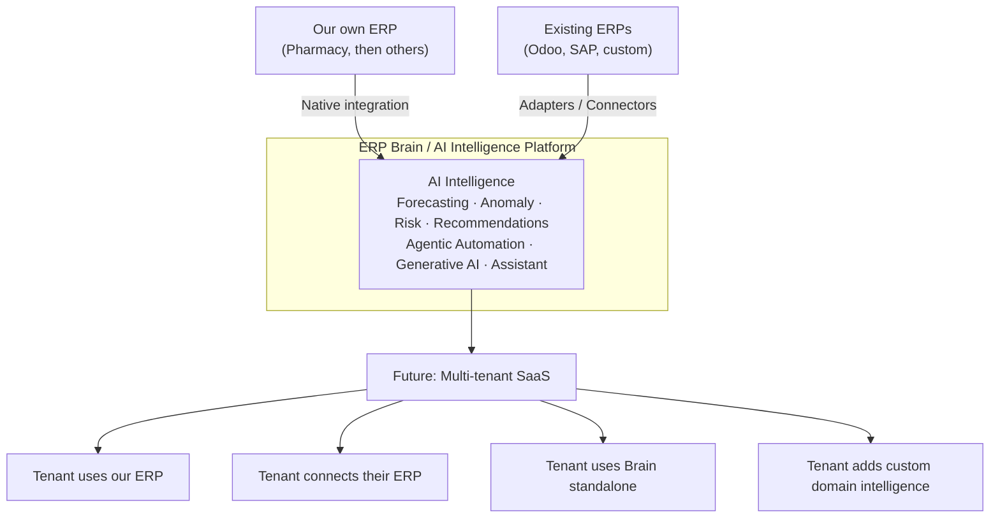

The MVP builds the left branch only (**Our own ERP → Native integration → AI**), but the canonical contract in the middle is written as if the right branch (**Existing ERPs → Adapters**) already needs to exist — because it does, on day one, conceptually: your own ERP's "adapter" is just the in-process special case of the same interface a third-party connector will implement later. This is why §4 of your brief ("do not couple the Brain to Pharmacy") isn't a nice-to-have — it's the only way the right-hand branch is ever reachable without a rewrite.

Five SaaS entry points are targeted long-term (own ERP, connect existing ERP, Brain-only, multi-tenant, custom intelligence plugins). None require MVP implementation; all five require the MVP to **not** make decisions that foreclose them (hardcoded single-tenant assumptions in schemas, Brain code that imports pharmacy-specific types, UI that renders AI output by string-matching). Section 14 lists exactly which foreclosing decisions to avoid.

## 3. Problem Definition

Traditional ERPs are systems of record: they store and enforce business transactions correctly, but they don't reason. The common failure mode when teams try to add "AI" to an ERP is direct coupling — a model or LLM prompt built against `SELECT * FROM inventory_items`, an anomaly script that knows about pharmacy-specific `batch_expiry` columns, a chatbot that queries the production database. This works as a demo and fails as a product: the intelligence can't move to a second ERP, can't be sold standalone, can't be safely given write access, and can't be audited because there's no boundary between "the system remembering what happened" and "the system deciding what should happen."

The problem this architecture solves is narrower and more tractable than "build an AI ERP": **define a stable vocabulary for business operations (canonical model), force every ERP — including your own — to speak it through an adapter, and build the intelligence exclusively against that vocabulary.** The Pharmacy ERP is not the product being sold; it's the cheapest way to generate real `SaleCreated` events and real stockout scenarios to prove the vocabulary and the adapter pattern hold up under an actual, if small, production workload.

A second, secondary problem this architecture must solve for a 9-person graduation team specifically: **nine people cannot work sequentially against a moving target.** The canonical contract and mock servers (Phase 0) exist as much for team-parallelism as for future ERP portability — they are the same artifact serving two purposes.

## 4. Architectural Principles

| # | Principle | Why |
| --- | --- | --- |
| 1 | **System of Record vs. System of Intelligence are separate services** | Prevents the Brain from ever becoming a second source of truth for business data; ERP data corrections don't require Brain deployments and vice versa. |
| 2 | **Canonical contracts, not schema coupling** | The Brain's code, prompts, and models reference `InventoryItem`, never `inventory_items`. A second ERP connector means writing a new adapter, not touching the Brain. |
| 3 | **Every ERP — including ours — goes through an adapter** | If our own ERP bypasses the adapter "just this once" for convenience, the Brain silently becomes pharmacy-coupled again. The in-process adapter for our ERP is not optional scaffolding; it's the same contract a future Odoo adapter implements. |
| 4 | **Deterministic code and classical ML come before the LLM, always** | Token cost and latency scale with what you send an LLM. Aggregation, filtering, and numeric forecasting are cheaper, faster, and more reliable as code than as prompts. The LLM's job is reasoning and language, not arithmetic. |
| 5 | **Nothing that writes business state executes without a human approval gate in MVP** | The Agent has no database access and no unsupervised write path. This is a hard MVP requirement, not a future hardening pass (see §10). |
| 6 | **Tenant-ready schema, single-tenant MVP** | Every core table carries `tenant_id` from day one, defaulted to one seeded row. This costs nothing now and avoids a full data-migration project later (see §14). |
| 7 | **Modular monolith over premature microservices** | Two deployable services (ERP, Brain) is the right number for a 9-person team and an MVP's operational budget. Module boundaries inside the .NET solution are enforced by code structure so extraction later is possible, but nobody pays a distributed-systems tax now. |
| 8 | **AI output is always structured JSON, never prose the frontend parses** | The Brain returns `Insight`/`Forecast`/`ActionProposal` objects (see §16). The frontend never regexes an LLM's sentence to decide what button to show. |
| 9 | **Contracts and mocks ship before implementations** | The `/contracts` folder and its mock servers are Phase 0 deliverables so all 9 people can build in parallel from day two (see §21). |
| 10 | **New infrastructure only when the alternative is demonstrably worse** | Redis Streams instead of Kafka, pgvector instead of a vector DB, hosted LLM API instead of self-hosted models — each is a deliberate "not yet" call, justified where it's made, not a gap. |

### Fixed technology stack

Per your addendum, these five are locked and not reconsidered anywhere below:

| Layer | Technology | Role | Fits because |
| --- | --- | --- | --- |
| ERP core | **.NET 8 / ASP.NET Core**, Modular Monolith + Clean Architecture | System of Record, transactional workflows, ERP APIs | Strong typing and EF Core migrations suit a transactional ledger; Clean Architecture's module boundaries give you microservice-shaped seams without microservice-shaped ops overhead. |
| AI Brain | **Python / FastAPI** | AI orchestration, ML, forecasting, agentic tools | Python owns the ML/LLM ecosystem (scikit-learn, LightGBM, Anthropic/OpenAI SDKs); FastAPI gives async I/O for LLM calls and auto-generated OpenAPI for contract-first work. |
| Frontend | **React / Next.js (TypeScript)** | ERP UI, dashboards, AI surfaces | App Router gives you route groups for `(erp)` vs `(ai)` surfaces cleanly; TypeScript types are generated once from `/contracts`. |
| Data | **PostgreSQL** (×2 logical databases) + **Redis** | Transactional storage, cache, MVP event bus | Postgres' `pgvector` extension covers embeddings if RAG is ever justified, avoiding a dedicated vector DB; Redis Streams cover MVP eventing, avoiding Kafka/RabbitMQ ops. |
| Delivery | **Docker, Docker Compose, GitHub Actions** | Local dev, CI/CD, deployment | One `docker-compose.yml` runs the whole system (7 containers) on a laptop or a single cloud VM — the right ceiling for a graduation-scale production deployment (see §27). |

Supporting choices left to my judgment (not core frameworks, so not locked by your addendum), each justified where used: EF Core (ORM, .NET side), SQLModel + Alembic (ORM/migrations, Python side), Nginx as reverse proxy, a hosted LLM API rather than self-hosted models, MediatR for in-process module messaging in .NET.

---

## 5. System Architecture

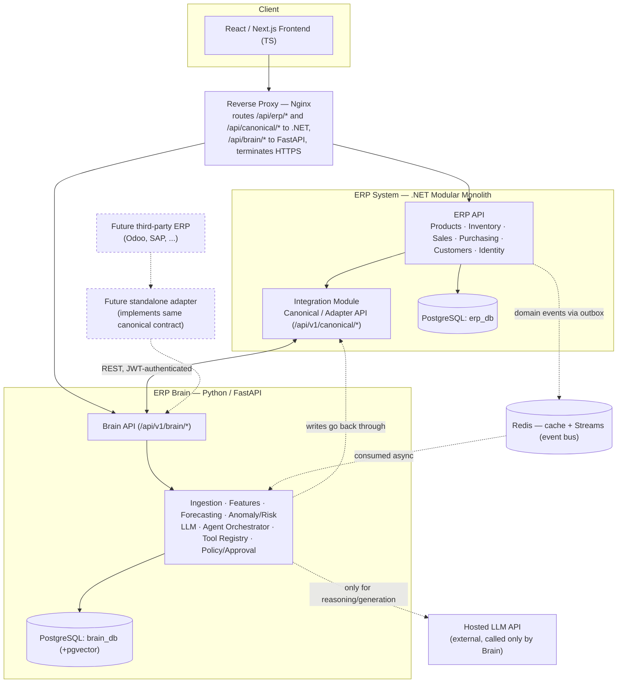

Two deployable services, one shared contract, one proxy. Note what's *not* on this diagram: no direct arrow from `BRAINCORE` to `ERPDB` anywhere, at any layer — that arrow is architecturally impossible, not just discouraged, because the Brain container has no network route or credentials to `erp_db` (see §12).

**Why a modular monolith and not microservices for the ERP itself:** Products, Inventory, Sales, Purchasing, Customers, and Identity share one transactional boundary (a sale simultaneously touches inventory and creates a financial record) and one small team. Splitting them into separate services now buys you nothing but distributed transactions and 5x the deployment surface for a 9-person team on a graduation timeline. Clean Architecture module boundaries (§6) mean that if a future SaaS phase genuinely needs to scale Inventory independently, extraction is a refactor, not a rewrite.

**Why the Brain is its own service and not a module inside the .NET monolith:** This is the one deliberate exception to "don't split services," because it's the whole point of the project — the Brain must be independently deployable, independently scalable (ML/LLM workloads have a completely different resource profile than transactional CRUD), and portable to sit behind a different ERP entirely. Putting it in the .NET solution would make §2 of your brief structurally impossible.

## 6. Component Architecture

### 6.1 ERP Backend (.NET, Modular Monolith / Clean Architecture)

```
ErpBackend.sln
/src
  /Modules
    /Identity       Identity.Domain / .Application / .Infrastructure / .Api
    /Products       (Product catalog, categories)
    /Inventory      (InventoryItem, stock movements, locations)
    /Sales          (Sale, SaleLine, POS workflow)
    /Purchasing     (Supplier, PurchaseOrder, PurchaseOrderLine)
    /Customers      (Customer)
    /Integration    Integration.Api (exposes /api/v1/canonical/*)
                    Integration.Mapping (module DTO -> canonical schema)
                    Integration.Events (outbox publisher)
  /Shared
    Shared.Kernel      (Entity/ValueObject/DomainEvent base types, audit fields)
    Shared.Contracts   (canonical + event DTOs, generated from /contracts)
  /Host
    Erp.Api.Host       (composition root: Program.cs wires every module into one app)
/tests
  <Module>.Tests (unit), Integration.Tests (contract tests against /contracts fixtures)
```

Each module is a **vertical slice**: its own Domain (entities, invariants, no dependencies on anything), Application (use cases / CQRS handlers via MediatR, defines the interfaces Integration maps against), Infrastructure (EF Core repositories, this module's tables only), and Api (its own controllers, mounted into the shared host). **Cross-module rule:** a module may only call another module through its public Application-layer interfaces (in-process, via MediatR requests) — never through another module's DbContext or tables directly. This single rule is what keeps "modular" from silently becoming "big ball of mud," and it's what makes future extraction to microservices a boundary you already have rather than one you'd have to discover.

The **Integration module is the adapter** described in §8 — it is a peer of Products/Sales/etc., not a wrapper around the whole app, and it depends on the other modules' Application interfaces exactly the way a future standalone Odoo-adapter service would depend on Odoo's API.

### 6.2 ERP Brain (Python / FastAPI)

```
brain/
  app/
    main.py                    FastAPI app factory, middleware, JWT auth
    api/v1/
      insights.py  forecasts.py  assistant.py  agent.py
    core/           config.py, security.py (JWT validation), errors.py
    ingestion/      canonical_client.py (HTTP client to /api/v1/canonical/*)
                    event_consumer.py (Redis Streams consumer)
    normalization/  canonical JSON -> internal feature-ready models
    features/       feature engineering (lag features, rolling stats, calendar)
    forecasting/     models/, training.py, inference.py
    anomaly/  risk/
    llm/            prompts/, client.py (hosted LLM wrapper), rag/ (optional, §9)
    agent/          orchestrator.py, tool_registry.py, tools/, policy.py, approval.py
    evaluation/     offline eval harness, golden datasets
    observability/  audit.py, tracing.py
    model_registry/
    db/             models.py (SQLModel), alembic/ (migrations)
  tests/
```

FastAPI's dependency-injection system enforces the same discipline as the .NET module boundary: `agent/tools/*.py` may only call `ingestion/canonical_client.py`, never `db/models.py` directly for anything that represents ERP business state — the Brain's own `brain_db` is for derived data (forecasts, features, agent logs), not a shadow copy of the ERP's truth.

### 6.3 Frontend (React / Next.js, TypeScript)

```
erp-frontend/
  app/
    (erp)/   products/  inventory/  sales/  purchasing/  customers/
    (ai)/    insights/  assistant/  approvals/
    layout.tsx
  components/
    erp/     (tables, forms per ERP module)
    ai/      InsightCard, ForecastChart, AssistantChatPanel, ApprovalModal
    ui/      design-system primitives (buttons, cards, badges)
  lib/
    api/     erpClient.ts, canonicalClient.ts (rarely used directly by FE), brainClient.ts
    auth/    JWT storage + refresh
  types/     generated from /contracts OpenAPI specs — never hand-written
```

Route groups `(erp)` and `(ai)` are a deliberate visual and mental separation matching §11 of your brief: AI surfaces are additive panels bolted onto ERP screens (e.g., an `<InsightCard>` inside the Inventory page), not a separate app the user has to context-switch into.

---

## 7. Data Architecture

| Store | Technology | Owner | Why it exists (and why nothing fancier) |
| --- | --- | --- | --- |
| ERP database | PostgreSQL `erp_db` | .NET / EF Core migrations | System of Record. Relational integrity (FKs, transactions) matters for money and stock — a sale and an inventory decrement must commit atomically. |
| Brain database | PostgreSQL `brain_db` (separate instance or at minimum separate credentials + network policy) | Python / Alembic migrations | Derived/intelligence data only: canonical cache, features, forecasts, model metadata, agent logs, AI audit trail. Physically separate so "no AI-to-ERP-DB access" is enforced at the infrastructure layer, not just by code discipline. |
| Feature store | Plain tables in `brain_db` | Brain / Data pipeline | A dedicated feature-store platform (Feast, Tecton) solves online/offline skew at a scale and team size you don't have. Postgres tables with a `computed_at` timestamp are the entire feature store you need for one tenant and a handful of SKUs. Revisit only if multi-tenant scale makes ad hoc queries too slow. |
| Vector store | **pgvector extension inside `brain_db`** | Brain | RAG is only justified at all if you add unstructured knowledge (policy docs, drug leaflets) — your core forecasting/insight data is already structured and canonical, so classical retrieval via the Canonical API usually beats vector search for it. If/when RAG is added, pgvector avoids standing up Pinecone/Weaviate/Qdrant for a corpus that will be tiny in MVP. |
| Cache | Redis | Both services | Caches canonical-API reads (avoid re-querying `erp_db` for data that changed a minute ago) and repeated LLM responses (identical assistant questions shouldn't re-spend tokens). |
| Event bus (MVP) | **Redis Streams** | ERP publishes, Brain consumes | See §8.4 for the explicit Kafka/RabbitMQ trade-off — Streams is the right size for single-tenant, low-volume MVP traffic and it's infrastructure you already run for caching. |
| Analytics storage | Reuse `brain_db` tables for MVP | Brain | A dedicated warehouse (ClickHouse/BigQuery) is unjustified before you have enough tenants or volume to make ad hoc Postgres queries slow. |
| Model artifacts | Docker volume / local filesystem, versioned by filename (`lgbm_amox_v3.pkl`) + a row in `model_registry` | Brain | S3 + MLflow is the right future move (§30); for one tenant and a handful of models, a volume and a registry table are enough and add zero new infrastructure. |
| Logs | Structured JSON to stdout, captured by Docker | All services | Centralized log platforms (ELK, cloud logging) are a Post-MVP cost; `docker compose logs` plus stdout JSON is sufficient for a graduation-scale deployment and costs nothing to operate. |
| Audit store | Append-only `AuditLog` table in `brain_db` (AI actions) + `AuditLog` table in `erp_db` (business record changes) | Both | Two audit tables, not one, because they answer different questions ("what did a human change" vs "what did the AI propose/do and who approved it") and belong to different systems of ownership. |

## 8. Integration Architecture

### 8.1 The canonical model

The Brain reasons over a small set of ERP-agnostic entities. Each is defined once, owned jointly by whoever builds the Integration module (.NET) and whoever consumes it (Brain), and versioned as a unit.

| Canonical entity | Core fields | Maps from (pharmacy-specific) |
| --- | --- | --- |
| `Product` | id, sku, name, category, unit, tenant_id | `products` table |
| `InventoryItem` | product_id, quantity_on_hand, reserved_quantity, available_quantity, location_id, reorder_point, updated_at | `inventory_items`, `stock_movements`, `product_stock` |
| `Sale` / `SaleLine` | id, customer_id, lines[{product_id, qty, unit_price}], total, occurred_at | `sales`, `sale_lines` |
| `PurchaseOrder` / `PurchaseOrderLine` | id, supplier_id, status, lines[{product_id, qty}], created_by | `purchase_orders`, `po_lines` |
| `Supplier` | id, name, contact, lead_time_days | `suppliers` |
| `Customer` | id, name, contact (minimized — see §12) | `customers` |
| `Employee` | id, name, role | `employees` / Identity users |

**"Transaction" is deliberately not a top-level entity** — `Sale` and `PurchaseOrder` share a `FinancialTransaction` shape (amount, currency, timestamp, parties) used internally for ledger/audit views, rather than forcing every future ERP's very different transaction concept into one rigid schema. This is a mild pushback on your brief's example list: a generic `Transaction` entity sounds clean but tends to become either too vague to be useful or a dumping ground; a shared *interface* two concrete entities implement holds up better across ERPs.

**Why the abstraction is necessary:** without it, "get inventory" means one SQL query for pharmacy and a completely different one for Odoo, and every forecasting feature, every agent tool, and every frontend component would need per-ERP branches. With it, they're written once against `InventoryItem` and never change when a connector is added.

**Where transformation happens:** entirely inside the Integration module of whichever ERP is being adapted (in-process for our own ERP; inside a standalone adapter service for a third-party ERP). The Brain never transforms ERP-shaped data — it only ever receives canonical shapes.

**Who owns the canonical model:** the contract lives in `/contracts/canonical/*.schema.json` in the monorepo, changed by PR, requiring sign-off from one Integration-layer owner (.NET side) and one Brain-side data owner (see §19) — it is a shared asset, not property of either team.

**Versioning:** each payload carries `"version": "1.0"`. Additive, backward-compatible fields don't bump the major version; breaking changes do, and old + new versions are served side-by-side at `/api/v1/canonical/...` vs a future `/api/v2/...` during migration.

**Validation:** the Integration module validates outgoing payloads against the JSON Schema in `/contracts` in CI (contract tests, §25); the Brain validates incoming payloads with Pydantic models generated from the same schema — a schema drift fails CI on both sides before it fails in production.

### 8.2 Adapter architecture

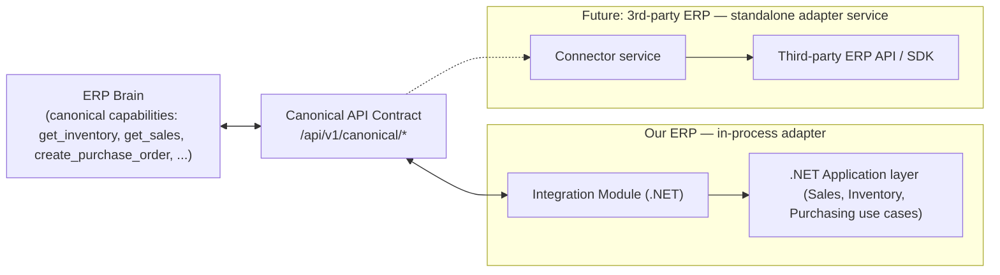

The adapter interface is the same regardless of which side implements it — a small set of capability methods the Brain calls and a small set of write operations it may request:

| Capability | Direction | Notes |
| --- | --- | --- |
| `get_products()`, `get_inventory()`, `get_sales(range)`, `get_suppliers()` | Read | Paginated, filterable by `updated_since` for incremental sync. |
| `create_purchase_order(payload)`, `update_inventory(payload)` | Write | Always behind the approval gate (§10) when invoked by the Agent; may be invoked without approval by trusted internal ERP workflows. |
| `capabilities()` | Discovery | Returns which of the above this adapter actually supports — see §8.3 for why this matters. |

Cross-cutting concerns every adapter must implement, addressed once here rather than per-connector:

- **Authentication:** service-to-service JWT (shared signing key in MVP; per-adapter OAuth client credentials in future multi-connector world).
- **Authorization:** the Brain's JWT carries `tenant_id` and scopes; the adapter rejects requests outside the token's tenant.
- **Data mapping:** owned by the adapter, never by the Brain (§8.1).
- **Error handling:** standardized error envelope (§16.7) regardless of what the underlying ERP returned.
- **Retries:** idempotent reads retry with exponential backoff at the Brain's HTTP client; writes are retried only if the adapter guarantees idempotency (next point).
- **Idempotency:** every write request carries an `Idempotency-Key` header; the adapter persists a dedupe record so a retried `create_purchase_order` can't double-create.
- **Rate limiting:** per-tenant token bucket at the reverse proxy; protects the ERP from an over-eager agent loop.
- **Webhooks/events:** outbound only in MVP (ERP → Brain via outbox/Streams, §8.4); inbound webhooks from a third-party ERP are a Future connector concern, handled the same way.
- **API/connector versioning:** the contract's `version` field (§8.1) plus the adapter's own semver, so a connector can declare "I implement canonical v1.2."
- **Observability:** every adapter call carries a `trace_id` (W3C traceparent) propagated end-to-end (§13).
- **Security:** adapter credentials stored encrypted (§12), scoped to least-privilege ERP API permissions, never given raw database credentials.

### 8.3 Adding a future ERP connector without touching the Brain

| The other ERP exposes... | What the connector does |
| --- | --- |
| **REST API** | Thin translation service: calls their REST endpoints, maps responses to canonical JSON, implements the same `/api/v1/canonical/*` contract. This is the common case (Odoo, most modern SaaS ERPs). |
| **GraphQL API** | Same translation role; the connector issues GraphQL queries instead of REST calls internally, but still *exposes* REST canonical endpoints to the Brain — the Brain never speaks GraphQL. |
| **SDK** | Connector is a thin wrapper around the vendor SDK, same external contract. |
| **Webhooks available** | Connector subscribes to the vendor's webhooks to populate its own small cache/outbox, feeding the same event contract (§8.4) the Brain already consumes — no Brain-side change. |
| **Only database access** | Weakest case: connector becomes a read-mostly ETL job (scheduled or CDC-based) into a staging schema it owns, then maps staging rows to canonical JSON on the same schedule. Writes back to that ERP are typically not attempted (too risky without a proper API) — the connector is read-only until/unless the vendor exposes a real interface. |
| **No integration interface at all** | Out of scope for an adapter; the honest answer is "not integrable yet," logged as a connector backlog item rather than reverse-engineered against a live production database. |

In every row, the Brain's code is unchanged — this table is the concrete proof that §4's central requirement holds.

### 8.4 Event-driven vs. synchronous, and why Redis Streams over Kafka/RabbitMQ

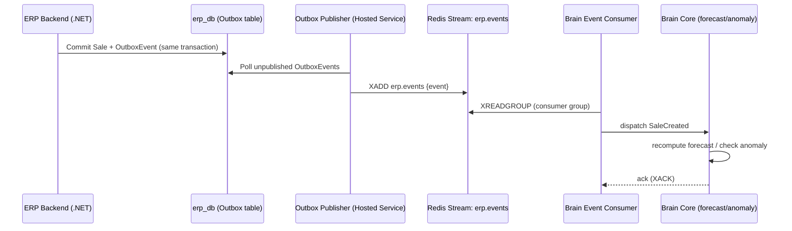

**Synchronous REST** is used wherever a human is waiting on the answer: Agent tool calls, the assistant chat, on-demand "why is this flagged" explanations, and all ordinary ERP CRUD. **Asynchronous events** are used wherever the trigger and the consumer don't need to share a request: a sale shouldn't have to wait for a forecast recompute to finish before the receipt prints.

The **transactional outbox pattern** (write the event row in the same DB transaction as the business change, publish it from a separate background worker) is what makes this safe on your fixed stack without adding a broker: it guarantees an event is never lost due to a crash between "commit the sale" and "publish the event," which a naive "call Redis directly after commit" approach doesn't guarantee.

**Why not Kafka/RabbitMQ for MVP:** both are excellent and both are one more stateful service to deploy, monitor, and back up, for a single tenant emitting a few hundred events a day. Redis is already in your stack for caching; Redis Streams (consumer groups, acknowledgment, replay) covers everything this MVP's event volume needs. Revisit when multi-tenant volume or true multi-consumer fan-out (§15) makes Streams' simpler guarantees insufficient — that's a Post-MVP infrastructure swap behind the same outbox pattern, not a rewrite of how events are produced.

---

## 9. AI Architecture

### 9.1 Brain modules

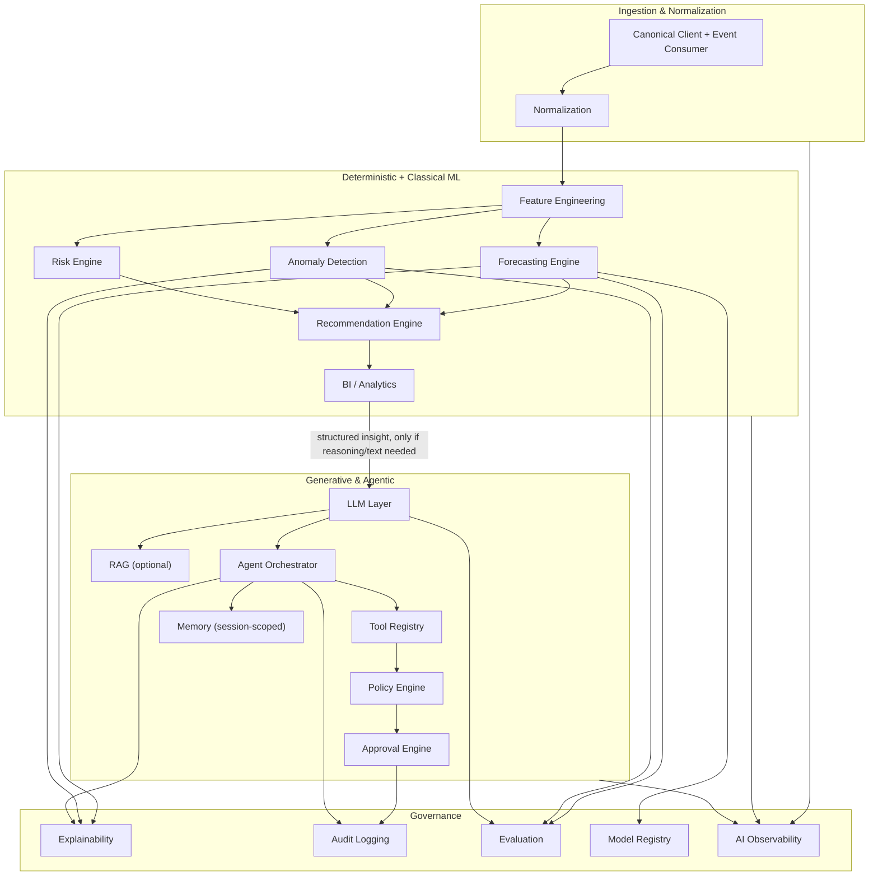

| Component | Why | When it runs | Input → Output | Owner | MVP / Future |
| --- | --- | --- | --- | --- | --- |
| Data ingestion | Get canonical data in without polling the ERP for everything constantly | On event (Streams) + scheduled backfill | Canonical API / events → raw normalized rows | Data Engineer | **MVP** |
| Normalization | Isolate the Brain's internal models from the canonical wire format | Same as ingestion | Canonical JSON → internal Pydantic models | Data Engineer | **MVP** |
| Feature engineering | Turn transactions into model inputs (lags, rolling averages, calendar flags) | Incremental on event; full recompute nightly | Normalized rows → feature tables | Data Engineer + AI Engineer | **MVP** |
| Forecasting engine | Predict demand per product to drive stockout insight | Nightly batch + on-demand for a single SKU | Features → forecast + confidence interval | AI Engineer | **MVP** |
| Anomaly detection | Flag statistically unusual sales/inventory movement | On event (near-real-time) | Features → anomaly score + flag | AI Engineer | **MVP** |
| Risk engine | Combine forecast + anomaly + business rules into a severity | On event / on-demand | Forecast + anomaly + rules → Risk object | AI Engineer | **MVP** |
| Recommendation engine | Turn a risk into a concrete suggested action | On-demand when a risk is surfaced | Risk → Recommendation (e.g., suggested PO quantity) | AI Engineer | **MVP** |
| BI / analytics engine | Aggregate views (sales trends, top movers) for dashboards | On-demand | Canonical data → aggregate stats | Data Engineer | **MVP (basic)** |
| LLM layer | Turn structured insights into natural-language explanation, and power the assistant chat | On-demand only — never on every transaction | Structured insight + user question → text / structured explanation | AI Engineer | **MVP** |
| RAG | Ground the assistant in unstructured docs (policies, product info) | On-demand, only if such docs exist | Query → retrieved chunks → LLM context | AI Engineer | **Future** (add only when an unstructured corpus exists — see §4 principle 10) |
| Agent orchestrator | Decide which tool(s) to call to answer a request or propose an action | On assistant/agent request | User intent → tool call plan | AI Engineer | **MVP** |
| Tool registry | Single source of truth for what the Agent is allowed to do | Loaded at startup, checked per call | Tool name → schema + permissions | AI Engineer | **MVP** |
| Policy engine | Static allow/deny + "does this need approval" rules | Per tool call | Tool + context → allow / require-approval / deny | AI Engineer | **MVP (static rules)**, dynamic risk-scoring → Future |
| Approval engine | Human-in-the-loop gate for write actions | Per write tool call | ActionProposal → pending → approved/rejected | AI Engineer + Full Stack (UI) | **MVP** |
| Memory | Keep short conversational context for the assistant | Per session | Conversation turns → session state | AI Engineer | **MVP (session-scoped only)**, persistent cross-session memory → Future |
| Explainability | Answer "why did you flag this" without re-prompting an LLM for every dashboard render | Generated alongside forecast/anomaly output | Model internals → human-readable factor list | AI Engineer | **MVP (lightweight)** |
| Audit logging | Immutable record of every AI action and approval | Every agent action | Action + actor + decision → AuditLog row | AI Engineer | **MVP** |
| Evaluation | Prove the Brain works (§26) | CI + scheduled | Predictions vs. ground truth → metrics | AI Engineer | **MVP (baseline)** |
| Model registry | Track which model version produced which forecast | On training run | Model artifact + metrics → registry row | AI Engineer | **MVP** |
| AI observability | Token cost, latency, tool success rate | Continuous | Traces/logs → dashboards | DevOps + AI Engineer | **MVP (basic)** |

### 9.2 Cost-optimized processing pipeline

```mermaid
flowchart LR
    A["Raw ERP data<br/>(events, canonical reads)"] --> B["Deterministic preprocessing<br/>(code, not LLM)"]
    B --> C["Aggregation / filtering"]
    C --> D["Feature engineering"]
    D --> E["Classical ML / statistics<br/>(forecast, anomaly score)"]
    E --> F["Structured insight<br/>(Risk / Forecast / Recommendation JSON)"]
    F -->|"only if a human asked a question,<br/>or the situation needs narration"| G["LLM<br/>(reasoning / explanation / generation)"]
    G -->|"only if the user/system decided to act"| H["Agentic execution<br/>(tool call, human-approved)"]
```

| Should be... | Examples | Never sent to an LLM |
| --- | --- | --- |
| **Deterministic code** | Unit conversion, aggregation, date/calendar features, threshold checks, the outbox/event plumbing | Raw per-row transaction tables; a "is quantity > 0" check |
| **Classical ML/statistics** | Demand forecasting (LightGBM / Holt-Winters), anomaly scoring (IsolationForest / z-score on residuals), risk severity scoring | Anything with a closed-form or well-trodden statistical answer |
| **LLM** | Explaining *why* a risk was flagged in plain language, answering free-form assistant questions, drafting a report narrative, agent reasoning about which tool to call | Full sales history dumps, raw table contents, anything a `SELECT`+aggregation already answers |
| **Agents** | Multi-step tasks needing tool orchestration (check inventory → check forecast → propose PO) | Any single deterministic lookup — a plain API call doesn't need an agent loop around it |

Concrete cost controls, all **MVP-required**, not aspirational:

- **Caching:** identical assistant questions within a TTL window return the cached response (Redis) instead of re-calling the LLM.
- **Incremental processing:** feature engineering recomputes only rows touched since the last run (via `updated_since`), not a full table scan per event.
- **Event-driven vs. batch:** anomaly detection runs per-event (cheap, rule/statistic-based); forecast retraining runs nightly batch (expensive, doesn't need real-time).
- **Embeddings:** used only if/when RAG is actually added (§9.1) — not generated speculatively for data that's already structured and queryable.
- **Model routing:** a small/cheap model (or no model at all — a template) handles routine "here's your forecast" narration; a larger model is reserved for the open-ended assistant chat and multi-step agent reasoning.
- **Local vs. API model:** hosted API model for MVP (§4 principle 10) — no GPU infra, no fine-tuning pipeline to maintain on a graduation timeline; revisit only if per-token cost at real scale justifies self-hosting.
- **Context minimization:** the LLM prompt receives the *already-computed* Risk/Forecast JSON object (a few hundred tokens), never the underlying rows it was computed from.
- **Structured outputs:** every LLM call that feeds the frontend requests a JSON schema response (function-calling / structured output mode), never freeform text the backend then tries to parse.
- **Token budgeting & cost monitoring:** every LLM call logs `tokens_in`, `tokens_out`, `estimated_cost`, `model` to `brain_db` (§13) — visible in a simple cost dashboard before it's ever a surprise.

### 9.3 Forecasting architecture

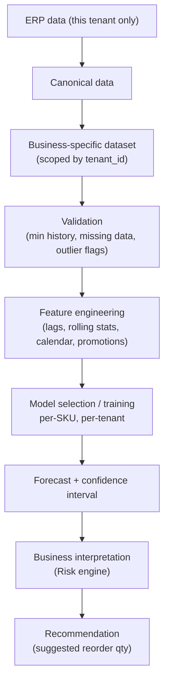

**One model per business, never one model for everyone.** Concretely: forecasting is scoped by `tenant_id` at every stage — the training dataset query, the model artifact's filename/registry key, and the inference call all carry it, so "tenant B's promotion spike" can never leak into tenant A's forecast even by accident. For MVP with one tenant this looks like a no-op; it's the difference between a schema that supports 50 pharmacies later and one that needs a rewrite to.

| Concern | MVP approach |
| --- | --- |
| **Cold start** (new SKU, <8 weeks history) | Fall back to category-level average or a naive seasonal-naive forecast; flag `confidence: "low"` rather than a false-precision number. |
| **Minimum data requirement** | ~8-12 weeks of sales history per SKU before a per-SKU LightGBM model trains; below that, the cold-start fallback applies. |
| **Retraining** | Nightly batch job retrains SKUs with new data since last run; full retrain weekly. |
| **Model versioning** | Every trained model gets a registry row (`sku, version, trained_at, metrics, artifact_path`); inference always reads the latest *validated* version, not just latest-trained. |
| **Monitoring / evaluation** | MAPE/WAPE tracked per SKU per week; a model whose error jumps past a threshold is flagged for review, not silently trusted (§26). |
| **Seasonality** | Calendar features (day-of-week, month, holiday flags) in the feature set; not a separate model. |
| **Promotions** | A `is_promotion` flag as a feature if/when the ERP records promotions; without it, promotion-driven spikes will show as anomalies rather than forecasted demand — an honest MVP limitation worth stating rather than hiding. |
| **Missing data** | Explicit gap-filling (forward-fill for short gaps, exclude SKU from training if gaps exceed a threshold) rather than silently treating missing days as zero demand. |
| **Outliers** | Winsorized in training data; flagged (not deleted) so the anomaly detector can still see them. |
| **Different business behavior** | Per-tenant feature sets and per-tenant model selection (not forced into one global model) — this *is* the tenant isolation; §15 adds hard data isolation (separate schemas/RLS) on top when multi-tenant. |

---

## 10. Agentic Architecture

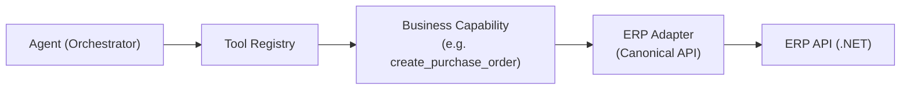

The Agent never sees a connection string. Every capability it has is a named, schema-defined tool that terminates in the same Canonical API the rest of the Brain uses — there is no separate, more-privileged path for agentic access.

| Design area | MVP approach |
| --- | --- |
| **Tool registry** | A Python dict/registry loaded at startup from `agent/tools/*.py`; each tool self-declares its schema (see §16.5 for the JSON shape). |
| **Tool schemas** | JSON Schema input/output per tool, validated before *and* after execution (bad LLM-generated arguments are rejected before they reach the adapter). |
| **Permission checks** | Every tool call carries the caller's JWT; the tool registry checks `scopes` before dispatch (e.g., `inventory:write` required for `update_inventory`). |
| **Approval policies** | MVP policy is intentionally simple and static, not a scored risk engine: **every tool marked `requires_approval: true` (all writes, no exceptions in MVP) blocks on human approval; read-only tools never block.** A dynamic, risk-scored policy engine is explicitly Post-MVP (§4 principle 10) — building it now would be solving a problem you don't have data to calibrate yet. |
| **Human-in-the-loop** | An `ActionProposal` is created, surfaced in the ERP UI (§11), and only converted into a real tool execution after `POST /agent/proposals/{id}/approve` from an authorized user. |
| **Read-only vs. write** | Declared per-tool (`read_only: bool`), enforced by the registry, not by convention. |
| **Action validation** | Input schema validation + business-rule validation (e.g., supplier must exist) happens in the adapter, so the same validation protects both agent-initiated and human-initiated writes. |
| **Idempotency** | Every write tool call generates an `Idempotency-Key`, passed through to the adapter (§8.2) — an agent retry after a timeout can't double-create a purchase order. |
| **Rollback / compensation** | MVP scope is additive actions only (create PO, not delete/modify existing records), which sidesteps most rollback complexity; where compensation is needed (e.g., cancel a just-created draft PO), it's itself a separate approved tool call, not an automatic undo. |
| **Audit trail** | Every proposal, approval/rejection, and execution result is written to `AgentAction`/`AuditLog` (brain_db), including the acting user, the model version, and the full tool arguments. |
| **Agent execution state** | Persisted per session (`AgentSession` table) so a page refresh doesn't lose an in-flight proposal. |
| **Failure recovery** | A failed tool call surfaces a structured `ActionResult{status: "failed", reason}` to the frontend and is logged — the agent does not silently retry write actions on its own. |
| **Guardrails** | System prompt + tool allow-list scoped per session; the LLM cannot invent a tool name that isn't in the registry (orchestrator rejects unknown tool calls before execution). |
| **Maximum action scope** | A hard cap on write actions per agent session (e.g., 3) in MVP, mainly to bound the blast radius of a misbehaving prompt/loop, not because 3 is a principled number. |
| **Sensitive operations requiring approval** | In MVP: **all** writes. This is deliberately maximal and simple rather than trying to pre-classify "sensitive" vs. "safe" writes before you have real usage data to justify the distinction. |

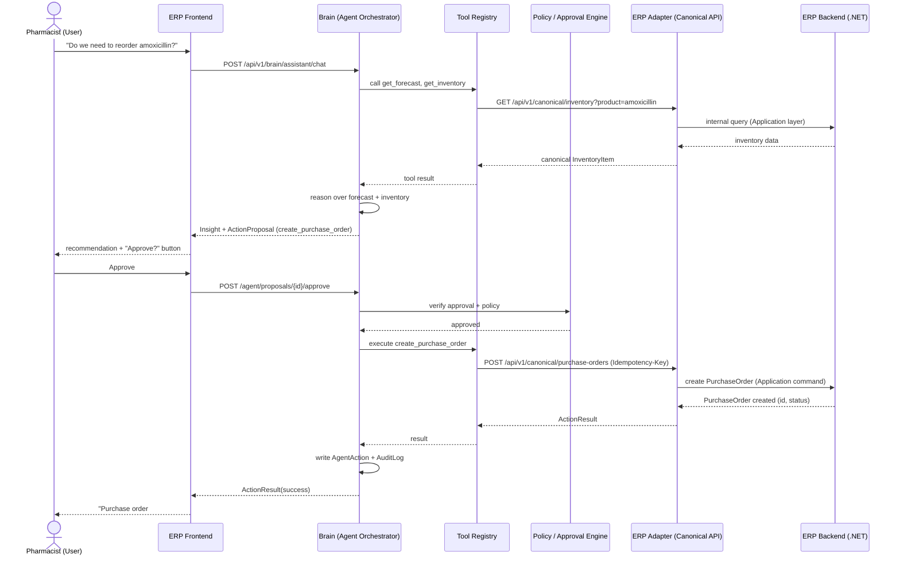

## 11. Frontend Architecture

The Brain returns structured intelligence only; the frontend owns all rendering decisions. This is enforced by the AI Output Contract (§16.6) — every Brain response is one of a small closed set of typed shapes (`Insight`, `Alert`, `Recommendation`, `Forecast`, `Risk`, `AgentAction`, `ActionProposal`, `ActionResult`, `Explanation`), and the frontend has one React component per type.

| Surface | Component | Consumes |
| --- | --- | --- |
| Inventory / Product pages | `<InsightCard>` inline banner | `Insight` (e.g., `insight.stockout_risk`) |
| Dashboard | `<ForecastChart>` | `Forecast` |
| Anywhere a risk is relevant | `<AlertBadge>` | `Alert` |
| AI assistant panel | `<AssistantChatPanel>` | streamed `Explanation` + any `Insight`/`Recommendation` the assistant surfaces mid-conversation |
| Agent-proposed actions | `<ApprovalModal>` | `ActionProposal` → on confirm, posts approval → renders `ActionResult` |
| AI-generated reports | rendered as a normal document view | `Explanation` with a `report` subtype |

The user should feel AI is *inside* the ERP, not a separate app: `<InsightCard>` renders in the same Inventory table row as the stock count, not on a separate "AI" tab. The one dedicated AI-first surface is the assistant chat panel (`(ai)/assistant`), because open-ended Q&A genuinely doesn't have a natural home inside a specific ERP screen.

---

## 12. Security

| Area | MVP approach |
| --- | --- |
| **Authentication** | ASP.NET Core Identity issues JWTs for ERP users. The Brain does not run its own user management — it validates the same JWT (shared signing key in MVP; JWKS endpoint if the team prefers not to share a raw secret between services). |
| **Authorization / RBAC** | A small fixed role set in MVP: `Admin`, `Pharmacist`, `Staff`. Roles map to JWT `roles` claim, checked both in .NET (standard `[Authorize]`) and in the Brain's tool registry (§10). A dynamic permission-management UI is explicitly Post-MVP. |
| **Tenant isolation** | MVP: single seeded tenant, but every query is already tenant-scoped in code (§4 principle 6) so enabling real isolation later is a policy change, not a rewrite. |
| **API security** | HTTPS everywhere (terminated at the Nginx reverse proxy in MVP deployment); input validation via model binding (.NET) / Pydantic (Python) rejects malformed requests before business logic runs. |
| **Secrets management** | `.env` files + Docker secrets for MVP (never committed — `.env.example` only in the repo); a cloud secrets manager (§30) is a Future upgrade once there's a real cloud target. |
| **Encryption** | TLS in transit everywhere; at-rest disk/volume encryption at whatever host/cloud provider is chosen (§32); passwords hashed via ASP.NET Identity's standard hasher — never rolled by hand. |
| **Data minimization** | Customer PII is not sent to the LLM unless the specific task needs it (e.g., a stockout-risk explanation never needs a customer's name or contact info — only aggregate demand numbers). Where a customer identifier is genuinely needed (e.g., "did this customer previously order X"), only the minimum field (a masked ID) crosses into the prompt. |
| **Audit logs** | Business-record changes logged in `erp_db.AuditLog`; every AI action logged in `brain_db.AuditLog` (§10) — both are append-only, no update/delete path exposed via any API. |
| **Agent / tool permissions** | §10 — scoped per tool, checked per call, all writes gated by approval. |
| **Prompt injection defenses** | Canonical data returned from the adapter is treated as **untrusted content**, not instructions, when it's interpolated into an LLM prompt (e.g., a product name or note field can't override the system prompt or trigger an unintended tool call) — enforced by keeping tool-selection logic outside the LLM's free-text influence: the LLM proposes a tool + arguments, the orchestrator validates the tool exists and the arguments match its schema *before* any execution, regardless of what the LLM "said." |
| **Tool abuse prevention** | Per-tool and per-session rate limits (§10 max action scope); anomalous agent behavior (e.g., a burst of identical tool calls) is itself a signal the observability layer (§13) can surface. |
| **Data leakage prevention** | AI observability traces (§13) redact PII fields before persisting — a debug trace should never become a second, less-protected copy of customer data. |
| **LLM security** | System prompts define the assistant's scope explicitly (pharmacy business assistant, not general chatbot); structured-output mode is used wherever the response feeds a UI component, closing off a large class of "the model said something unexpected and we rendered it as HTML" issues. |
| **PII / sensitive data handling** | Pharmacy data can be health-adjacent (what a customer purchased). Treat customer purchase history with the same minimization discipline as any PII, and treat "what regulations apply" as a genuinely open question for your team to confirm with your institution/advisor rather than something this document should assert — it depends on your country's data-protection regime, not just the software. MVP recommendation either way: **synthetic or clearly consented demo data only**, not real customers' real purchase history, for a graduation-project deployment (see §14, "what not to build"). |
| **Connector credentials** | Stored encrypted, scoped to least-privilege ERP permissions, rotated manually in MVP (automated rotation is Future). |
| **Rate limiting** | At the Nginx reverse proxy (per-IP) and at the Brain's API layer (per-tenant token bucket), protecting both the LLM cost surface and the ERP's write path. |
| **Network security** | Docker network segmentation: the Brain container is on a network that can reach `brain_db`, Redis, and the ERP's public API — **not** `erp_db`. This is the concrete enforcement of "no direct AI-to-database access," not just a coding convention. |

## 13. Observability

| Signal | Where it's captured | Why |
| --- | --- | --- |
| Application logs | Structured JSON, stdout, both services | Standard debugging; cheap on Docker Compose (§7). |
| AI / LLM logs | `brain_db` — prompt template used, tokens in/out, latency, model, cost estimate | Needed for §9.2's cost budgeting and for reconstructing *why* a given explanation was generated. |
| Agent traces | `brain_db.AgentAction` | Full tool-call sequence per session — this is what answers "why did the agent propose this PO." |
| API metrics | Request count/latency/error-rate per endpoint (both services) | Standard health signal; feeds Phase 10/11 readiness. |
| Model metrics | Per-SKU MAPE/WAPE, anomaly precision/recall (§26) | Forecast quality can silently degrade; this is the tripwire. |
| Token usage & AI cost | Aggregated from AI/LLM logs into a simple `/brain/admin/cost` view | Directly answers §7's "maximum capability, minimum unnecessary cost" mandate with a number, not a promise. |
| Latency | Per-request, both services, plus LLM call latency separately (it dominates) | Assistant/agent responses are the slowest path in the system; worth tracking on its own. |
| Error rates | Per-endpoint, both services | Standard. |
| Forecast performance | Weekly rollup of predicted vs. actual (§26) | Distinguishes "the architecture works" from "the numbers are right." |
| Agent success/failure | Proposal → approved/rejected → executed/failed counts | Proves the human-in-the-loop loop is actually being used, not just built. |
| Audit logs | See §12 | Compliance + debugging both need this; one source, two audiences. |

A `trace_id` (W3C `traceparent` header) is generated at the reverse proxy and propagated through every hop — ERP API → Integration module → Brain API → LLM call → back — so a single request can be followed end-to-end across both services from logs alone, without needing a full distributed-tracing platform (Jaeger/Tempo) in MVP. That upgrade is a Future item (§30) once trace volume makes grep-by-`trace_id` too slow.

---

## 14. MVP Scope

Building, exactly matching your §12: (1) Pharmacy ERP, (2) ERP Backend, (3) Pharmacy Adapter/Integration Layer, (4) ERP Brain, (5) AI/ML capabilities, (6) Agentic capabilities, (7) AI-aware frontend, (8) complete end-to-end workflow (§28).

**Multi-tenancy is not implemented**, per your instruction — but three cheap decisions keep it reachable later instead of requiring a rewrite:

1. Every core table (`erp_db` and `brain_db`) carries a `tenant_id` column, defaulted to one seeded row.
2. Every query in both codebases is written tenant-scoped from day one (`WHERE tenant_id = :tenant_id`), even though it's always the same value.
3. Model artifacts and forecast tables are keyed by `(tenant_id, sku)`, not just `sku`.

None of this adds meaningful MVP effort (it's one extra column and one extra `WHERE` clause everywhere) and it converts a future multi-tenancy project from "add a column to 20 tables and backfill it, hope nothing broke" into "turn on row-level security and stop defaulting the value."

### What NOT to build in MVP

| Not building | Why |
| --- | --- |
| Full multi-tenant SaaS, tenant admin portal, billing/subscriptions | Zero MVP demo value; §15 covers the design, not the build. |
| Real third-party ERP connector (Odoo, SAP, etc.) | §8.3's table proves the *pattern* works; building an actual second connector adds weeks for a demo point you can make with a diagram and the pattern already proven by your own adapter. |
| Kafka/RabbitMQ | Redis Streams covers MVP event volume (§8.4). |
| Dedicated vector DB service | pgvector covers it if/when RAG is even added (§7, §9.1). |
| Feature-store platform (Feast, etc.) | Postgres tables are the feature store at this scale (§7). |
| Dynamic, risk-scored approval/policy engine | Static "all writes need approval" is simpler, safer, and enough to prove the pattern (§10). |
| Unsupervised / autonomous high-risk agent actions | Every write is human-approved, no exceptions, in MVP (§10). |
| Self-hosted or fine-tuned LLMs | Hosted API model; no GPU/MLOps burden on a graduation timeline (§9.2). |
| Sending raw ERP tables to an LLM for any purpose | Violates §9.2's entire cost pipeline; there is no code path in this design that does this. |
| Prescription-specific regulatory workflows (controlled-substance scheduling, prescriber verification) | Real pharmacy compliance is a large domain of its own and orthogonal to proving the Brain's architecture. MVP models **generic retail-style inventory** (SKU, quantity, expiry, supplier, price) — enough to demonstrate stockout forecasting and purchasing automation without taking on regulatory scope that doesn't serve the actual thesis of this project. If your program specifically requires regulatory realism, flag it — see §32. |
| Native mobile app | Web-responsive Next.js is enough for a demo. |
| Full i18n/l10n | Not a differentiator for this demo. |
| Complex real-time streaming dashboards | Polling / refresh-on-navigation is sufficient; true push (WebSockets/SSE) is a nice-to-have, not core. |

## 15. Future SaaS Architecture

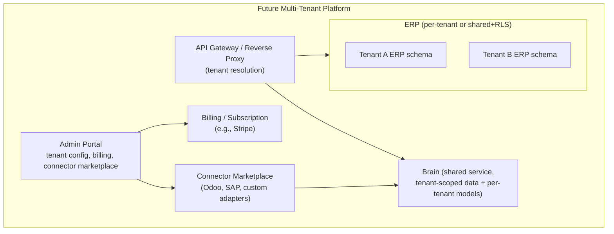

| Future capability | How the MVP's decisions make it reachable |
| --- | --- |
| Multi-tenant architecture | `tenant_id` already threaded everywhere (§14); enable PostgreSQL Row-Level Security policies rather than migrating schemas. |
| Tenant isolation | RLS at the DB layer + tenant claim in every JWT (already present in MVP auth design, §12). |
| Tenant-specific models | Model registry is already keyed by `(tenant_id, sku)` (§14); no schema change, just more rows. |
| Tenant-specific forecasting/policies | Forecasting is already per-tenant by design (§9.3), not a shared global model. |
| Billing/subscription | New Admin service; doesn't touch ERP or Brain internals. |
| Connector marketplace | Each connector implements the same canonical contract (§8.3) — "marketplace" is a registry of connectors, not new Brain logic. |
| Custom/domain-specific intelligence plugins | The module boundary in §9.1 (Forecasting, Anomaly, Risk, Recommendation as separate components) means a new vertical (e.g., retail instead of pharmacy) adds new feature/model modules without touching the Agent, LLM layer, or contracts. |
| Multiple business verticals | Canonical model (§8.1) was chosen generic on purpose — `Product`/`InventoryItem`/`Sale` describe a retail pharmacy and a hardware store equally well. |
| Enterprise integrations, admin portal, deeper observability | New services layered on top; none require re-architecting the ERP↔Brain boundary this document defines. |

---

## 16. API Contracts

All endpoints versioned under `/api/v1/`. Contract source of truth lives in `/contracts` (OpenAPI + JSON Schema), generated into both C# DTOs and TypeScript types — no team hand-writes a duplicate shape. Change management: a PR touching `/contracts` requires sign-off from the two owners named in §19 for that contract (never a unilateral change by whichever team happens to need a new field first).

### 16.1 ERP → Integration Layer (internal, in-process)

Not HTTP — a MediatR command/query inside the .NET solution, e.g. `Application` layer exposes `IInventoryQueries.GetItemAsync(productId)`, which `Integration.Mapping` calls and transforms into canonical shape. Listed here because it's a real contract (the Integration module depends on it) even though it never crosses a network boundary.

### 16.2 Integration Layer → Brain (the Canonical API)

`GET /api/v1/canonical/inventory/{product_id}`

```json
{
  "schema": "canonical.InventoryItem",
  "version": "1.0",
  "product_id": "b3f1c2a0-4e51-4a2e-9d3e-000000000001",
  "sku": "AMOX-500-30",
  "quantity_on_hand": 240,
  "reserved_quantity": 15,
  "available_quantity": 225,
  "unit": "box",
  "location_id": "main-store",
  "reorder_point": 50,
  "updated_at": "2026-09-24T10:15:00Z",
  "tenant_id": "00000000-0000-0000-0000-000000000001"
}
```

`POST /api/v1/canonical/purchase-orders` (write, idempotent)

```json
{
  "schema": "canonical.PurchaseOrder",
  "version": "1.0",
  "supplier_id": "8a1e...-uuid",
  "lines": [
    { "product_id": "b3f1c2a0-...-0001", "quantity": 300 }
  ],
  "created_by": { "type": "agent", "session_id": "sess-...", "approved_by": "user-uuid" }
}
```

### 16.3 Brain → Frontend

`GET /api/v1/brain/insights?entity_type=product&entity_id=...`

```json
{
  "type": "insight.stockout_risk",
  "id": "ins-9f2a...",
  "entity": { "type": "product", "id": "b3f1c2a0-...-0001", "name": "Amoxicillin 500mg" },
  "severity": "high",
  "confidence": 0.86,
  "forecast": {
    "horizon_days": 14,
    "predicted_stockout_date": "2026-10-03",
    "expected_demand": 180,
    "current_available": 225
  },
  "explanation": "Demand rose 22% over the last 3 weeks; current stock covers about 11 days at this rate.",
  "recommendation": { "type": "create_purchase_order", "suggested_quantity": 300, "supplier_id": "8a1e...-uuid" },
  "generated_at": "2026-09-24T10:16:40Z",
  "generated_by": { "component": "forecasting-engine", "model_version": "lgbm-amox-v3" }
}
```

### 16.4 Brain → Agent Tools (internal, function-calling shape)

```json
{
  "name": "create_purchase_order",
  "description": "Creates a draft purchase order for a supplier. Always requires human approval before execution.",
  "read_only": false,
  "requires_approval": true,
  "input_schema": {
    "type": "object",
    "properties": {
      "supplier_id": { "type": "string", "format": "uuid" },
      "lines": {
        "type": "array",
        "items": {
          "type": "object",
          "properties": {
            "product_id": { "type": "string", "format": "uuid" },
            "quantity": { "type": "integer", "minimum": 1 }
          },
          "required": ["product_id", "quantity"]
        }
      }
    },
    "required": ["supplier_id", "lines"]
  }
}
```

### 16.5 Agent → Tool Registry

Registration shape every `agent/tools/*.py` file must export (the object above, plus a `handler` reference) — the orchestrator refuses to call anything not present in the registry at startup, closing off the "LLM invents a tool name" failure mode (§10, §12).

### 16.6 Agent Tool → ERP Adapter

Reuses §16.2 in the write direction — a tool's `handler` is a thin call into the same `canonical_client.py` (§6.2) every other Brain module uses. There is deliberately no separate, more-privileged HTTP path for agent-initiated writes.

### 16.7 Events contract

```json
{
  "event_id": "8f2b3c10-...-uuid",
  "event_type": "SaleCreated",
  "occurred_at": "2026-09-24T10:16:32Z",
  "tenant_id": "00000000-0000-0000-0000-000000000001",
  "source": "erp-backend",
  "version": "1.0",
  "payload": {
    "sale_id": "…",
    "lines": [{ "product_id": "b3f1c2a0-...-0001", "quantity": 2, "unit_price": 45.5 }],
    "customer_id": "…",
    "total_amount": 91.0
  }
}
```

Core event types: `SaleCreated`, `InventoryUpdated`, `PurchaseOrderCreated`, `StockThresholdReached`.

### 16.8 Authentication contract

JWT claims, issued by .NET Identity, validated by both services:

```json
{
  "sub": "user-uuid",
  "roles": ["Pharmacist"],
  "tenant_id": "00000000-0000-0000-0000-000000000001",
  "scopes": ["inventory:read", "agent:approve"],
  "iat": 1758700000,
  "exp": 1758703600
}
```

### 16.9 Error contract

```json
{
  "error": {
    "code": "VALIDATION_ERROR",
    "message": "quantity must be greater than 0",
    "details": [{ "field": "quantity", "issue": "must be > 0" }],
    "trace_id": "00-4bf92f3577b34da6a3ce929d0e0e4736-00f067aa0ba902b7-01"
  }
}
```

### 16.10 Observability contract

`traceparent` header (W3C standard) on every inbound/outbound HTTP call across both services; structured JSON log line shape: `{ "ts", "level", "service", "trace_id", "message", "…extra" }`.

---

## 17. Data Contracts

Every table below (both databases) carries the same audit spine unless noted: `id UUID PK (default gen)`, `tenant_id UUID` (§14), `created_at`, `updated_at`, `created_by`, `updated_by` (timestamptz + user id). Soft delete (`deleted_at NULL`) is used only where history must survive the delete for reporting/forecasting integrity (Products, Suppliers, Customers) — Sales/PurchaseOrders are never deleted, only status-transitioned, because they're financial records.

### 17.1 `erp_db` (System of Record)

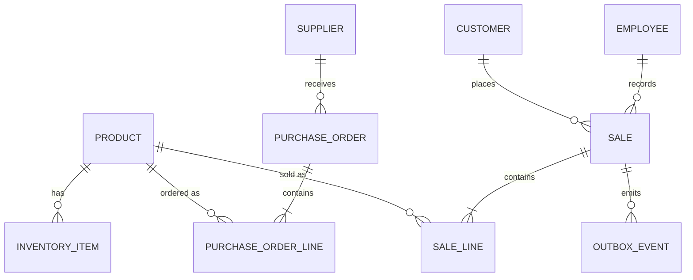

| Table | Key columns beyond the audit spine | Notes |
| --- | --- | --- |
| `Product` | sku (unique per tenant), name, category, unit, is_active | Soft delete. |
| `InventoryItem` | product_id FK, quantity_on_hand, reserved_quantity, location_id, reorder_point | `available_quantity` is computed, not stored, to avoid drift. |
| `StockMovement` | product_id FK, delta, reason, reference_id | Append-only ledger — `InventoryItem.quantity_on_hand` is a materialized sum, reconstructable from this table. |
| `Sale` / `SaleLine` | customer_id FK (nullable), employee_id FK, status, total | Never deleted. |
| `Supplier` | name, contact, lead_time_days | |
| `PurchaseOrder` / `PurchaseOrderLine` | supplier_id FK, status (`draft/approved/sent/received`), created_by_type (`human`/`agent`), approved_by | The `created_by_type`/`approved_by` pair is what makes an agent-created PO auditable at the ERP layer too, not just in the Brain's own audit log. |
| `Customer` | name, contact (minimized, §12) | Soft delete. |
| `Employee` / Identity `User` | name, role | ASP.NET Identity owns auth fields (password hash, etc.) separately. |
| `OutboxEvent` | event_type, payload (jsonb), published_at (nullable) | §8.4 — unpublished rows are what the background worker polls. |
| `AuditLog` | actor, action, entity_type, entity_id, before/after (jsonb) | Business-record change history; append-only. |

### 17.2 `brain_db` (Intelligence, derived data)

| Table | Key columns | Notes |
| --- | --- | --- |
| `CanonicalCache` | entity_type, entity_id, payload (jsonb), synced_at | Local read cache of canonical data, refreshed by ingestion (§6.2) — never the source of truth. |
| `SalesFact` | product_id, date, quantity, revenue (denormalized, one row per product-day) | What the feature pipeline actually reads; avoids re-aggregating `SaleLine`-equivalent data on every training run. |
| `Forecast` | product_id, model_version, horizon_days, predicted_demand, confidence_low/high, generated_at | Keyed `(tenant_id, product_id, model_version)` per §9.3. |
| `ModelRegistry` | model_name, version, trained_at, metrics (jsonb), artifact_path, status (`training/validated/retired`) | §9.3, §26. |
| `AnomalyEvent` / `RiskAssessment` | entity ref, score, severity, detected_at | |
| `Recommendation` | risk_id FK, type, payload (jsonb) | |
| `AgentSession` | user_id, started_at, ended_at, status | |
| `AgentAction` | session_id FK, tool_name, arguments (jsonb), status, requires_approval, approved_by, result (jsonb) | The core audit object for §10. |
| `AuditLog` (Brain-specific) | actor (`agent`/`user`), action, trace_id | Distinct from `erp_db.AuditLog` — see §7. |
| `Embedding` *(only if RAG added, §9.1)* | source_type, source_id, vector (pgvector), content | Not created in MVP unless an unstructured corpus exists. |

---

## 18. Team Structure

Nine people map onto five workstreams. One deliberate staffing call worth stating explicitly (per §35's instruction not to just agree with assumptions): **Omar's stated stack is MERN**, but this project's locked stack has no Node/Mongo backend — his backend experience doesn't transfer to .NET, but his React experience transfers directly. He's staffed on frontend, not backend, below; treating "MERN" as "generically full-stack JS" and assigning him .NET work would be the weaker call.

| Workstream | People |
| --- | --- |
| AI Brain / ML | Ibrahim (primary), Abdelrahman (data pipeline side) |
| Data Pipeline / Canonical (Python side) | Abdelrahman (primary) |
| ERP Backend (.NET) | Ahmed Hassan, Yasin Eisa, Ahmed Salah, Maged (secondary) |
| ERP Frontend (React) | Omar, Maged, Mahmoud (AI surfaces + UX) |
| DevOps | Ali (sole owner — see §29 risk on this) |

## 19. Responsibility Matrix

### 19.1 Ibrahim Ahmed Abd-Elhady — Data Scientist / AI Engineer

- **Owns:** Forecasting engine, Anomaly detection, Risk engine, LLM layer, Agent orchestrator's reasoning/prompt design, AI evaluation framework, Model registry.
- **Exact tasks:** per-SKU LightGBM + cold-start fallback models; anomaly scoring; risk-severity rules combining forecast + anomaly; system prompts and structured-output schemas for the LLM layer; agent orchestrator's tool-selection logic; offline evaluation harness (§26).
- **Deliverables:** `brain/app/forecasting/*`, `brain/app/anomaly/*`, `brain/app/risk/*`, `brain/app/llm/*`, `brain/app/agent/orchestrator.py`, `brain/app/evaluation/*`.
- **Depends on:** feature tables being populated; canonical contract (§8.1) being stable enough to build fixtures against (available from Phase 0 mocks — doesn't have to wait for the real .NET implementation).
- **Interfaces implemented:** `ForecastEngine.predict(product_id)`, `AnomalyEngine.score(event)`, tool schemas consumed by `tool_registry.py`.
- **Must NOT modify:** `erp_db` schema or any .NET code; the Canonical API contract without Yasin/Abdelrahman sign-off.
- **Definition of Done:** forecast + anomaly endpoints return schema-valid JSON against real seeded data; evaluation metrics computed and visible.
- **Testing:** unit tests for feature transforms and scoring logic; offline evaluation against a held-out time window (§26).
- **Secondary reviewer:** Abdelrahman (canonical integration), Mahmoud (AI-facing UX contract fit).

### 19.2 Ibrahim Ahmed Abd-Elhady — Data Engineer / Backend

- **Owns:** Data ingestion (event consumer + canonical client), canonical data normalization (Python side), feature engineering pipeline, `brain_db` schema/migrations, joint ownership of the `/contracts/canonical/*` schema with Yasin.
- **Exact tasks:** `event_consumer.py` (Redis Streams consumer group), `canonical_client.py` (HTTP client + retry/backoff), normalization models, feature tables + nightly recompute job, Alembic migrations.
- **Deliverables:** `brain/app/ingestion/*`, `brain/app/normalization/*`, `brain/app/features/*`, `brain/app/db/*`.
- **Depends on:** ERP's outbox + `/api/v1/canonical/*` existing (real, from Phase 3 onward) or mocked (from Phase 0).
- **Interfaces implemented:** `CanonicalClient.get_inventory()/get_sales()/...`, `FeatureStore.get_features(product_id, date)`.
- **Must NOT modify:** `erp_db`; Ibrahim's model code (coordinates via the feature-table contract instead).
- **Definition of Done:** an event published by the ERP is observably reflected in `brain_db` feature tables within the expected latency window, with an integration test proving it.
- **Testing:** consumer contract tests against `/contracts` fixtures; migration tests in CI.
- **Secondary reviewer:** Ibrahim (feature shape fitness), Yasin (canonical contract fidelity).

### 19.3 Maged Abd-ElAziz — Full Stack

- **Owns (vertical slice):** Product & Inventory module, full stack — `.NET` API (Domain/Application/Infrastructure/Api) *and* the corresponding React UI (`app/(erp)/products`, `app/(erp)/inventory`).
- **Exact tasks:** Product CRUD, InventoryItem + StockMovement ledger logic, reorder-point config; matching React pages/forms; generated TS types wiring.
- **Deliverables:** `Modules/Products/*`, `Modules/Inventory/*` (.NET), `app/(erp)/products`, `app/(erp)/inventory` (React).
- **Depends on:** Identity module (Ahmed Salah) for auth middleware; `/contracts` for shared DTOs.
- **Interfaces implemented:** `IProductQueries`, `IInventoryCommands` (consumed by the Integration module — Yasin — for canonical mapping).
- **Must NOT modify:** Other modules' tables; the Integration module's mapping logic (exposes interfaces for it instead).
- **Definition of Done:** Product/Inventory CRUD works end-to-end through the UI against a running `erp_db`; `IInventoryCommands` is stable enough for Yasin to map without renegotiation.
- **Testing:** module unit tests (xUnit) + component tests (Jest/RTL) for the two UI areas.
- **Secondary reviewer:** Ahmed Salah (.NET conventions), Omar (frontend conventions).

### 19.4 Mahmoud Ragab — UI/UX + ML Engineer

- **Owns:** UX architecture / design system (cross-cutting, informs all frontend work), all AI-facing components (`InsightCard`, `ForecastChart`, `AssistantChatPanel`, `ApprovalModal`).
- **Exact tasks:** design tokens/component library conventions (Phase 1, blocks nothing else but should land early); build the `components/ai/*` set directly against the AI Output Contract (§16.6); secondary — support Ibrahim with evaluation/labeling UI for building golden datasets (§26).
- **Deliverables:** `components/ui/*` (design system), `components/ai/*`, `app/(ai)/*` route group.
- **Depends on:** AI Output Contract shapes (§16.3) — available from Phase 0 as a fixed schema, so this can be built against fixtures before the Brain is real.
- **Interfaces implemented:** React components typed directly against `types/canonical/*` and `types/ai-output/*` generated from `/contracts`.
- **Must NOT modify:** ERP-domain components (`components/erp/*`) beyond using shared `components/ui/*` primitives.
- **Definition of Done:** every AI Output Contract type has a corresponding, contract-typed component, demoable against fixture JSON without the Brain running.
- **Testing:** component tests with fixture data covering each severity/state variant (e.g., `high`/`medium`/`low` risk).
- **Secondary reviewer:** Omar (integration into app shell), Ibrahim (does the UI represent the AI output correctly).

### 19.5 Omar Mashhour — Frontend (React/Next.js)

- **Owns:** Next.js app shell (routing, layout, auth token handling — foundational, Phase 1/2), Sales/POS UI, Purchasing/Supplier UI.
- **Exact tasks:** app shell + `lib/auth`; `app/(erp)/sales`, `app/(erp)/purchasing` pages matching Ahmed Hassan's and Yasin's backend modules respectively.
- **Deliverables:** `app/layout.tsx`, `lib/auth/*`, `app/(erp)/sales/*`, `app/(erp)/purchasing/*`.
- **Depends on:** Identity module (Ahmed Salah) for the auth contract; Sales/Purchasing API contracts (Ahmed Hassan/Yasin) — mockable from Phase 0.
- **Interfaces implemented:** `lib/api/erpClient.ts` consumers for Sales/Purchasing.
- **Must NOT modify:** AI-facing components (Mahmoud's); backend code.
- **Definition of Done:** a user can log in, complete a POS sale, and create/view a purchase order end-to-end through the UI.
- **Testing:** component tests (Jest/RTL) + Playwright E2E for the POS and purchasing flows (feeds §28 demo).
- **Secondary reviewer:** Mahmoud (UX conformance), Ahmed Hassan/Yasin (API fit).

### 19.6 Ahmed Hassan & Abdelrahman Elhusainy (Secondry) — Backend (.NET)

- **Owns:** Sales/POS module backend, Customers module backend.
- **Exact tasks:** Sale/SaleLine domain + application logic (atomic sale + inventory decrement, §17.1), Customer CRUD.
- **Deliverables:** `Modules/Sales/*`, `Modules/Customers/*`.
- **Depends on:** Inventory module's `IInventoryCommands` (Maged) for the decrement call; Identity for auth.
- **Interfaces implemented:** `ISalesCommands`, `ICustomerQueries` (consumed by Integration/Yasin for canonical mapping and by Omar's frontend).
- **Must NOT modify:** Inventory/Purchasing/Identity internals.
- **Definition of Done:** a sale commits atomically with its inventory decrement and emits a `SaleCreated` outbox event.
- **Testing:** unit tests on the sale-commit invariant; integration test proving the outbox row is created in the same transaction.
- **Secondary reviewer:** Yasin (canonical mapping fit), Maged (inventory interface fit).

### 19.7 Ali Mohamed — DevOps

- **Owns:** Docker/Docker Compose for all services, GitHub Actions CI/CD, environment/secrets configuration, monitoring/health checks, deployment scripts, migration orchestration support.
- **Exact tasks:** `docker-compose.yml` (7 services, §27), per-service Dockerfiles, CI pipelines (build/test/lint per app, contract tests, §25), `.env.example`, health-check endpoints wiring, log aggregation (stdout capture), deployment runbook.
- **Deliverables:** `/infrastructure/*`, `.github/workflows/*`.
- **Depends on:** each app having a working local build to containerize — earliest usable from end of Phase 1.
- **Interfaces implemented:** none code-facing; owns the environments everyone else's code runs in.
- **Must NOT modify:** application code, beyond adding Dockerfiles/health endpoints in coordination with each owner.
- **Definition of Done:** `docker compose up` brings up the full system from a clean checkout; CI is green on `main` and blocks merges on contract-test failure.
- **Testing:** CI pipeline itself is the test surface; smoke-tests the compose stack on each deploy.
- **Secondary reviewer:** whichever team's service is affected by an infra change.

### 19.8 Ahmed Salah — Full Stack

- **Owns:** Identity/Auth/RBAC module (.NET, foundational — needed by everyone), Customer-facing auth UI (login/session), secondary owner of Purchasing UI support.
- **Exact tasks:** ASP.NET Core Identity setup, JWT issuance (§16.8), role seeding (`Admin/Pharmacist/Staff`), login page.
- **Deliverables:** `Modules/Identity/*`, `app/(erp)/login` (or shared layout auth gate).
- **Depends on:** nothing — this is a Phase 1 foundation others depend on.
- **Interfaces implemented:** `IAuthService`, the JWT contract (§16.8) every other module and the Brain rely on.
- **Must NOT modify:** business modules beyond wiring `[Authorize]`.
- **Definition of Done:** a seeded user can log in and receive a JWT that both `.NET` and the Brain accept.
- **Testing:** auth flow integration tests; token validation unit tests on both the .NET and (jointly with Abdelrahman) Brain side.
- **Secondary reviewer:** Maged (.NET conventions), Omar (frontend auth integration).

### 19.9 Yasin Eisa  & Abdelrahman Elhusainy (Secondry) — Backend (.NET)

- **Owns:** Integration Layer / Canonical API / ERP Adapter (the single most architecturally load-bearing piece — §8), Purchasing & Supplier module backend.
- **Exact tasks:** `Integration.Api` (all `/api/v1/canonical/*` endpoints), `Integration.Mapping` (module DTOs → canonical schema), outbox publisher background service, PurchaseOrder/Supplier domain + application logic — including the `create_purchase_order` path the Agent calls.
- **Deliverables:** `Modules/Integration/*`, `Modules/Purchasing/*`.
- **Depends on:** every other .NET module's Application-layer interfaces (Maged's `IInventoryCommands`, Ahmed Hassan's `ISalesCommands`/`ICustomerQueries`) being stable enough to map — mockable from Phase 0 contracts so this doesn't block on them being *real*.
- **Interfaces implemented:** the full Canonical API contract (§16.2) — this is the interface every Brain-side module (Abdelrahman, Ibrahim) codes against.
- **Must NOT modify:** other modules' domain logic — only consumes their public interfaces.
- **Definition of Done:** every canonical endpoint returns schema-valid data against real `erp_db` data, and `create_purchase_order` round-trips correctly with idempotency.
- **Testing:** contract tests against `/contracts` fixtures (both directions); idempotency tests (duplicate `Idempotency-Key` doesn't double-create).
- **Secondary reviewer:** Abdelrahman (Brain-side contract fidelity), Ahmed Hassan (Sales mapping).

---

## 20. Development Phases

Your suggested 0–12 structure holds up well and is kept as-is. Each phase lists goal, parallel tracks, dependencies, and acceptance criteria; detailed task lists live in GitHub issues cut directly from the Responsibility Matrix (§19), not repeated here.

| Phase | Goal | Parallel tracks (who) | Depends on | Acceptance criteria |
| --- | --- | --- | --- | --- |
| **0 — Architecture & Contracts** | This document + runnable mocks | Whole team reviews; Yasin+Abdelrahman+Ibrahim finalize `/contracts/canonical`; Ibrahim+Mahmoud finalize `/contracts/ai-output` | Nothing | `/contracts` merged; mock servers for Canonical API and Brain API run via `docker compose up mocks`; every member can state their Phase-1 task. |
| **1 — Foundation** | Repos, environments, CI/CD, auth | Ali: repo+CI scaffolding. Ahmed Salah: Identity module. Omar: app shell. Mahmoud: design tokens. Ibrahim: Brain FastAPI skeleton + `brain_db` migrations. | Phase 0 contracts | `docker compose up` runs 7 empty-but-wired services; login works end-to-end; CI green on an empty test suite. |
| **2 — ERP Core** | Product/Inventory/Sales/Purchasing/Customer CRUD, seeded demo data | Maged: Product+Inventory. Ahmed Hassan/Abdelrahman: Sales+Customers. Yasin/Abdelrahman: Purchasing+Supplier (backend only this phase). Omar: Sales/Purchasing UI. Mahmoud: continues AI component shells against fixtures. | Phase 1 (auth, shell) | All ERP CRUD works through the UI; seed script produces ≥12 weeks of synthetic sales history (needed for §9.3's minimum data requirement). |
| **3 — Canonical Model & Integration Layer** | Real `/api/v1/canonical/*`, contract tests passing both sides | Yasin/Abdelrahman: Integration.Api + Mapping. Ibrahim: swap Brain's mock client for the real one, contract tests. | Phase 2 (modules to map) | Contract tests green; Brain ingests real (not mocked) canonical data. |
| **4 — AI Data Pipeline** | Outbox → Redis Streams → Brain consumer → feature tables | Ali: Redis in compose. Yasin: outbox publisher. Ibrahim: consumer + normalization + features. | Phase 3 | A real `SaleCreated` event is observably reflected in `brain_db` feature tables within the target latency. |
| **5 — ML Intelligence** | Forecasting, anomaly, risk, model registry, baseline evaluation | Ibrahim: all of it, using Phase 4's features (or Phase 0 fixtures, started earlier). | Phase 4 (real data) — model *code* can start against fixtures from Phase 0 | Forecast + anomaly + risk endpoints return schema-valid results; baseline MAPE recorded. |
| **6 — Generative AI** | LLM layer: explanations, assistant chat | Ibrahim: prompts, structured-output wiring. Mahmoud: wires `AssistantChatPanel` to real endpoint. | Phase 5 (structured insights to narrate) | Assistant answers a real business question using real Insight/Forecast data, citing them (not hallucinated numbers). |
| **7 — Agentic AI** | Tool registry, policy/approval engine, orchestrator, `create_purchase_order` tool | Ibrahim: orchestrator + tools. Yasin/Abdelrahman: ensures Canonical API supports idempotent writes. Mahmoud: `ApprovalModal`. | Phase 6 (LLM layer) + Phase 3 (write path) | Full agentic loop (§10 sequence diagram) works end-to-end against real data, gated by a real approval click. |
| **8 — Frontend AI Integration** | All AI surfaces wired to real Brain endpoints (not fixtures) | Mahmoud: swap fixtures for live calls across `components/ai/*`. Omar: integrates `InsightCard` into ERP pages. | Phase 5–7 (real endpoints) + Phase 2 (ERP pages to embed into) | AI insights render inline inside real ERP screens, not a separate demo page. |
| **9 — End-to-End Integration** | Full demo flow (§28) works without manual intervention | Whole team; Ali coordinates the integration environment. | Phases 2–8 | §28's 15-step flow completes start to finish in the deployed environment. |
| **10 — Testing, Evaluation, Security** | Full test suite green, AI evaluation run, security review | Whole team runs §25/§26 checklists; Ali runs a lightweight security pass (§12). | Phase 9 | CI fully green; evaluation metrics published; no critical items open on the security checklist. |
| **11 — Deployment** | Production-like deployment (§27) | Ali leads; whole team smoke-tests. | Phase 10 | System reachable over HTTPS on a real domain, backups configured, deployed via CI/CD, not manually. |
| **12 — Demo, Docs, Presentation** | Rehearsed demo, finalized docs, presentation | Whole team. | Phase 11 | Demo runs live twice without failure; this document + README are current. |

---

## 21. Parallel Work Plan

The mechanism that makes "all 9 people work simultaneously" real, not aspirational, is that **Phase 0 ships mock servers, not just documents.** Concretely:

- A JSON-fixture-serving stub of `/api/v1/canonical/*` (seeded from `/contracts/fixtures/*.json`) — lets Ibrahim starts forecasting/feature work in Phase 2–3 without waiting for Yasin's real Integration layer.
- A matching stub of `/api/v1/brain/*` — lets Mahmoud and Omar wire real AI components in Phase 2 without waiting for the Brain to be real.
- Generated TS/C# types from `/contracts`, so nobody hand-writes a shape that can silently drift from the agreed one.

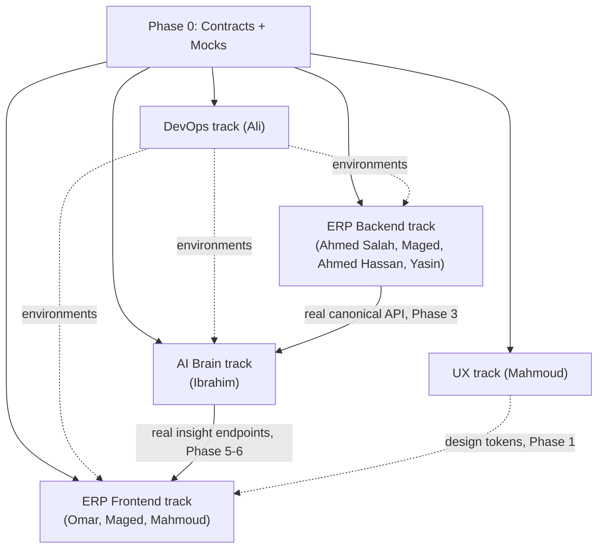

Each track works against the Phase-0 mock until its real upstream dependency lands, then swaps the mock for the real client (a one-line config change in `canonical_client.py` / `erpClient.ts`) — this swap point is itself a scheduled, visible milestone per phase (§20), not a surprise integration event in Phase 9.

## 22. Dependency Graph

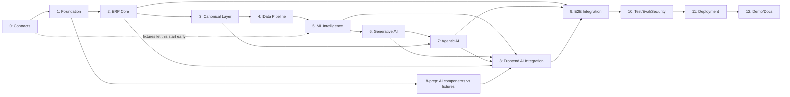

## 23. Critical Path

**0 → 1 → 3 → 4 → 5 → 7 → 9 → 10 → 11 → 12.** Everything the Brain does depends on the canonical contract being real (Phase 3), which depends on the ERP modules existing (Phase 2, but only their Application-layer interfaces — the UI doesn't gate this). Phase 7 (Agentic) is on the critical path because it's the last piece the demo (§28) needs and it depends on both the LLM layer (6) and write-capable canonical API (3).

**Off the critical path, genuinely parallel:** Phase 2's UI work (Omar/Maged/Ahmed Salah's frontend halves), Mahmoud's entire design-system + AI-component-against-fixtures work (starts Phase 1, doesn't block on anything past Phase 0), and Ali's environment work (runs continuously alongside every phase).

**Biggest blocker risk:** Phase 3 (Yasin/Abdelrahman's Integration layer) is a single-person critical-path dependency for the entire AI Brain track. Mitigated two ways: (a) Phase-0 mocks mean Ibrahim are not literally blocked, only *the switch to real data* is;

**Safe to mock indefinitely if needed:** a real third-party ERP connector (never built in MVP, §14) and RAG/vector search (§9.1) — neither blocks any phase above.

---

## 24. Repository Structure

**Monorepo**, not multi-repo. At 9 people across 3 tech stacks joined by one evolving contract, a single PR that changes `/contracts` and both sides that consume it is far safer than coordinating a release across separate repos — the alternative (multi-repo) buys independent versioning you don't need yet at the cost of cross-repo coordination you can't afford on a graduation timeline. Revisit only if the Brain and ERP genuinely need independent release cadences at real SaaS scale (§30).

```
/apps
  /erp-backend        (.NET solution — see §6.1 for internal structure)
  /erp-frontend       (Next.js — see §6.3)
  /brain              (FastAPI — see §6.2)
/contracts
  /canonical          (JSON Schema: Product, InventoryItem, Sale, PurchaseOrder, ...)
  /ai-output          (JSON Schema: Insight, Alert, Recommendation, Forecast, Risk, ActionProposal, ActionResult)
  /events             (JSON Schema: event envelope + per-event payloads)
  /fixtures           (sample payloads — power the Phase 0 mock servers)
  openapi.erp.yaml  openapi.brain.yaml
/infrastructure
  docker-compose.yml  docker-compose.prod.yml
  /nginx
  /github-actions     (reusable workflow snippets)
/docs
  ERP-Brain-Architecture-Blueprint.md   (this file)
  /adr                (Architecture Decision Records for anything this doc leaves open, §32)
/scripts
  seed-demo-data.*    (synthetic pharmacy data generator, §9.3's min-history requirement)
/tests
  /contract-tests     (validates both sides against /contracts)
  /e2e                (Playwright, §28's demo flow)
CODEOWNERS
```

`CODEOWNERS` maps each top-level folder under `/apps` and each subfolder under `/contracts` to the primary+secondary owners named in §19, so GitHub enforces the review pairing this document already specifies rather than relying on people remembering it.

## 25. Testing Strategy

| Layer | Tool | Owner | What it proves |
| --- | --- | --- | --- |
| Unit — .NET | xUnit | Each module owner | Domain invariants (e.g., a sale can't decrement inventory below zero without a backorder flag). |
| Unit — Python | pytest | Ibrahim | Feature transforms, scoring functions, tool schema validation. |
| Unit — Frontend | Jest + React Testing Library | Omar/Maged/Mahmoud | Components render correctly per contract-typed fixture props. |
| **Contract tests** | JSON Schema validation in CI, run against `/contracts/fixtures` from both the .NET producer and the Python consumer | Yasin + Abdelrahman + Ibrahim | The single most important test class in this project — a schema drift between the two sides fails CI before it fails in a demo. |
| Integration | Testcontainers (.NET) / pytest + a real Postgres+Redis via Docker Compose (Python) | Module owners | A sale really does commit + emit an outbox row atomically; an event really does reach a feature table. |
| End-to-end | Playwright | Omar (owns the suite), whole team adds scenarios for their module | §28's full demo flow, plus each module's core CRUD path. |
| AI evaluation | Custom harness (§26) | Ibrahim | Whether the *numbers* the architecture proves are correct, separate from whether the *plumbing* works. |

CI (GitHub Actions, Ali) runs, on every PR: lint + unit tests for the changed app(s), always the full contract-test suite (cheap, catches the highest-value class of bug), and E2E only on PRs targeting `main` (expensive, doesn't need to run on every push).

---

## 26. AI Evaluation

| Capability | Ground truth | Metric | Offline | Online |
| --- | --- | --- | --- | --- |
| Forecasting | Held-out actual sales (last N weeks excluded from training) | MAPE / WAPE per SKU | Weekly backtest on held-out window | Rolling predicted-vs-actual comparison as new weeks arrive |
| Anomaly detection | Synthetically injected anomalies (known spikes/drops seeded into demo data) + a small manually-labeled set | Precision/recall against injected + labeled anomalies | Run against the labeled set in CI | Track flagged-anomaly volume over time for drift |
| Recommendations | Human judgment (does the suggested reorder quantity look sane given the forecast) | Rubric-scored sample review (Ibrahim + one non-AI reviewer, e.g. Ahmed Hassan, to avoid single-evaluator bias) | Sampled review each phase-5/6 milestone | N/A pre-launch |
| LLM outputs (explanations, assistant) | A small hand-written golden set of Q&A pairs | Structured-output schema validity rate (does it parse) + rubric score for factual grounding against the Insight it was given | Golden-set run in CI on prompt changes | Spot-check transcripts |
| Agentic tasks | Scripted scenarios (§28-style) with known correct tool sequence | Tool-call accuracy (right tool, right arguments) + task success rate | Scenario suite run before each demo rehearsal | Real approval/rejection rate as a proxy signal |
| Safety | Adversarial prompts (attempt to get the agent to skip approval, call an unregistered tool, or leak another tenant's data) | Pass/fail on each scripted attempt | Run once per phase-7+ milestone | N/A pre-launch |

Regression testing: the golden set and scenario suite (above) are re-run on every change to prompts, tool schemas, or models — a prompt tweak that improves one answer but breaks the golden set is caught before merge, not after the demo.

## 27. Deployment

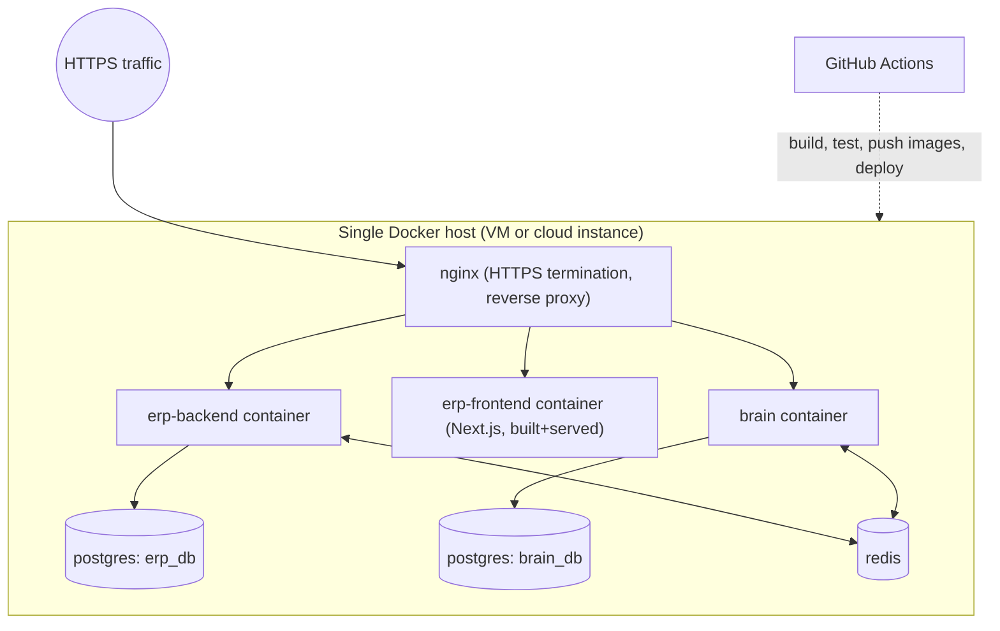

Graduation-MVP production deployment is deliberately a **single Docker Compose stack on one host** — this is a real, HTTPS-reachable, CI/CD-deployed product, not a notebook, but it is not the startup-scale architecture (§30). Explicitly:

| Concern | MVP approach |
| --- | --- |
| Containers | One Dockerfile per app (3), plus off-the-shelf Postgres/Redis/nginx images — 7 containers total via `docker-compose.prod.yml`. |
| CI/CD | GitHub Actions: on merge to `main`, build+test+push images, SSH-deploy (or a simple webhook) to the host, run migrations, restart the stack. |
| Environment separation | `docker-compose.yml` (local dev) vs `docker-compose.prod.yml` (deploy) with environment-specific `.env` files — not fully separate cloud environments, which isn't justified at this stage. |
| Secrets | Docker secrets / host-level `.env`, never committed. |
| Monitoring | Container health checks + `docker compose logs`; the AI cost dashboard (§13). |
| Backups | Scheduled `pg_dump` for both databases to off-host storage — simple, sufficient, restorable. |
| Migrations | EF Core migrations (.NET) and Alembic (Python) run as a deploy step, before the app containers restart. |
| Rollback | Redeploy the previous image tag; database migrations are written additive-first (no destructive migration ships without a reviewed rollback note) so a code rollback doesn't strand the schema. |
| Scaling | Vertical (bigger host) is sufficient for a demo audience; horizontal scaling is a Post-MVP concern (§30). |
| API gateway | Nginx reverse proxy covers routing/HTTPS/rate-limiting needs at this scale — a dedicated API gateway product is unjustified overhead here. |
| HTTPS / domain | Let's Encrypt via nginx (or the host provider's managed cert) on a real domain — not a self-signed cert, so the "production-style" bar is genuinely met. |
| Error tracking | Structured logs are sufficient for MVP; a dedicated error-tracking service (Sentry, etc.) is a cheap, optional Phase-11 add if time allows, not a hard requirement. |

## 28. Demo Scenario

The strongest demo is the one that visibly crosses every boundary this document argues for: ERP writes data → event crosses to the Brain → classical ML (not the LLM) computes the actual forecast → the LLM narrates it → the agent proposes a write → a human approves → the write goes back through the *same* adapter contract ordinary ERP writes use.

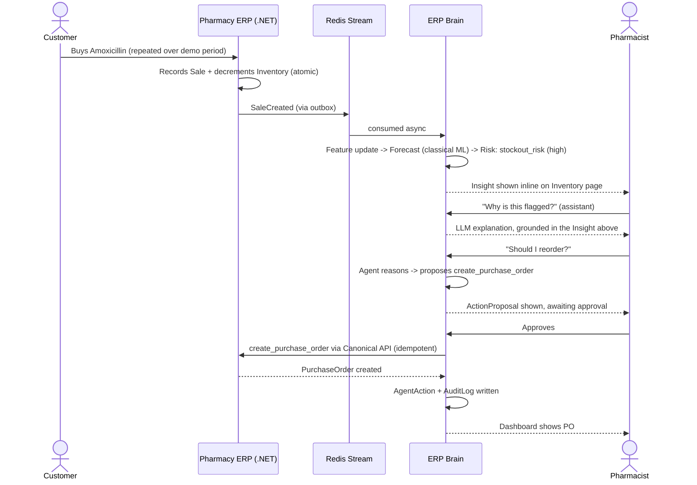

This directly satisfies your §33 15-step flow while making the architecture's key claims *visible*, not just asserted: the audience sees the forecast number come from a model (not a chat response), sees the approval gate actually block execution until clicked, and sees the resulting PO appear in the ordinary ERP purchasing screen — proving the agent used the same write path a human would.

---

## 29. Risks and Mitigations

| Risk | Likelihood/Impact | Mitigation |
| --- | --- | --- |
| **LLM cost overrun** | Low if §9.2 is followed / Medium if skipped | Token/cost logging (§13) from Phase 6 onward, reviewed weekly; caching + structured-output discipline enforced in code review, not just this document. |
| **Scope creep from the brief's own ambition** (38 sections, SaaS vision) | High if unmanaged | §14's explicit "what not to build" list is the enforcement mechanism — any Phase-2-through-9 PR that adds something on that list should be questioned in review. |
| **Synthetic demo data looking unconvincing** | Medium / Medium | Seed generator (§24 `/scripts`) should model a real weekly/seasonal pattern with at least one deliberate stockout scenario baked in, not pure randomness — the demo's forecast needs something real to catch. |
| **Unknown real deadline vs. 13-phase plan** | Medium / High | §32 gives explicit compression guidance; the critical path (§23) is the one sequence not to compress. |
| **Contract drift** (someone changes a canonical field without going through `/contracts`) | Medium / High | Contract tests in CI (§25) fail the build the moment .NET and Python disagree — this is a caught bug, not a demo-day surprise, as long as CI is trusted and not bypassed. |
| **Cold-start forecasting looking weak in the demo** (§9.3) | Medium / Medium | Seed at least 8-12 weeks of history for the hero SKU (Amoxicillin in the demo script) specifically, so the demo doesn't hit its own cold-start fallback. |
| **Approval fatigue making the agent demo feel clunky** | Low / Low | MVP's "everything needs approval" (§10) is a deliberate trade-off for safety and simplicity — for the demo specifically, keep the flow to one approval click, not a chain of them. |

## 30. Future Expansion

Beyond the SaaS-specific items in §15, the concrete engineering upgrades this architecture is designed to accept without a rewrite:

| Upgrade | Trigger for doing it | What changes |
| --- | --- | --- |
| Redis Streams → Kafka/RabbitMQ | Multi-tenant volume or need for multiple independent consumers per event | Outbox publisher's target changes; consumers' interface doesn't (§8.4). |
| pgvector → dedicated vector DB | RAG corpus grows large enough that pgvector's query latency becomes a bottleneck | New service behind the same `RAG` module interface (§9.1); nothing upstream changes. |
| Plain tables → feature-store platform (Feast) | Multi-tenant scale makes ad hoc feature queries slow | `features/` module's storage backend swaps; its interface to `forecasting/` doesn't. |
| Hosted LLM → self-hosted/fine-tuned model | Per-token cost at real scale justifies the infra investment | `llm/client.py`'s implementation swaps behind the same interface. |
| Static approval policy → dynamic risk-scored policy engine | Enough real approval/rejection history exists to calibrate a model | New `policy.py` implementation; the approval gate itself (§10) doesn't move. |
| Single agent → multi-agent orchestration | Task complexity genuinely exceeds one orchestrator's scope | Additive on top of the existing Tool Registry/Policy/Approval layers. |
| grep-by-trace_id → distributed tracing platform (Jaeger/Tempo) | Trace volume across services makes manual correlation too slow | `traceparent` propagation (§13) is already in place; this only adds a collector/UI. |
| Docker Compose single-host → orchestrated multi-host (Kubernetes or managed containers) | Real multi-tenant load needs horizontal scaling | Each service is already a container with externalized config (§27) — the unit of deployment doesn't change, only how many of it run and where. |

## 31. Final Recommended Blueprint

If the team internalizes one paragraph from this entire document, it's this: **the Brain never touches a database it doesn't own, never receives a shape it doesn't recognize, and never writes anything a human didn't approve — everything else in this blueprint exists to make those three sentences true in code, not just in a diagram.**

| Decision | Final call |
| --- | --- |
| Service topology | Two services: `.NET` modular monolith (ERP) + `Python/FastAPI` (Brain). Not microservices. |
| Canonical contract | `Product`, `InventoryItem`, `Sale`/`SaleLine`, `PurchaseOrder`/`PurchaseOrderLine`, `Supplier`, `Customer`, `Employee` — versioned in `/contracts`, owned jointly. |
| Adapter for our own ERP | In-process `Integration` module inside the .NET solution — same contract a future third-party connector implements standalone. |
| Event bus (MVP) | Redis Streams + transactional outbox. Not Kafka/RabbitMQ. |
| Vector store | pgvector inside `brain_db`, only if/when RAG is justified. Not a dedicated vector DB. |
| LLM strategy | Hosted API model, called only after deterministic + classical-ML processing has already produced a structured insight. |
| Agent write policy | 100% of writes require human approval in MVP. No exceptions, no risk-scoring yet. |
| Multi-tenancy | Not built; `tenant_id` threaded everywhere so it's a policy change later, not a migration project. |
| Repository | Monorepo, contract-first, mocks shipped in Phase 0. |
| Deployment | Single Docker Compose stack, HTTPS, real domain, CI/CD-driven — production-style without production-scale infrastructure. |

## 32. Open Architectural Decisions

Genuinely unresolved by the brief — logged here rather than blocking this document, per your instruction.

| Decision | Options | Recommendation | Why | Impact if deferred wrongly |
| --- | --- | --- | --- | --- |
| Hosting/cloud target for deployment (§27) | AWS / Azure / GCP / DigitalOcean / university-provided VM | Any single VM — the Docker Compose design is provider-agnostic | No information in the brief favors one provider; often decided by available student credits | Low — only changes deploy scripts, not architecture |
| LLM provider (§9.2) | Anthropic Claude API / OpenAI API / open-source self-hosted | Hosted API (either major vendor); self-hosting not justified at MVP scale | Cost/latency/quality trade-offs depend on budget and access the team actually has | Low — isolated behind `llm/client.py` |
| Real vs. synthetic pharmacy data (§9.3, §29) | Anonymized real pharmacy dataset vs. fully synthetic generator | Build the synthetic generator regardless; layer real anonymized data on top only if legally clear | Directly determines forecast/demo credibility | Medium — affects how convincing the forecasting demo is |
| Actual project deadline | Unknown | Treat §20's 13 phases as a dependency-ordered checklist; compress phases 5+6 or 10+11 if needed, never compress 0→1→3 | The critical path (§23) is where compression causes late integration failure | Medium |
| Regulatory/prescription realism (§14) | Generic retail-style inventory (recommended) vs. real controlled-substance/prescription workflows | Generic, unless your academic program specifically grades regulatory domain depth | Confirm with your advisor — this document can't know your grading rubric | Low-Medium |
| Number of demo user roles to actually implement (§12) | Single demo account vs. full 3-role walkthrough | Implement all 3 roles (cheap, matches "production-style" intent); demo script itself can run as one role for simplicity | Roles are near-zero marginal cost given Identity is already being built | Low |

## 33. Final Quality Check

| # | Check | Status | Where addressed |
| --- | --- | --- | --- |
| 1 | Brain is independent from ERP | ✅ | §5, §6.2, §8 |
| 2 | ERP remains System of Record | ✅ | §4 principle 1, §7 |
| 3 | No direct AI-to-database access | ✅ | §12 (network segmentation), §5 diagram |
| 4 | Canonical business model exists | ✅ | §8.1 |
| 5 | Adapter architecture exists | ✅ | §8.2 |
| 6 | External ERP integration is possible | ✅ | §8.3 |
| 7 | Agent uses tools, not databases | ✅ | §10 |
| 8 | Human approval exists for sensitive actions | ✅ | §10 (100% of writes in MVP) |
| 9 | Forecasting is business/tenant-specific | ✅ | §9.3 |
| 10 | Raw data is not blindly sent to LLMs | ✅ | §9.2 |
| 11 | Token cost is controlled | ✅ | §9.2, §13 |
| 12 | AI outputs are structured | ✅ | §11, §16.3 |
| 13 | API contracts are explicit | ✅ | §16 |
| 14 | Team members can work in parallel | ✅ | §21 |
| 15 | No team is blocked unnecessarily | ✅ | §21, §23 (mocks from Phase 0) |
| 16 | MVP is realistically achievable | ✅ | §14 (explicit exclusions), §20 |
| 17 | Multi-tenancy is future-ready but not forced into MVP | ✅ | §14, §15 |
| 18 | Production deployment is possible | ✅ | §27 |
| 19 | Security is addressed | ✅ | §12 |
| 20 | Observability is addressed | ✅ | §13 |
| 21 | AI evaluation is measurable | ✅ | §26 |
| 22 | Architecture supports future SaaS | ✅ | §15 |
| 23 | Architecture supports external ERP connectors | ✅ | §8.3 |
| 24 | Architecture supports domain-specific intelligence plugins | ✅ | §15 (modular Forecasting/Anomaly/Risk components) |
| 25 | Architecture is understandable by all 9 team members | ✅ | §19 (per-person sections), plain-language rationale throughout |

All items pass; no revision cycle was required before presenting this as final.

---

*Document control: v1.0. Future decisions (§32 once resolved, and any deviation from this blueprint discovered during implementation) should be logged as dated entries in `/docs/adr/`, not by editing this file's recommendations in place — keep this document as the "why we chose this" record and let the ADR log capture "and here's what changed since."*
